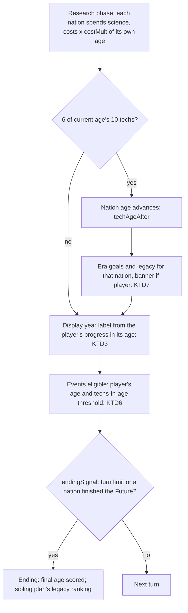
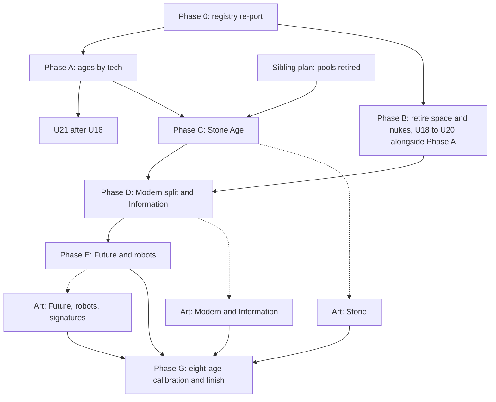

# Eight Ages - Plan

## Goal Capsule

- **Objective:** A player starts every game as a Stone Age people and can play through eight ages, from the Stone Age to the Future, where each nation's age comes only from its own research, every age has its own techs, units, buildings, battles and art, the opening has a real decision every few turns, and the late game ends without the old space race and nuclear systems.
- **Means:** Ages by tech only, with game speed as a per-age cost multiplier and the year as a display label (KTD1, KTD2, KTD3, KTD9), content added one age group per phase on top of a re-ported age registry (KTD12, KTD19), art produced by the art session in parallel with procedural fallbacks (KTD14).
- **Authority hierarchy:** the user's decisions in this plan's Key Decisions win over everything; then the R-IDs (product behaviour); then the KTDs (mechanism); then unit Approach text. `plans/eras-origins-and-future.md` (2026-10-03) is a content source only; where it disagrees with this plan, this plan wins. `plans/MASTER-PLAN.md` decision 32 (five ages for now) is superseded. The sibling plan `plans/2026-10-20-002-feat-differentiation-plan.md` owns the points-pool retirement (its KTD5), the save-number rule it shares with this plan (its KTD6), the event deck (its U26), the victory and legacy ranking, and rulers; this plan cites it and does not restate it.
- **Stop conditions:** stop and ask the user when a phase's balance-sim misses a Success Criterion by more than its tolerance after two calibration passes; when the Phase 0 re-port cannot be made bit-identical; when the town asset total would pass the size budget in KTD16; when a signature unit candidate touches a living political conflict, a trademarked product name or a documented atrocity record.
- **Execution profile:** many sessions. Each phase is its own branch off `claude/integration`, merged into `claude/integration` only when the user says so, and to `main` only when the user asks (the push deploys the site). Code units run through `compound-engineering:ce-work`; art units are executed by the art session in Blender (Blender MCP plus the `scripts/blender/` builders).
- **Who finishes and ships:** the lead agent reviews each phase, runs the `ship` skill, and reports to the user with the task count done and left.

---

## Product Contract

### Summary

Terra Imperium grows from five ages to eight: a new Stone Age before Bronze, Modern narrowed to the 20th century, and two new late ages, Information and Future (ending in robot armies). A nation's age is its research age and nothing else: no rule reads the calendar year, game speed scales costs per age, and the year on screen is a label drawn from the player's own progress through its age. A game ends at its speed's turn limit or when a nation completes the Future age's final goal. Every game begins with bands founding their first village. The old space race, nuclear weapons, satellites, missiles and ABM systems are removed, and the Information and Future ages take their place with their own techs, rosters, battles, diplomacy and art.

### Problem Frame

The game covers 2000 BCE to 2300 CE in five ages. Modern alone is 400 of about 923 turns at Normal (43%) on one roster, with an unredesigned space race and nukes bolted on, and the user has called the late game a slog. At the other end the game opens with cities already standing, and the user found the first 100 Marathon turns dead. The age itself is a calendar value with a one-age cap on research, so a nation that researches well cannot pull ahead and one that neglects research is lifted by the calendar, and years per turn tie the whole pace of play to that calendar. The Phase 0 age registry approved on 2026-10-03 was built on branch `claude/plan-eras-origins-future` (commit b41a30b9) but never merged; `claude/integration` is 1,174 commits past it and still has the hard-coded five-age tables.

### Key Decisions

- **Eight ages: Stone, Bronze, Classical, Kingdoms, Gunpowder, Modern, Information, Future (with robot armies); nominal labels run 5000 BCE to 2500 CE.** (session-settled: user-directed, chosen over Stone plus Industrial plus Information with no Future, and over the full nine ages of 2026-10-03: one Stone Age holds both the village and first-cities phases, and the Future gives the late game its own ending.) Governs R1, R12, R13.
- **Ages follow tech, not the calendar: a nation's age is its research age; the calendar floor and the one-age cap are removed.** (session-settled: user-directed, chosen over the calendar floor with a +1 cap: a nation's progress should be its own.) Governs R2, R3, R5, R6.
- **Only tech decides what age we are: no world age, no years per turn, no rule reads the year; speed is a per-age cost multiplier; the year is a display label; the game ends at a turn limit or on the Future's final goal.** (session-settled: user-directed, chosen over a world age by median with a calendar hold and a turn cap: "stop with the turn years thing, only tech decides what age we are".) Governs R4, R7, R9.
- **Every game starts in the Stone Age; no later-age start in the start picker; era starts stay only as test and sandbox fixtures.** (session-settled: user-directed, chosen over a Start picker with Dawn and later eras: one opening to tune and teach.) Governs R10.
- **Retire the space race, nukes, satellites, missiles and ABM systems; the Future keeps no space victory; the ending feeds the sibling plan's legacy ranking.** (session-settled: user-directed, chosen over keeping them inside Information and Future as the 2026-10-03 plan did: they were never redesigned for this game.) Governs R18.
- **Signature units: none in the Stone Age; a curated set of about 40 new signature units for Information and Future; the 150 existing ones stay.** (session-settled: user-directed, chosen over one signature per people in every age: art cost, and the Stone Age has generic bands only.) Governs R17.

### Requirements

**Age model**
- R1. The game has eight ages in this order: `stone`, `bronze`, `classical`, `kingdoms`, `gunpowder`, `modern`, `information`, `future`, each with a nominal year range used only as a label (KTD9).
- R2. A nation's age is the age its research has reached, with no calendar floor and no cap on how far ahead it runs; research is never lost, so a nation's age never goes down.
- R3. A nation enters the next age when it has researched 6 of its current age's 10 techs, and it may start techs of its own age and the next age only.
- R4. No game rule reads the calendar year; the year shown is a label interpolated from the player's progress through its own age (KTD3).
- R5. Falling behind costs nothing extra; a nation catches up faster on techs its known contacts already hold (KTD5).
- R6. Every rule that belongs to a nation (government and reforms, recruit cost and resource, naval reach, contact radius, wonders, resources, extraction, buildings, events, era goals, waits, battle roster and powers, the defender's side in a battle) reads that nation's own age; independents read the age of the strongest major they know (KTD8).

**Pacing and ending**
- R7. Fast, Normal and Marathon scale research, production and growth costs by a multiplier per age, keyed by the paying nation's own age, with Bronze to Gunpowder at today's values (KTD9).
- R8. The Stone Age opening offers a real decision every few turns at every speed (Success Criteria SC1, SC2, SC9).
- R9. Every game ends through one ending signal: the speed's turn limit (today's totals: about 440, 923 and 1,514 turns) or the first nation to complete the Future age's final goal (KTD3).

**Start**
- R10. Every new game starts in the Stone Age with each major people as a band at its home; the band founds the first village within the first turns, and AI bands settle on turn 1 or 2.
- R11. Farming exists at the start only in the agricultural hearths and spreads by contact; before Agriculture a village lives by forage with a size cap.

**Content per age**
- R12. Every age has 10 techs, two per line, each with a boost; the Future adds two robot techs outside the age threshold and a repeatable Future Tech.
- R13. Every age has one named unit per class it offers: the Stone Age has no cavalry, the Modern, Information and Future ages have air, and the late Future turns land and air classes into robot variants.
- R14. Each new age has building tiers, wonders, government and reform tiers, law tiers where they fit, resources and improvements, historical events, and era goal targets.
- R15. Diplomacy changes by age: Stone Age contact, gifts, raids and the first treaty; Information institutions; the Future's Planetary Council.
- R16. Peoples carry titles and regiment names for every age, and independents behave for every age (bands and villages in the Stone Age). Owners: Stone U34, Information U57, Future U72.
- R17. Signature units: none in the Stone Age, about 40 new ones across Information and Future, the existing 150 unchanged.

**Retirement**
- R18. The space race, space missions, satellites, missiles, ABM defences and nuclear strikes are gone from the engine, AI, battle, UI, i18n, saves and victories.

**Battle**
- R19. A tactical battle works in every age with per-age stats, commander powers, battle economy names and art, and stays deterministic, with Auto within the parity guardrail of `.claude/skills/battle-lab/SKILL.md` for same-age pairs and for 1-, 2- and 3-age gaps (SC7). Owners of the per-age battle tables: Stone U38, Information U58, Future U66 and U72.
- R20. Robots need no manpower, cost rare metals and more production, never lose morale, cannot hold a captured city without a human unit, and are vulnerable to EMP and Hijack.

**Saves**
- R21. Saves of version 13 load with ages re-derived from research, no nation demoted, retired systems stripped and building tiers shifted, and nothing else lost; version 10 saves still migrate through and older ones are still refused.

**Presentation**
- R22. The UI shows eight ages: the research graph with an age jump strip, the age banner, age names, a theme per age, the start screen, the nation overview, all checked at 844x390.
- R23. Every new or changed player-facing string exists in English and Hebrew, including Hebrew names for every new age, tech, unit, building, wonder, reform, law and event.
- R24. Every (age, class) pair a player can field has a model at all times (a GLB or the procedural fallback), and all new art stays inside the triangle budgets of `plans/art/TRIANGLE-BUDGET.md` and the size budget of KTD16.

**Quality**
- R25. The macro engine stays deterministic, turns stay inside the 80 ms budget under `PERF_CHECKS=1` compared against the base commit on the same machine, and one test fails by name when any per-age table misses an age.

### Scope Boundaries

**Deferred for later**
- The climate meter, the Climate Accord and the move of `BUILD_CLIMATE_RESILIENCE` (U52, kept as a deferred unit).
- Cyber espionage options and the trade network bonus (U53, kept as a deferred unit).
- The Green Sahara, `src/data/paleoClimate.js` and the "Sahara dries" event (removed from U24 and U33).
- The Unify action (removed from U25).
- New CC0 ambient audio loops per age (removed from U95; weapon sound families stay).
- Historical names per age for the 150 peoples beyond titles (the 2026-10-03 plan section 3.5 mapped country ids, which no longer drive new games).
- Tin and sea level rise.
- Historical short scenarios and seeded challenges (sibling plan territory).

**Outside this plan**
- Points-pool retirement, the legacy ranking and victory model, the event deck, rulers: `plans/2026-10-20-002-feat-differentiation-plan.md`.
- LOD cuts, soldier triangle cuts and impostors: not until the user asks (standing user rule of 2026-10-14). Budgets here are caps on new art only.
- A later-age start in the start picker (Key Decisions).

### Success Criteria

- SC1. Stone Age opening, Normal, scripted player policy, 5 seeds: the first city is founded by turn 2, the first tech completes by turn 5, and in turns 1 to 60 no stretch of 4 turns passes without a player-facing completion or choice (tech, building, unit, camp, boost, contact, raid, growth, event).
- SC2. The same on Marathon: first city by turn 2, first tech by turn 8, first building by turn 8, and no stretch of 6 turns without a completion or choice in turns 1 to 75.
- SC3. At the end of the Stone Age's target span (Normal turn 60, Fast turn 30, Marathon turn 75), all majors: median capital size 2 to 3 (cradles 5 or more), median cities per major 1 to 2 and no major above 12, at least 90% with Agriculture, 10% to 40% of majors already in the Bronze Age.
- SC4. At each age's target end turn per speed (KTD9 table), between 30% and 70% of living majors have entered the next age, on 3 seeds per speed.
- SC5. The research leader is at most 2 ages above the median major at any checkpoint, and at most 1 for 80% of checkpoints.
- SC6. At Normal on 3 seeds the research leader enters the Future age before 85% of the turn limit, and the median major is at least Modern when the game ends.
- SC7. Battle parity for every same-age pair of the new ages, every adjacent-age pair, and 2-age and 3-age gap pairs stays inside the battle-lab guardrail on 32 seeds.
- SC8. ms per turn under `PERF_CHECKS=1` within the 80 ms budget at every checkpoint, compared with the base commit on the same machine.
- SC9. The same opening on Fast: first city by turn 2, first tech by turn 4, and no stretch of 3 turns without a completion or choice in turns 1 to 30.

---

## Planning Contract

### Key Technical Decisions

- KTD1. **One helper decides a nation's age: `ageOf(state, nationId)` returns the research age (`state.techAgeId` for the player, `nations[id].tech.ageId` for AI), and `getEffectiveAgeId` and `getEffectiveAgeIndex` are deleted.** About 60 call sites pass `state.age` as a floor today (dossier section 1); each becomes `ageOf`. `state.age` is removed from game rules: readers that showed "the age" read the player's age, and the field is dropped in the save migration. Research is never lost, so an age only rises; units, buildings, reforms and wonders a nation holds are never re-gated downward, and no code path handles demotion. Inherits the ages-by-tech Key Decisions (Governs R2, R4, R6).
- KTD2. **There is no world age.** Nothing computes a median or any world-level age. Rules that used the calendar age either read the acting nation's age (KTD1), the age of the strongest known major (KTD8), or, for contact reach, the higher of the nation's own age and the research leader's age minus one (KTD5). `researchLeaderAge(state)` (the highest age among living majors) and `strongestKnownMajor(state, id)` live in `src/engine/ageRefs.js` (U7); both read only research and known contacts. (session-settled: user-directed, chosen over a world age by lower median that paced the calendar: only tech decides the age.) Governs R4, R6.
- KTD3. **The year is a display label and the ending is one signal.** `displayYear(state)` interpolates the player's age's nominal range by the share of that age's 10 base techs the player has researched: `start + (end - start) x min(1, done / 10)`; it rises monotonically because research is never lost, and it is shown in the header, logs and reports only. `state.year` is kept as that label for saves and logs, written once per turn, and no rule reads it (a lint-style test greps engine rule files for `state.year` reads outside the label writer and display code). The ending: `endingSignal(state)` in `src/engine/ending.js` (U11) returns `{ reason: 'turnLimit' }` when the turn reaches the speed's `turnLimit`, or `{ reason: 'futureGoal', nationId }` when a nation first researches every Future tech including both robot techs. The sibling plan's legacy ranking reads that signal and owns what the ending scores. (session-settled: user-directed, chosen over a calendar held inside a world-age window with a 1.25x turn cap: "stop with the turn years thing".) Governs R4, R9.
- KTD4. **The year gate on techs is removed; the research window is the nation's own age and the next.** `tech.yearAvailable`, `turnsUntilYear` and the calendar half of `techGate` go; `canStartTech` allows a tech whose age index is at most the nation's age index plus one, with its prerequisites. A nation still has to finish 6 of its age's 10 techs to advance, which is the brake the +1 cap used to be.
- KTD5. **Catch-up replaces the behind-the-calendar penalty; contact reach follows the leader.** `getAgesBehind` and `getAgesBehindResearchCostMultiplier` (+30% per age behind) are deleted. `techDiffusion.js` keeps its share rule (`DIFFUSION_MAX` 0.3 off the known nations' share that hold the tech, `PIONEER_MULT` 1.2) and adds `CATCHUP_MAX` 0.45, used instead of `DIFFUSION_MAX` when at least one known contact holding the tech is in a later age than the buyer. `CONTACT_KM` is read at `max(ageOf(nation), researchLeaderAge - 1)`, so an isolated people's reach grows as the world advances and it is not locked out of catch-up. Penalising the laggard compounds the gap; a discount from what neighbours know is the Civ IV rule the file already models.
- KTD6. **Historical events key off the player's age and spread across it.** Each event gets an `ageId` derived once from its `year` against the nominal ranges. An event is eligible when the player's age equals its age and the player has researched at least `round(6 x (event.year - age.startYear) / (age.endYear - age.startYear))` of that age's techs, so events spread across the age with no burst on entry; events of an age the player has left are skipped. This is a predicate only: the sibling plan's event deck (its U26) owns selection. New events are written as deck cards once that unit merges, or converted by its script if they land first.
- KTD7. **Era goals, legacies and the age banner fire on the nation's own age change.** `awardEraLegacy` runs for a nation when its research age advances (in `research.js` where `techAgeAfter` writes the new age); the player's banner shows on the player's advance. The final age is scored once when the ending signal fires. `nation.eraGoals` stays keyed by age id. Waits through `speedTurns` key off the waiting nation's age; a wait shared by two nations uses the older of the two; a wait owned by no nation (people emergence) uses the research leader's age.
- KTD8. **Independents read the age of the strongest major they know.** "Known" is the same contact rule as diffusion (border, capital within `CONTACT_KM`, trade partner); "strongest" is the largest economy size (`tradeValue.js economySizes`), ties broken by id. With no known major an independent stays at `FIRST_AGE_ID`. Prices (tribute, mercenaries, trade gold), raid factor, size cap, art band and battle roster use it.
- KTD9. **Speed is a cost multiplier per age, keyed by the paying nation's age; years per turn are gone.** `GAME_SPEEDS[speed]` holds `costMult` per age and a `turnLimit`; `REFERENCE_YEARS` and the `years` rows are deleted, and `speedCostMult(speed, ageId)` returns `costMult[ageId]`. Bronze to Gunpowder keep today's effective values exactly (today's `REFERENCE_YEARS / years`), so their tuning holds; `speedTrainMult`, `buildSpeedMult` and `speedTurns` keep their formulas over the new multiplier.

  | Speed | Stone | Bronze | Classical | Kingdoms | Gunpowder | Modern | Information | Future | Turn limit |
  |---|---|---|---|---|---|---|---|---|---|
  | Fast | 0.8 | 0.8 | 0.8 | 0.83 | 0.8 | 1.0 | 1.0 | 1.0 | 440 |
  | Normal | 1.6 | 1.6 | 1.67 | 1.67 | 2.0 | 2.0 | 2.0 | 2.0 | 923 |
  | Marathon | 2.0 | 4.0 | 4.0 | 3.33 | 4.0 | 2.0 | 2.0 | 2.0 | 1,514 |

  Target turns per age (what `RESEARCH_AGE_BASE` is calibrated to; they sum to the turn limit):

  | Speed | Stone | Bronze | Classical | Kingdoms | Gunpowder | Modern | Information | Future |
  |---|---|---|---|---|---|---|---|---|
  | Fast | 30 | 24 | 52 | 84 | 80 | 45 | 55 | 70 |
  | Normal | 60 | 48 | 109 | 167 | 200 | 90 | 110 | 139 |
  | Marathon | 75 | 120 | 260 | 334 | 400 | 100 | 105 | 120 |

  Nominal year labels: Stone -5000 to -2000, Bronze -2000 to -800, Classical -800 to 500, Kingdoms 500 to 1500, Gunpowder 1500 to 1900, Modern 1900 to 1990, Information 1990 to 2100, Future 2100 to 2500. The Stone Age is short in turns and dense in decisions (U23, U24, U26), with a lower Marathon multiplier than Bronze so it is not dead. New-age values are first guesses for U47, U63, U77 and U96.
- KTD10. **Each phase that changes the save shape bumps `CURRENT_SAVE_VERSION` when it merges into `claude/integration`, with its own migration step.** At the time of writing the next free number is 14; before each merge the number is checked against `plans/RULER-PLAN.md`, `plans/MAP-VARIATIONS-PLAN.md` and `plans/2026-10-20-002-feat-differentiation-plan.md` (its KTD6), and the phase takes the next free one. Save units: U16, U21, U45, U62, U76. `OLDEST_LOADABLE_SAVE_VERSION` stays 10. The first migration grants every tech of the ages below a nation's old effective age (today's calendar floor and +1 cap) before re-deriving, so no nation is demoted on load. `SETUP_VERSION` (`src/battle/setup/buildBattleSetup.js`, 13 today) follows the same rule for every phase that changes battle results, and `src/engine/__fixtures__/battle-golden.json` is regenerated with each bump.
- KTD11. **Stone building tiers are inserted at index 0 and saved indexes shift by one in the migration.** Lines that gain a Stone tier (food, military, defense, culture, logistics, naval, science) add 1 to every saved tier index of that line. Chosen over storing tier ids: the shift is one migration step with a fixture test, while ids would touch every building reader. Information and Future tiers are appended, so they shift nothing.
- KTD12. **Phase 0 is re-ported, not cherry-picked.** b41a30b9 is the design reference (`FIRST_AGE_ID`, `LAST_AGE_ID`, `isAgeAtLeast`, `isAgeBefore`, `agesFrom`, `nextAgeId`, shared `formatYear`, explicit per-age unit attack, defence and cost, techs listed by age, naval names and era goal targets keyed by age, `src/data/ageRegistry.test.js`). It is rebuilt on today's code and must be bit-identical by `.claude/skills/balance-sim/stateHash.sim.js` against the base commit. Verified 2026-10-20: none of these symbols exist on `claude/integration`.
- KTD13. **The Stone Age's two phases are derived, never stored.** A nation is in the village phase until it knows Agriculture and Chiefdoms, then in the first-cities phase; `stonePhaseOf(state, nationId)` computes it from research. No save field, no migration.
- KTD14. **Art fallback by age.** Buildings and close-view art (battle rts buildings, city kits, props, improvements, ships, outposts, towns) use the full order: the exact age, then the nearest earlier age, then the nearest later age, then the procedural model. Units use a narrower order: the exact age, then the nearest earlier age only if its file is the same kind (foot, mounted, machine, air), else the procedural model, so `modern:cavalry` (a tank) never resolves to a Gunpowder horse. One helper `artAgeFor(available, ageId, { kind })` in `src/data/ages.js` serves `buildingArt()` in `src/battle/data/economy.js`, `findUnitModel` in `src/battle/render/unitModels.js` and the close view's readers. The Stone Age has no earlier age, so until its art exists it uses Bronze files for buildings and the procedural soldier for units.
- KTD15. **Today's `modern-*` unit art becomes Information art; new 20th-century art is made for Modern.** The current modern models are present-day (mechanised infantry, ATGM teams, jets), which is the Information look. Files are renamed `information-<class>.glb` in U81 and the Modern roster is renamed to 20th-century units (U50); until the new Modern files exist, Modern foot units fall back (KTD14) to Gunpowder foot files and its vehicles to the procedural model.
- KTD16. **Town size budget: each new age at most 65 MB of map town files, at most 2 MB per file, and `src/assets/map/towns` at most 850 MB in total (648 + 3 x 65 = 843).** Today it is 648 MB for five ages (about 130 MB each). New ages ship about 40 to 60 town files (small, medium, big x a/b over 6 regional kits plus a base, instead of 13), 1024 atlases for Stone huts, and shared atlases per age; layouts in `src/data/townLayouts.json` can still number 80 to 100 per age because layouts are cheap JSON that reuse kit files. Battle rts sets: Stone base plus 6 regional, Information base plus 4, Future base plus 2, because regional styles converge in the late ages.
- KTD17. **Robots are a roster variant of the Future roster, gated by Autonomous Warfare and Machine Consciousness.** The unit keeps class, promotions and place; name, model, stats and rules switch, the same way units upgrade at an age change today. Future signature units stay human after the switch.
- KTD18. **Late-game resources: rare metals from tile deposits from the Information age; helium-3 is retired with space.** Robots and Future recruits cost rare metals; the Fusion Reactor needs only its tech.
- KTD19. **Each phase adds its age ids to `AGE_ORDER` with every per-age table filled in the same commit.** The completeness test (U2) fails otherwise. Labels only: until the Future exists, Information's label range runs to 2300.
- KTD20. **New content carries no ADM, DIP or MIL.** New techs, reforms, laws, wonders and actions have no `admBonus`, `dipBonus` or `milBonus` effects and no pool costs. Effects that the 2026-10-03 plan wrote as pool bonuses map per the sibling plan's KTD5 (decree pace, opinion, `hrMult`); until that plan merges, each takes a gold, science or stability effect of equal size and a TODO naming the sibling unit. Costs are gold (or the sibling plan's replacement once merged).
- KTD21. **Per-age unit power is explicit.** Attack and defence by age: stone 7 and 6, bronze 10 and 8, classical 18 and 14, kingdoms 26 and 20, gunpowder 34 and 26, modern 42 and 32, information 52 and 40, future 64 and 48, robots 72 and 54. Bronze to Modern keep today's values (`10 + 8i`, `8 + 6i`), so their balance is untouched.
- KTD22. **The Synthetics become an automation meter, not an estate.** There is no estate system in the code today (verified 2026-10-20: no estate module in `src/`), so the 2026-10-03 plan's Synthetics estate is rebuilt as `nation.automation` in a new `src/engine/automation.js` (kept: the user approved Future flavour on 2026-10-03).
- KTD23. **Late signature units live in a second table.** `SIGNATURE_UNITS` holds one entry per people today; the new ones go in `LATE_SIGNATURE_UNITS` (same shape, `ageId` information or future), and `signatureUnitFor(people, ageId)` reads both.

### High-Level Technical Design

The turn flow with ages by tech only:

Phases and their order:

### Assumptions

- The 150-people pool and the peoples world (`src/engine/worldgen/peoplesWorld.js`) remain the only new-game mode; `createInitialState` without a scenario still builds the legacy world for tests.
- `formatYear` in `src/i18n/core.js` already handles any negative year, so the label needs no format change beyond the "c." prefix before 2000 BCE (U22).
- The battle sim's fixed-point rules accept new per-age overrides without structural change, except shields, pierce and beams (U66).
- The art session has Blender 5.2.2 and the shared rig (`scripts/blender/ti_units.py`, `ti_figure.py`); new kinds (hover, drone, walker) extend it.

### Risks and Dependencies

| Risk | Mitigation |
|---|---|
| Removing the calendar floor lets non-researching AI nations stay in the Stone Age for the whole game | KTD5 catch-up and leader-driven contact reach; AI research doctrine always researches (U36); SC4 and SC5 check the spread |
| With no world pace, the player's year label and the AI's progress drift apart | labels are display only (KTD3); SC4 ties research costs to target turns |
| A runaway leader with no cap | 6-of-10 rule, rising `RESEARCH_AGE_BASE`, catch-up for followers; SC5 |
| The Future goal ends the game early for a runaway | SC6 calibration; the sibling plan's ranking decides what that ending scores |
| Phase 0 re-port drifts behaviour | bit-identical stateHash gate (KTD12) |
| Content volume (32 new techs, 30 units, about 30 tiers, 10 wonders, art for three ages) | one phase per age group, completeness test, procedural fallbacks |
| Town art pushes the repo and deploy size up | KTD16 budget, checked in U97; Cloudflare Pages' 25 MB per-file limit is far above the 2 MB cap |
| Save number collisions with the ruler, map variation and differentiation plans | KTD10 rule at each merge |
| The sibling plan lands later than Phase C | KTD20 equal-size gold, science or stability fallback |
| Signature units of present-day armies touching living conflicts, trademarks or atrocity records | U85 filters and asks the user to approve the list |

### Sequencing

Phase 0 first (risk-free when bit-identical). U18 to U20 (Phase B) run alongside Phase A after Phase 0; U21 starts after U16. Phase C needs Phase A and the sibling plan's pool retirement (or KTD20). Phase D needs Phase B (Information replaces the retired systems) and Phase C (the registry has grown once already). Phase E needs Phase D. Art tracks start with their age's phase and can trail it, because fallbacks keep every age playable. Phase G runs once all three content phases are merged.

Honest size, in agent sessions:

| Phase | Code sessions | Art sessions |
|---|---|---|
| 0. Registry re-port | 1 to 2 | |
| A. Ages by tech | 3 to 4 | |
| B. Retire space and nukes | 2 | |
| C. Stone Age | 8 to 10 | 6 to 8 |
| D. Modern split and Information | 5 to 7 | 8 to 10 |
| E. Future and robots | 8 to 10 | 8 to 10 (plus 4 to 6 for signatures) |
| G. Calibration and finish | 2 to 3 | |
| Total | 29 to 38 | 26 to 34 |

---

## Implementation Units

### Unit Index

| U-ID | Title | Files touched (key) | Depends on |
|---|---|---|---|
| U1 | Re-port the Phase 0 age registry | `src/data/ages.js`, `src/data/techTree.js`, `src/data/eraGoals.js`, `src/data/navalLines.js` | none |
| U2 | Registry completeness test over every per-age table | `src/data/ageRegistry.test.js` | U1 |
| U3 | Age-count tests read AGE_ORDER | test files listed in U3 | U1 |
| U4 | Supersede decision 32 and update CLAUDE.md age notes | `plans/MASTER-PLAN.md`, `CLAUDE.md` | U1 |
| U5 | `ageOf` helper, remove floor and cap | `src/data/ages.js`, `src/engine/nationState.js` | U1 |
| U6 | Nation-owned rules read the nation's age | `src/engine/gameReducer.js`, `src/data/government.js` | U5 |
| U7 | Age reference helpers: research leader and strongest known major | `src/engine/ageRefs.js`, `src/engine/stateAudit.js` | U5 |
| U8 | Independents read the strongest known major's age | `src/data/independents.js`, `src/engine/mercenaries.js` | U7 |
| U9 | Research window replaces the year gate | `src/engine/research.js`, `src/engine/researchStatus.js` | U5 |
| U10 | Catch-up discount replaces the behind penalty | `src/engine/techDiffusion.js`, `src/engine/research.js` | U7, U9 |
| U11 | Display year label and the one ending signal | `src/engine/ending.js`, `src/engine/displayYear.js`, `src/engine/resolveTurn.js` | U5 |
| U12 | Waits and reigns keyed by the right age | `src/data/proceduralEvents.js`, `src/engine/accords.js` | U5, U7 |
| U13 | Events keyed by the player's age and progress | `src/data/events.js` | U5 |
| U14 | Era goals, legacies and banner on the nation's advance | `src/engine/eraGoals.js`, `src/components/modals/AgeAdvanceBanner.jsx` | U5, U11 |
| U15 | Age readouts for tech-driven ages | `src/components/panels/researchSheetModel.js`, `src/components/ui/nationOverviewModel.js` | U9, U11 |
| U16 | Save migration: re-derive ages without demotion | `src/engine/saveMigrations.js` | U5, U11 |
| U17 | Phase A balance compare | `.claude/skills/balance-sim/` | U5 to U16 |
| U18 | Remove space, satellites, missiles and ABM from engine and data | `src/data/spaceMissions.js`, `src/engine/aiMissiles.js` | U1 |
| U19 | Remove nuclear and missile battle powers | `src/battle/sim/effects.js`, `src/battle/sim/tacticalAI.js` | U18 |
| U20 | Remove space UI and strings | `src/components/panels/SpacePanel.jsx`, i18n | U18 |
| U21 | Strip retired state from saves; retire the space victory | `src/engine/saveMigrations.js`, `src/data/victoryConditions.js` | U16, U18 |
| U22 | Register the Stone Age, label range, cost multipliers | `src/data/ages.js`, `src/i18n/core.js` | U11, U2 |
| U23 | Band start and the first village | `src/engine/settlers.js`, `src/data/scenarios.js` | U22 |
| U24 | Hearths and forage (Green Sahara deferred) | `src/data/hearths.js`, `src/engine/cityEconomy.js` | U22 |
| U25 | Village and first-cities phases (Unify deferred) | `src/engine/stonePhase.js`, `src/engine/gameReducer.js` | U27 |
| U26 | Tribal camps | `src/engine/tribalCamps.js` | U23 |
| U27 | Stone techs, boosts and effects | `src/data/techTree.js`, `src/data/boosts.js` | U22 |
| U28 | Stone building tiers | `src/data/buildings.js` | U27 |
| U29 | Stone wonders | `src/data/greatProjects.js` | U27 |
| U30 | Stone governments, reforms and laws | `src/data/government.js`, `src/data/laws.js` | U27 |
| U31 | Stone resources, improvements and recruit costs | `src/data/resources.js`, `src/data/actionCosts.js` | U27 |
| U32 | Stone diplomacy: contact, gifts, raids, Border Stele | `src/engine/diplomacy.js`, `src/data/opinion.js` | U25 |
| U33 | Stone events and era goals | `src/data/events.js`, `src/data/eraGoals.js` | U13, U22 |
| U34 | Peoples and independents in the Stone Age | `src/engine/peopleNames.js`, `src/data/independents.js` | U22, U8 |
| U35 | Stone per-age macro tables | `src/engine/fleets.js`, `src/utils/aiLogic.js` | U22 |
| U36 | Stone AI | `src/engine/aiProduction.js`, `src/utils/aiLogic.js` | U23 to U32 |
| U37 | Stone roster and battle stats | `src/data/unitClasses.js`, `src/battle/data/battleStats.js` | U22 |
| U38 | Stone battle economy, materials, bridges, projectiles, art fallback | `src/battle/data/economy.js`, `src/battle/setup/cityBattle.js` | U37 |
| U39 | Stone commander powers | `src/engine/invasion.js`, `src/battle/sim/effects.js` | U37 |
| U40 | Stone battlefields and village battles | `src/battle/setup/cityBattle.js`, `src/battle/setup/tileContext.js` | U38 |
| U41 | Stone parity | `src/engine/autoBattle.js` | U37 to U40 |
| U42 | Stone UI: research columns, jump strip, start and onboarding | `src/components/panels/researchView.js`, `src/components/ui/StartScreen.jsx` | U27 |
| U43 | A theme per age | `src/index.css`, `src/hooks/useAgeTheme.js` | U22 |
| U44 | Stone i18n | `src/i18n/locales/data/he.systems.js` and siblings | U27 to U40 |
| U45 | Save migration: Stone steps | `src/engine/saveMigrations.js` | U28, U16 |
| U46 | Stone tests | `src/engine/longRun.test.js`, `e2e/` | U22 to U45 |
| U47 | Stone calibration and dead-opening metrics | `scripts/campaignTelemetry.mjs` | U46 |
| U48 | Register Information; Modern label 1900 to 1990 | `src/data/ages.js` | U47, U21 |
| U49 | Modern and Information techs | `src/data/techTree.js`, `src/data/boosts.js` | U48 |
| U50 | Modern and Information rosters, fleets, battle stats | `src/data/unitClasses.js`, `src/data/navalLines.js` | U48 |
| U51 | Information buildings, wonders and the Energy line | `src/data/buildings.js`, `src/data/greatProjects.js` | U49 |
| U52 | The climate meter (deferred) | `src/engine/climate.js` | U51 |
| U53 | Cyber espionage and trade networks (deferred) | `src/engine/gameReducer.js`, `src/data/actionCosts.js` | U49 |
| U54 | World Congress and sanctions | `src/engine/worldCongress.js` | U49 |
| U55 | Information governments, reforms and laws | `src/data/government.js`, `src/data/laws.js` | U49 |
| U56 | Rare metals, recruit costs and age literals | `src/data/resources.js`, `src/data/tileYields.js` | U49 |
| U57 | Modern and Information macro tables and AI | `src/utils/aiLogic.js`, `src/engine/aiEconomy.js` | U49 to U56 |
| U58 | Modern and Information powers and battle economy | `src/engine/invasion.js`, `src/battle/sim/effects.js` | U50 |
| U59 | Information events and era goals | `src/data/events.js`, `src/data/eraGoals.js` | U49 |
| U60 | Information UI | `src/components/panels/` | U54 |
| U61 | Information i18n | `src/i18n/locales/data/` | U49 to U60 |
| U62 | Save migration: Modern split steps | `src/engine/saveMigrations.js` | U49, U51 |
| U63 | Information parity and calibration | `.claude/skills/battle-lab/`, `.claude/skills/balance-sim/` | U48 to U62 |
| U64 | Register the Future; Future final goal | `src/data/ages.js` | U63 |
| U65 | Future techs, robot techs and Future Tech | `src/data/techTree.js`, `src/data/boosts.js` | U64 |
| U66 | Future roster and sim features | `src/battle/sim/`, `src/data/unitClasses.js` | U64 |
| U67 | Robot armies | `src/data/unitClasses.js`, `src/engine/robots.js` | U65, U66 |
| U68 | Future powers | `src/engine/invasion.js`, `src/battle/sim/effects.js` | U66 |
| U69 | Future buildings, wonders, governments, reforms, laws | `src/data/buildings.js`, `src/data/government.js` | U65 |
| U70 | The automation meter | `src/engine/automation.js` | U67 |
| U71 | The Planetary Council | `src/engine/worldCongress.js` | U54, U65 |
| U72 | Future AI and macro tables | `src/utils/aiLogic.js`, `src/engine/aiProduction.js` | U65 to U71 |
| U73 | Future events and era goals | `src/data/events.js`, `src/data/eraGoals.js` | U65 |
| U74 | Future UI | `src/components/` | U70, U71 |
| U75 | Future i18n | `src/i18n/locales/data/` | U65 to U74 |
| U76 | Save and setup migration: Future steps | `src/engine/saveMigrations.js` | U64 to U70 |
| U77 | Future parity and calibration | `.claude/skills/` | U64 to U76 |
| U78 | Art pipeline ready for eight ages | `scripts/import-models.js`, `scripts/art/pack-map-models.mjs` | U1 |
| U79 | Procedural fallbacks for new ages | `src/battle/render/soldierFactory.js`, `src/components/map/closeView/townModels.js` | U78 |
| U80 | Stone base units and clips (art session) | `scripts/blender/build_units_stone.py`, `src/assets/units/stone-*.glb` | U78 |
| U81 | Modern re-base and 20th-century units (art session) | `src/assets/units/modern-*`, `information-*` | U78, U50 |
| U82 | Information base units and clips (art session) | `src/assets/units/information-*.glb` | U81 |
| U83 | Future base units and clips (art session) | `src/assets/units/future-*.glb` | U78, U66 |
| U84 | Robot units and mechanical clips (art session) | `src/assets/units/future-robot-*.glb` | U83, U67 |
| U85 | Late signature unit data | `src/data/signatureUnits.js` | U50, U66 |
| U86 | Late signature unit art (art session) | `src/assets/units/signature/` | U85 |
| U87 | Battle rts buildings per new age (art session) | `src/assets/battle/rts/` | U78 |
| U88 | Battle city kits per new age (art session) | `src/assets/battle/city/` | U78 |
| U89 | Map towns and layouts per new age (art session) | `src/assets/map/towns/`, `src/data/townLayouts.json` | U78 |
| U90 | Map improvements, outposts, ships, shared kits (art session) | `src/assets/map/` | U78 |
| U91 | Props, projectiles, bridges, landing props (art session) | `src/assets/battle/props/`, `projectiles/` | U78 |
| U92 | Wonder models (art session) | `src/assets/map/wonders/` | U29, U51, U69 |
| U93 | Icon sets | `scripts/icons/generate-icon-data.mjs`, `src/assets/icons/` | U27, U49, U65 |
| U94 | Age banners and illustrations | `src/assets/ui/ages/`, `AgeAdvanceBanner.jsx` | U43 |
| U95 | Weapon audio families (ambient loops deferred) | `src/battle/audio/battleAudio.js` | U37, U50, U66 |
| U96 | Eight-age calibration | `.claude/skills/balance-sim/` | all content units |
| U97 | Performance and size budgets | `.claude/skills/perf/`, `scripts/art/` | U96 |
| U98 | Final docs and ship | `CLAUDE.md`, `plans/MASTER-PLAN.md` | U97 |

---

### Phase 0. Registry re-port (branch `claude/ages-p0-registry`)

### U1. Re-port the Phase 0 age registry

- **Goal:** `src/data/ages.js` becomes the one age registry on today's code, with no gameplay change.
- **Requirements:** R1, R25 (enables every later unit).
- **Depends on:** none.
- **Files:** `src/data/ages.js`, `src/data/techTree.js`, `src/data/eraGoals.js`, `src/data/navalLines.js`, `src/data/unitClasses.js`, `src/data/scenarios.js`, `src/battle/data/battleStats.js`, `src/battle/audio/battleAudio.js`, `src/battle/render/soldierFactory.js`, `src/battle/render/BattleRenderer.js`, `src/battle/setup/buildBattleSetup.js`, `src/engine/fleets.js`, `src/data/navalReach.js`, `src/engine/invasion.js`, `src/components/battle/BattleSandbox.jsx`, `src/components/map/closeView/townModels.js`, every file with a literal `'modern'` or `'bronze'` age check (dossier section 3), `scripts/import-models.js`.
- **Approach:** Read `git show b41a30b9` for the design (KTD12) and rebuild it by hand: `FIRST_AGE_ID`, `LAST_AGE_ID`, `isAgeAtLeast`, `isAgeBefore`, `agesFrom`, `nextAgeId`, one `formatYear` used by every copy; explicit per-age `power` and `costMult` in the registry with today's values; `CATEGORY_LINES` as `{ name, age }` lists; naval names, cargo and era goal targets keyed by age id; the private `AGE_ORDER` copy in `battleStats.js` removed; literal `=== 'modern'` checks become `isAgeAtLeast(x, 'modern')`; `'bronze'` defaults become `FIRST_AGE_ID`. Add `artAgeFor` (KTD14) with today's behaviour.
- **Test Scenarios:** `src/data/ages.test.js` covers the new helpers (`isAgeAtLeast('modern','gunpowder')`, `agesFrom('kingdoms')`, `nextAgeId(LAST_AGE_ID) === null`, `formatYear(-2000)`); tech ids unchanged (snapshot of `Object.keys(TECH_TREE)`).
- **Verification:** stateHash identical to the base commit at every checkpoint on Fast seed 11 and Normal seed 12; `npm run lint`; `npx vitest run`; e2e green.
- **Model:** opus
- **Skills:** balance-sim (stateHash), add-mechanic, compound-engineering:ce-work, superpowers:verification-before-completion

### U2. Registry completeness test over every per-age table

- **Goal:** One test fails by name when any per-age table misses an age in `AGE_ORDER` or names an unknown one.
- **Requirements:** R25.
- **Depends on:** U1.
- **Files:** `src/data/ageRegistry.test.js` (new).
- **Approach:** Import every table in the dossier inventory: engine (`RESEARCH_AGE_BASE`, `COLONY_SLOTS_BY_AGE`, `OUTPOST_SLOTS_BY_AGE`, `NAVAL_KM_BY_AGE`, `DEEP_OK_FROM`, `SHELF_OK_FROM`, `CONTACT_KM`, `STRIKE_MAX`, `BORDER_KM_BY_AGE`, `AI_MAX_STANDING_UNITS_BY_AGE`, `GAME_SPEEDS.*.costMult`), data (`UNIT_ROSTER`, unit icons, unit names, building tiers' ages, building icons, government `minAgeId` and reform tiers, wonders' `ageId`, resources' unlock age, `RESOURCE_KNOWN_FROM_AGE`, `RECRUIT_STRATEGIC_RESOURCE_BY_AGE`, era goal targets, `AGE_BAND`, `RAID_ERA_FACTOR`, naval lines, techs per age), battle (`AGE_OVERRIDES` keys valid, `NAVAL_LINE_STATS`, economy names, `BRIDGE_BY_AGE`, `MATERIAL_BY_AGE`, projectiles, audio families), render (soldierFactory per-age tables, `AGE_STYLE`), i18n (`age.<id>`, `p2.ageShort.<id>`, `AGE_INDEX`), icons (`src/assets/icons/ages/<id>.svg`). A table may opt out of an age only through a listed reason (for example Stone has no cavalry).
- **Test Scenarios:** each table x each age; a deliberately removed key in a local copy fails with "<table> is missing <age>"; 10 techs per age; every roster unit has a model path or procedural entry and an icon.
- **Verification:** `npx vitest run src/data/ageRegistry.test.js` passes on five ages.
- **Model:** sonnet
- **Skills:** superpowers:test-driven-development, compound-engineering:ce-work

### U3. Age-count tests read AGE_ORDER

- **Goal:** No test hard-codes five ages.
- **Requirements:** R25.
- **Depends on:** U1.
- **Files:** `src/data/ages.test.js`, `src/components/panels/researchSheetModel.test.js`, `src/components/ui/nationOverviewModel.test.js`, `src/battle/render/unitExtras.test.js`, `src/data/buildings.test.js`, `src/data/government.test.js`, `src/data/techTree.test.js`, `src/data/resources.test.js`, `src/components/panels/empireOverviewModel.test.js` (`toHaveLength(5)`), `src/battle/sim/__fixtures__/recordBattles.js`.
- **Approach:** Replace literal 5, 50 and age lists with `AGE_ORDER.length`, `AGE_ORDER.length * 10` and `AGE_ORDER`; leave fixture contents alone.
- **Test Scenarios:** the suite passes unchanged on five ages.
- **Verification:** `npx vitest run` green; grep finds no `toHaveLength(5)` tied to ages.
- **Model:** haiku
- **Skills:** compound-engineering:ce-work

### U4. Supersede decision 32 and update CLAUDE.md age notes

- **Goal:** The roadmap and project notes describe eight ages by tech.
- **Requirements:** R1.
- **Depends on:** U1.
- **Files:** `plans/MASTER-PLAN.md` (decision 32 and the status table), `CLAUDE.md` (Architecture: the age registry, `ageOf`, `displayYear`, `endingSignal`, `artAgeFor`).
- **Approach:** Mark decision 32 superseded by this plan with the date; add one short CLAUDE.md paragraph naming the registry helpers and the rules "read a nation's age through `ageOf`; no rule reads `state.year`; speed is `speedCostMult` by the paying nation's age".
- **Test Scenarios:** none (docs).
- **Verification:** reads plainly; no em dashes.
- **Model:** haiku
- **Skills:** ce-noslop, ship

---

### Phase A. Ages by tech (branch `claude/ages-pa-tech`)

### U5. `ageOf` helper, remove the calendar floor and the cap

- **Goal:** A nation's age is its research age everywhere the effective age or the calendar age was used (KTD1).
- **Requirements:** R2, R6.
- **Depends on:** U1.
- **Files:** `src/data/ages.js`, `src/engine/nationState.js`, `src/data/scenarios.js` (era fixtures), and the about 60 call sites of `getEffectiveAgeId` / `getEffectiveAgeIndex` (dossier section 1: `gameReducer.js`, `resolveTurn.js`, `aiEconomy.js`, `aiLanding.js`, `cityEconomy.js`, `cityManifest.js`, `colonies.js`, `defense.js`, `fieldBattle.js`, `fleets.js`, `invasion.js`, `navalBattle.js`, `raidBattle.js`, `spending.js`, `supplyMeter.js`, `warOdds.js`, UI models and `scripts/campaignTelemetry.mjs`), plus the world-level readers of `state.age` (`src/App.jsx`, `src/components/panels/LogConsole.jsx`, `src/components/ui/turnReportModel.js`), which read the player's age.
- **Approach:** Add `ageOf(state, nationId)` and `ageIndexOf` in `nationState.js` beside `getTechAgeId`; delete `getEffectiveAgeId`, `getEffectiveAgeIndex` and `getCalendarAgeId`; replace call sites mechanically; `satellites.js` sites are deleted in U18 instead. Era fixtures (later-era scenarios kept for tests and the sandbox) mark every tech of every earlier age researched, so a fixture's nations derive the fixture's age.
- **Test Scenarios:** a nation with tech age classical reads classical whatever `state.year` holds; a nation two ages ahead reads its own age (no cap); a Modern era fixture is still Modern after one `resolveTurn`; no reader of `state.age` remains in rules.
- **Verification:** grep finds no `getEffectiveAge` or `getCalendarAgeId` outside the files U18 deletes; `npx vitest run`; lint.
- **Model:** opus
- **Skills:** add-mechanic, compound-engineering:ce-work, superpowers:test-driven-development

### U6. Nation-owned rules read the nation's age

- **Goal:** Every gate that `state.age` (the calendar) decided for a nation now uses that nation's age.
- **Requirements:** R6.
- **Depends on:** U5.
- **Files:** `src/engine/gameReducer.js` (government 2170 to 2191, `getRecruitUnitCost` 1328, `isReachableBySea` 1419 and 2050, `defenderAgeId` 2002 to 2103), `src/engine/civilWar.js`, `src/components/panels/DomesticPanel.jsx`, `src/engine/governmentPreview.js`, `src/data/government.js` (`canChangeGovernmentType`, `canEnactReform`, `resetReformsForType`), `src/engine/tradeRoutes.js`, `src/engine/techDiffusion.js` (`CONTACT_KM` lookup), `src/engine/wonders.js`, `src/data/resources.js` (`isResourceUnlocked`), `src/data/buildings.js` (`canBuildExtraction`), `src/engine/raidBattle.js`, `src/engine/fieldBattle.js` (rebels use the rebel host's age).
- **Approach:** Pass `ageOf(state, nationId)` into each; the defender of a lane or landing uses its own age; `canBuildExtraction` drops its calendar-plus-one rule and uses the nation's age.
- **Test Scenarios:** a Bronze nation in a Kingdoms world cannot pick a Republic; a Classical defender in a Gunpowder attack fights with its Classical roster; reforms offer tiers up to the nation's age.
- **Verification:** grep for `state.age` in nation gates is empty (world readers listed in U7 remain); tests green.
- **Model:** opus
- **Skills:** add-mechanic, compound-engineering:ce-work

### U7. Age reference helpers: research leader and strongest known major

- **Goal:** Two tech-only helpers replace every world-level age reader (KTD2): `researchLeaderAge(state)` and `strongestKnownMajor(state, nationId)`.
- **Requirements:** R4, R6.
- **Depends on:** U5.
- **Files:** `src/engine/ageRefs.js` (new), `src/engine/techDiffusion.js` (share the "known" rule instead of copying it), `src/engine/stateAudit.js` (invariant: no `state.age` field after migration).
- **Approach:** Leader: highest `ageIndexOf` among non-independent majors with at least one city. Strongest known major: the known major with the largest economy size, ties by id; none known gives null. Both cached per turn like the diffusion index.
- **Test Scenarios:** leader ignores independents and cityless nations; strongest known major is order-independent across `state.nations` key order; an isolated independent gets null.
- **Verification:** `enginePurity.test.js`, `determinismGuard.test.js` green.
- **Model:** sonnet
- **Skills:** add-mechanic, superpowers:test-driven-development

### U8. Independents read the strongest known major's age

- **Goal:** Independents' prices, raids, sizes, art band and battles use the age of the strongest major they know, else `FIRST_AGE_ID` (KTD8).
- **Requirements:** R6, R16.
- **Depends on:** U7.
- **Files:** `src/engine/mercenaries.js` (79, 176), `src/engine/cityStates.js` (120), `src/engine/indepPolicy.js` (588, 630), `src/engine/capture.js` (131), `src/engine/independents.js` (141, 246), `src/engine/raids.js` (574), `src/data/independents.js`, `src/data/cityStates.js`, `src/components/independents/independentArt.js`.
- **Approach:** One helper `independentAgeOf(state, id)` over `strongestKnownMajor`; no table values change in this unit.
- **Test Scenarios:** an independent beside a Kingdoms major prices at Kingdoms; one with no known major stays at the first age; raid factor follows the same age.
- **Verification:** `npx vitest run src/engine/independents* src/engine/raids*`; balance compare in U17.
- **Model:** sonnet
- **Skills:** add-mechanic, compound-engineering:ce-work

### U9. Research window replaces the year gate

- **Goal:** Techs are gated by prerequisites and the window of KTD4, never by year.
- **Requirements:** R3, R4.
- **Depends on:** U5.
- **Files:** `src/data/techTree.js` (drop `yearAvailable`), `src/engine/research.js` (`canStartTech` 72 and its BCE/CE message), `src/engine/researchStatus.js` (`techGate`, delete `turnsUntilYear`), `src/components/panels/researchView.js` (53, 123), `src/components/panels/TechPanel.jsx`, the AI research picker in `src/engine/research.js` and the player's advisor picker.
- **Approach:** `inResearchWindow(state, nationId, tech)` = tech age index at most own age index plus one; the locked reason shows "Reach the <age> first" through i18n. The AI and advisor pickers sort candidates by tech age index first, then doctrine priority, then tech id, so a nation finishes its own age before reaching ahead and the order is deterministic.
- **Test Scenarios:** a Bronze nation can start a Classical tech whose prerequisite it has, not a Kingdoms tech; the AI never queues outside the window; the picker returns an own-age tech before a next-age one at equal doctrine weight and breaks ties by id; old saves with a queued out-of-window tech drop it from the queue on load.
- **Verification:** research tests green; the research sheet shows the new locked reason.
- **Model:** opus
- **Skills:** add-mechanic, superpowers:test-driven-development, compound-engineering:ce-work

### U10. Catch-up discount replaces the behind penalty

- **Goal:** Laggards pay no penalty and get a bigger diffusion discount on techs that known contacts in later ages hold, and contact reach follows the leader (KTD5).
- **Requirements:** R5.
- **Depends on:** U7, U9.
- **Files:** `src/data/ages.js` (delete `getAgesBehind`, `getAgesBehindResearchCostMultiplier`), `src/engine/research.js` (62), `src/engine/techDiffusion.js` (`CATCHUP_MAX`, `CONTACT_KM` at `max(own, leader - 1)`), `src/components/panels/TechPanel.jsx` (194 to 195: show the catch-up discount instead of the penalty).
- **Approach:** Follow the add-mechanic checklist: the discount stays a cost multiplier, cached per turn as today.
- **Test Scenarios:** a Bronze nation among Classical holders pays at most 55% for a Bronze tech they all hold; the same tech held only by Bronze neighbours costs at most 70%; an isolated nation pays full price; the pioneer still pays 1.2; a Stone people's contact radius grows when the leader reaches Classical.
- **Verification:** a new `src/engine/techDiffusion.test.js` and the research tests; U17 shows the age spread.
- **Model:** opus
- **Skills:** add-mechanic, balance-sim, superpowers:test-driven-development

### U11. Display year label and the one ending signal

- **Goal:** The year is a label from the player's progress, speed is a per-age cost multiplier, and one signal ends the game (KTD3, KTD9).
- **Requirements:** R4, R7, R9.
- **Depends on:** U5.
- **Files:** `src/engine/displayYear.js` (new: `displayYear`), `src/engine/ending.js` (new: `endingSignal`, the only owner of the ending), `src/engine/resolveTurn.js` (272: write `state.year = displayYear(state)` instead of adding years; ranked ending 1295 to 1316 reads `endingSignal`), `src/data/ages.js` (`GAME_SPEEDS` gets `costMult` and `turnLimit`; delete `REFERENCE_YEARS`, `years`, `getYearsPerTurn`, `gameLengthTurns`; `speedCostMult` reads `costMult` and throws in tests for an unknown age), `src/data/victoryConditions.js` (ending text), `src/components/modals/GameOverModal.jsx`, `src/engine/gameReducer.js` (2859, continue after the ending), `src/engine/rulers.js` (reign in turns; if the sibling plan's single ruler has landed, drop it), `src/engine/researchStatus.js` (35), `src/data/historicalPopulation.js` (reads the label for display only), a rule-purity test in `src/engine/`.
- **Approach:** Bronze to Gunpowder multipliers equal today's `REFERENCE_YEARS / years` exactly, so balance is unchanged there (stateHash compare against the base commit with only those ages in play, minus the year label). The rule-purity test greps engine rule modules for reads of `state.year` and allows only `displayYear.js`, logs, reports and UI.
- **Test Scenarios:** the label at 5 of 10 Bronze techs is -1400; the label never decreases over a 300-turn run; `endingSignal` fires `turnLimit` at exactly 923 on Normal; it fires `futureGoal` with the nation id when a nation finishes the last Future tech, once; `speedCostMult('normal', 'gunpowder') === 2`.
- **Verification:** `src/data/ages.test.js`, resolveTurn tests, the purity test, a long run with research disabled reaches the turn limit without error.
- **Model:** opus
- **Skills:** add-mechanic, superpowers:test-driven-development, compound-engineering:ce-work

### U12. Waits and reigns keyed by the right age

- **Goal:** `speedTurns` waits read the age of whoever waits (KTD7).
- **Requirements:** R6.
- **Depends on:** U5, U7.
- **Files:** `src/data/proceduralEvents.js` (48), `src/engine/accords.js` (75 to 77), `src/engine/aiAccords.js` (63), `src/engine/mapTrade.js` (69), `src/engine/tradeDisruptions.js` (38 to 39), `src/engine/resolveTurn.js` (381 `peopleSpeedMult`, 721 reign).
- **Approach:** A wait owned by a nation uses its age; one shared by two nations (accord truce, demand cooldown, a pair's trade disruption) uses the older age of the two; people emergence uses `researchLeaderAge`.
- **Test Scenarios:** a truce between a Bronze and a Classical nation lasts the Bronze span; emergence uses the leader's age.
- **Verification:** accords and trade tests green.
- **Model:** sonnet
- **Skills:** add-mechanic, compound-engineering:ce-work

### U13. Events keyed by the player's age and progress

- **Goal:** Historical events become eligible inside the player's age and spread across it (KTD6).
- **Requirements:** R6, R14.
- **Depends on:** U5.
- **Files:** `src/data/events.js` (derive `ageId` from `year`; replace the year rule at 509 with `eventEligible(state, event)`), `src/data/eventChains.js`, `src/engine/applyEventEffects.js` if it reads the year.
- **Approach:** The predicate is exported for the sibling plan's event deck (its U26), which owns selection; if U26 has merged first, wire the predicate into the deck instead of `pickNextEvent`.
- **Test Scenarios:** a Gunpowder event dated 1700 is eligible for a Gunpowder player at 3 of 10 Gunpowder techs (`round(6 x 200 / 400) = 3`) and not at 2; a player who jumps past an age never sees its events; every event's derived age is a registry age.
- **Verification:** events tests green.
- **Model:** sonnet
- **Skills:** add-mechanic, superpowers:test-driven-development

### U14. Era goals, legacies and banner on the nation's advance

- **Goal:** Each nation scores its era goals when its own age advances; the player's banner shows then; the final age scores when the ending signal fires (KTD7).
- **Requirements:** R6.
- **Depends on:** U5, U11.
- **Files:** `src/engine/eraGoals.js` (`awardEraLegacy`), `src/engine/research.js` (where `techAgeAfter` writes), `src/engine/resolveTurn.js` (remove the calendar-change trigger 280 to 296; call the final scoring from `endingSignal`), `src/App.jsx` (148 to 161), `src/components/modals/AgeAdvanceBanner.jsx`, `src/components/panels/LegacyPanel.jsx`, `src/components/panels/LogConsole.jsx` (292).
- **Approach:** The banner subscribes to the player's age; the log line names the first nation into each age ("The Hittites enter the Classical Age, the first in the world").
- **Test Scenarios:** an AI nation's legacy is awarded when it advances while the player has not; the final age is scored exactly once.
- **Verification:** era goal tests green; browser check of the banner.
- **Model:** sonnet
- **Skills:** add-mechanic, compound-engineering:ce-work

### U15. Age readouts for tech-driven ages

- **Goal:** The research sheet, nation overview, top bar and turn report talk about the player's age and its progress, never "behind the calendar" or a world age.
- **Requirements:** R22.
- **Depends on:** U9, U11.
- **Files:** `src/components/panels/researchSheetModel.js` (54, 87), `src/components/ui/nationOverviewModel.js` (80 to 97: "next age in N techs" instead of years), `src/components/ui/topBarModel.js`, `src/components/ui/WorldTopBar.jsx`, `src/components/ui/turnReportModel.js` (174), `src/components/panels/DiplomacyPanel.jsx` (81: a nation's own age), i18n keys in `src/i18n/locales/ui/`.
- **Approach:** The header shows the player's age and the year label; nation cards show each nation's age.
- **Test Scenarios:** model tests for a nation ahead of, equal to and behind the player; strings exist in en and he.
- **Verification:** `node scripts/ui/panels-shots.mjs` at 844x390.
- **Model:** sonnet
- **Skills:** frontend-design, compound-engineering:ce-work

### U16. Save migration: re-derive ages without demotion

- **Goal:** Version 13 saves load with ages from research, nobody demoted, and `state.age` dropped (KTD10).
- **Requirements:** R21.
- **Depends on:** U5, U11.
- **Files:** `src/engine/saveMigrations.js` (`CURRENT_SAVE_VERSION` to the next free number, 14 at the time of writing, `MIGRATIONS[13]`), `src/engine/saveMigrations.test.js`, a new fixture `src/engine/__fixtures__/save-v13.json`.
- **Approach:** For every nation compute its old effective age with the old rule (`max(calendar, min(tech, calendar + 1))` from the saved year), grant every tech of the ages below it, then derive the age by walking `AGE_ORDER` with the 6-of-10 rule; write `techAgeId` and `tech.ageId`; delete `state.age`; rewrite `state.year` as the label; drop queued techs outside the window; keep `eraGoals` and reforms keys.
- **Test Scenarios:** a v13 save whose player was calendar Gunpowder with only 4 Kingdoms techs loads as Gunpowder with the missing Kingdoms techs granted; no nation's age is lower after load than its old effective age; a v10 save migrates through to the current version; a v9 save is still refused as too old; a current-version save loads unchanged.
- **Verification:** `npx vitest run src/engine/saveMigrations.test.js`; load a real autosave in the browser.
- **Model:** opus
- **Skills:** add-mechanic, superpowers:test-driven-development, compound-engineering:ce-work

### U17. Phase A balance compare

- **Goal:** Measure what ages by tech did to the five-age world and tune `CATCHUP_MAX` and AI research before merge.
- **Requirements:** R5, SC4, SC5.
- **Depends on:** U5 to U16.
- **Files:** `.claude/skills/balance-sim/worldStats.sim.js` (add per-checkpoint age histogram, leader gap to the median major, share of majors past each age at its target turn), `.claude/skills/balance-sim/compare.sh`.
- **Approach:** Base commit vs head on 3 seeds, Normal, 300 turns; report age histogram, leader gap, wars, ms per turn.
- **Test Scenarios:** the sim itself prints the new columns.
- **Verification:** SC5 holds; ms per turn within budget against the base commit.
- **Model:** opus
- **Skills:** balance-sim, superpowers:verification-before-completion

---

### Phase B. Retire space and nukes (branch `claude/ages-pb-retire`)

### U18. Remove space, satellites, missiles and ABM from engine and data

- **Goal:** The engine and AI have no space race, satellites, missiles, ABM or nuclear state.
- **Requirements:** R18.
- **Depends on:** U1.
- **Files:** delete `src/data/missiles.js`, `src/data/satellites.js`, `src/data/spaceMissions.js`, `src/engine/aiMissiles.js` and their tests; edit `src/data/actionCosts.js` (launchSatellite, launchMission, buildMissile, missileStrike, buildAbmDefense, asatStrike, Fusion Grid), `src/data/types.js` (ActionTypes), `src/engine/gameReducer.js` (initial `missiles`, `abmDefenseLevel`, `satellites`, `orbitalDebrisLevel`, `spaceMissionProgress`, `completedMissions`; handlers near 1136 to 1280), `src/engine/resolveTurn.js` (mission countdown 1170 to 1188, satellite stability 389), `src/engine/battleOutcome.js` (fallout, `nuclearScarred`, pariah), `src/engine/invasion.js` (`getBattlePowers` entries), `src/engine/modifiers/sources.js`, `src/utils/helpers.js` (satellite hooks), `src/data/resources.js` (helium3; keep rareMetals for KTD18), `src/data/achievements.js`.
- **Approach:** Delete, then let lint and tests find the stragglers; keep `rareMetals` as a resource with no source until U56.
- **Test Scenarios:** `endgameReachability.test.js` updated to the remaining victories; a full 200-turn run from a 1900 fixture has no missing-key errors.
- **Verification:** grep for `satellite`, `missile`, `nuclear`, `helium3`, `spaceMission` in `src/engine` and `src/data` finds nothing but the migration; lint; tests.
- **Model:** sonnet
- **Skills:** add-mechanic, compound-engineering:ce-work, superpowers:verification-before-completion

### U19. Remove nuclear and missile battle powers

- **Goal:** The battle sim has no nuclear, missile or satellite-sweep powers, and the setup version moves to 14.
- **Requirements:** R18, R19.
- **Depends on:** U18.
- **Files:** `src/battle/sim/effects.js` (satelliteSweep, missileTactical, missileTheatre, nuclearStrike), `src/battle/sim/tacticalAI.js`, `src/battle/setup/buildBattleSetup.js` (`allowNuclear`, `SETUP_VERSION` to the next free number per KTD10), `src/battle/sim/orderSchema.js` (drop the power orders), `src/components/battle/BattleHud.jsx`, `src/battle/render/BattleRenderer.js`, `src/engine/__fixtures__/battle-golden.json`.
- **Approach:** Keep the `missile` projectile visual for ATGM and Information ranged units; only the powers go. Replays of v13 battles report `version` status as `battleVerify.js` already does.
- **Test Scenarios:** golden battle regenerated and stable twice; an order naming a removed power is rejected by the schema.
- **Verification:** battle-lab squadTrace on a Modern battle; `npx vitest run src/battle src/engine/battle.golden.test.js`.
- **Model:** opus
- **Skills:** battle-lab, compound-engineering:ce-work

### U20. Remove space UI and strings

- **Goal:** No screen, tab, scene, sound or string mentions the retired systems.
- **Requirements:** R18, R23.
- **Depends on:** U18.
- **Files:** delete `src/components/panels/SpacePanel.jsx`; edit `src/components/panels/ActionPanel.jsx`, `src/components/panels/ActionPanelTabs.jsx`, `src/components/panels/DomesticPanel.jsx`, effect scenes (`spectacle.js`, `military.js`), `src/audio/worldSounds.js`, `src/components/modals/GameOverModal.jsx`, `effectIcons.js`, `effectRegistry.js`, `src/components/modals/describeEffects.js`; i18n: `space.*`, `sat.*`, `missile.*` in `src/i18n/locales/data/he.systems.js`, `p1.sp.*` in `src/i18n/locales/ui/pnl1.*`, `m.act.satellite*`, `m.act.missile*`, `m.battle.nuclearStrike` in `src/i18n/locales/msg/`, and their generators in `scripts/i18n-keys/`.
- **Approach:** Remove keys in both languages together; `hardcodedText.test.js` and `dataText.test.js` catch leftovers.
- **Test Scenarios:** i18n tests green; the action tabs render without the space tab.
- **Verification:** `node scripts/ui/panels-shots.mjs`.
- **Model:** sonnet
- **Skills:** compound-engineering:ce-work

### U21. Strip retired state from saves; retire the space victory

- **Goal:** Old saves lose the retired fields cleanly and the space victory is gone.
- **Requirements:** R18, R21.
- **Depends on:** U16, U18.
- **Files:** `src/engine/saveMigrations.js` (Phase B's own step and version per KTD10: delete `nation.missiles`, `nation.abmDefenseLevel`, `state.satellites`, `orbitalDebrisLevel`, `spaceMissionProgress`, `completedMissions`, region `nuclearScarred`; refund nothing), `src/data/victoryConditions.js` (remove `spaceAscendancy`; if the sibling plan's legacy ranking has landed, nothing else), `src/data/greatProjects.js` (Space Program keeps its id as a prestige and science wonder; Atomic Research Center stays a science wonder).
- **Approach:** Starts after U16 so the version chain is in place; whichever of this plan and the sibling plan lands second removes the victory line it still finds.
- **Test Scenarios:** a v13 fixture with satellites and missiles loads with none of those keys and passes `assertGameState`.
- **Verification:** saveMigrations tests; victoryConditions tests.
- **Model:** sonnet
- **Skills:** add-mechanic, compound-engineering:ce-work

---

### Phase C. Stone Age (branch `claude/ages-pc-stone`)

### U22. Register the Stone Age, label range, cost multipliers

- **Goal:** `stone` is the first age with its label range (-5000 to -2000) and its cost multipliers per speed.
- **Requirements:** R1, R7.
- **Depends on:** U11, U2.
- **Files:** `src/data/ages.js` (`AGE_ORDER`, `AGES.stone`, `START_YEAR = -5000` as the first label, `GAME_SPEEDS.*.costMult.stone`, speed blurbs), `src/i18n/core.js` (`formatYear` adds "c." before 2000 BCE), `src/i18n/locales/en.js` and `he.js` (188 to 190 speed blurbs, 535 to 542 age names), `src/i18n/locales/ui/pnl2.*.js` and `scripts/i18n-keys/pnl2.mjs` (`p2.ageShort.stone`), `src/i18n/gameText.js` (`AGE_INDEX`), `src/data/historicalPopulation.js` (display anchors back to -5000), `scripts/i18n-keys/misc.mjs` (onboarding text names the ages, not a year range), `src/engine/gameReducer.js` (initial age), `src/data/ages.test.js`.
- **Approach:** Every per-age table gets a Stone entry in the same commit (KTD19), using the first values of Appendix B and the Bronze entry where Appendix B has none; U27 to U40 then replace them with the designed content.
- **Test Scenarios:** `formatYear(-4200)` reads "c. 4200 BCE"; Stone multipliers match KTD9; the completeness test passes with six ages.
- **Verification:** `npx vitest run src/data`.
- **Model:** opus
- **Skills:** add-mechanic, compound-engineering:ce-work, superpowers:test-driven-development

### U23. Band start and the first village

- **Goal:** Each major starts as a band at its home and founds its first village in the first turns (R10).
- **Requirements:** R10.
- **Depends on:** U22.
- **Files:** `src/data/scenarios.js` (Dawn becomes the Stone start: no cities, one Band and one Hunters unit per major; `DAWN_CAPITAL_SIZE` used only when the first village is founded), `src/engine/worldgen/emergentWorld.js` (115: accept the Stone start), `src/engine/worldgen/peoplesWorld.js`, `src/engine/settlers.js` (Band is a settler that can fight at half infantry strength; founding on the home tile is instant and free; elsewhere within `ringsForKm(230)` of home), `src/engine/gameReducer.js` (until the first village the nation runs no economy or research; `checkNationElimination` and `checkPlayerDefeat` count a living Band as a holding), `src/engine/aiOperations.js` or `src/engine/aiProduction.js` (AI founds on turn 1 or 2), `src/engine/tutorial.js`, `src/components/modals/OnboardingOverlay.jsx`.
- **Approach:** The founding uses the one settling rule in `src/data/geo/citySpacing.js`; distances in km through `src/data/geo/gridScale.js`, never tile counts; the band's tile is the people's capital from `src/data/geo/peopleCapitals.json`; independents start as camps or size 1 villages (U34). Later-era scenarios remain in `src/data/scenarios.js` for tests and the sandbox only (U5).
- **Test Scenarios:** a fresh peoples game at seed 7 has zero cities on turn 0 and every major has one city by turn 2; the player ends turn 1 without founding and stays ACTIVE; an AI band that founds on turn 2 is alive on turn 1; founding beyond `ringsForKm(230)` is refused; `assertGameState` passes on turn 0 with no cities; a nation whose Band dies before founding is eliminated.
- **Verification:** `npx vitest run src/engine/worldgen src/engine/settlers*`; browser start on the phone layout.
- **Model:** opus
- **Skills:** add-mechanic, superpowers:test-driven-development, compound-engineering:ce-work

### U24. Hearths and forage (Green Sahara deferred)

- **Goal:** Farming starts in the hearths and spreads; villages without Agriculture forage under a size cap.
- **Requirements:** R11.
- **Depends on:** U22.
- **Files:** `src/data/hearths.js` (new: tile areas and crop packages from the 2026-10-03 plan 3.2, keyed by region of the peoples' capitals, not country ids), `src/data/tileYields.js`, `src/engine/cityEconomy.js` (forage yields, size cap 3 before Agriculture), `src/engine/techDiffusion.js` (Agriculture spreads by the normal rule).
- **Approach:** The Green Sahara (`src/data/paleoClimate.js` and its map tint) is deferred (Scope Boundaries); it would also need a non-year trigger now that no rule reads the year.
- **Test Scenarios:** a hearth people starts with Agriculture and size 2; a non-hearth village cannot pass size 3 until Agriculture.
- **Verification:** unit tests.
- **Model:** opus
- **Skills:** add-mechanic, superpowers:test-driven-development

### U25. Village and first-cities phases (Unify deferred)

- **Goal:** The Stone Age has a village phase and a first-cities phase (KTD13) with different rules.
- **Requirements:** R10, R14, R15.
- **Depends on:** U27.
- **Files:** `src/engine/stonePhase.js` (new: `stonePhaseOf`), `src/engine/research.js` (science halved before Proto-Writing), `src/data/government.js`, `src/data/laws.js`, `src/engine/cityEconomy.js`.
- **Approach:** Village phase: Tribal government only, laws limited to justice and land. First-cities phase: Monarchy and Theocracy, the Border Stele (U32), river cities +1 food per river tile. The Unify action is deferred (Scope Boundaries).
- **Test Scenarios:** the phase flips when both techs are known; a village-phase nation is offered only Tribal.
- **Verification:** tests; U47 numbers.
- **Model:** sonnet
- **Skills:** add-mechanic, balance-sim, superpowers:test-driven-development

### U26. Tribal camps

- **Goal:** About 150 neutral camps on free land give a choice when a unit enters: absorb (+1 population to the nearest city) or trade (tech progress or a map reveal).
- **Requirements:** R8, R14.
- **Depends on:** U23.
- **Files:** `src/engine/tribalCamps.js` (new), `src/engine/worldgen/peoplesWorld.js` (seeded placement from `rngSeed`, away from capitals), `src/engine/gameReducer.js`, `src/components/map/gl/sceneModel.js` (camp sprite), `src/components/modals/` (choice card through `useInteraction`), i18n.
- **Approach:** Camps vanish when borders cover them; the AI takes the absorb option by doctrine.
- **Test Scenarios:** same seed, same camps; entering a camp opens one choice and the camp is gone after; no camp within the settling distance of a capital.
- **Verification:** tests; phone screenshot of the card.
- **Model:** sonnet
- **Skills:** add-mechanic, frontend-design, compound-engineering:ce-work

### U27. Stone techs, boosts and effects

- **Goal:** The Stone Age has 10 techs with boosts, prerequisites and effects.
- **Requirements:** R12.
- **Depends on:** U22.
- **Files:** `src/data/techTree.js`, `src/data/boosts.js`, `src/engine/boosts.js` (new facts: farms count, nations met, raids won), `src/engine/research.js` (`RESEARCH_AGE_BASE.stone`).
- **Approach:** Techs (Appendix A): Hunting Bands, Copper Working; Agriculture, Animal Husbandry; Pottery, The Wheel; Chiefdoms, Sacred Kingship; Star Lore, Proto-Writing. Cross prerequisites: Bronze Casting needs Copper Working; Code of Laws needs Proto-Writing; Sacred Kingship needs Chiefdoms; The Wheel needs Animal Husbandry. Effects through existing `TECH_EFFECTS` hooks only; pool hooks (`admBonus`, `milBonus`) replaced per KTD20.
- **Test Scenarios:** 10 Stone techs, 2 per line; every prerequisite resolves, no cycles; every tech has a boost; existing tech ids unchanged.
- **Verification:** `src/data/techTree.test.js`, `src/data/ageRegistry.test.js`.
- **Model:** sonnet
- **Skills:** add-mechanic, compound-engineering:ce-work

### U28. Stone building tiers

- **Goal:** Seven lines gain a Stone tier 0 (KTD11).
- **Requirements:** R14.
- **Depends on:** U27.
- **Files:** `src/data/buildings.js` (Storage Pits, Warrior Lodge, Earthwork Ditch, Stone Circle, Trail Cairns, Canoe Landing, Tablet House; `BASE_TIER_COST` per line), `src/data/buildingIcons.js`, `src/engine/aiProduction.js` (tier choices), `src/engine/cityManifest.js` (manifest ids for the new tiers).
- **Approach:** Insert at index 0; every reader that compares tier indexes keeps working because the migration (U45) shifts saves; the Granary loses its `requiresTech: null` free status only if U47 asks.
- **Test Scenarios:** each line's first tier is Stone; tier costs rise monotonically; `buildings.test.js` iterates ages.
- **Verification:** tests; a Stone city can build every Stone tier.
- **Model:** opus
- **Skills:** add-mechanic, compound-engineering:ce-work

### U29. Stone wonders

- **Goal:** Four Stone wonders: Stonehenge, Catalhoyuk (the Great Settlement), Walls of Jericho, White Temple of Uruk.
- **Requirements:** R14.
- **Depends on:** U27.
- **Files:** `src/data/greatProjects.js` (3 tiers each, `SITE_RULES`), `src/engine/wonders.js`, i18n (`gp.*`).
- **Approach:** Effects from the 2026-10-03 plan 8.3, mapped to existing hooks; Catalhoyuk keeps the ASCII id `catalhoyuk`; display names carry the diacritics in i18n.
- **Test Scenarios:** each has a site rule that some Stone start satisfies; tiers resolve.
- **Verification:** wonders tests.
- **Model:** sonnet
- **Skills:** add-mechanic

### U30. Stone governments, reforms and laws

- **Goal:** Tribal, Monarchy and Theocracy open in the Stone Age; each type gets a Stone reform tier; laws gain customary tiers.
- **Requirements:** R14.
- **Depends on:** U27.
- **Files:** `src/data/government.js` (`minAgeId: 'stone'` for tribal, monarchy, theocracy with tech gates Sacred Kingship and a temple tech; `GOVERNMENT_REFORMS.*.stone`: Council of Elders, Big Man; City-King, Warlord King; Temple City), `src/data/laws.js` (customary justice and land tiers), `src/engine/civilWar.js`.
- **Approach:** Village phase allows only Tribal (U25).
- **Test Scenarios:** a village-phase nation cannot pick Monarchy; reform slots per type cover the Stone key.
- **Verification:** `src/data/government.test.js`.
- **Model:** sonnet
- **Skills:** add-mechanic

### U31. Stone resources, improvements and recruit costs

- **Goal:** Stone weapons need nothing, copper opens with Copper Working, horses are revealed by Animal Husbandry.
- **Requirements:** R14.
- **Depends on:** U27.
- **Files:** `src/data/resources.js` (copper unlock moves to stone via the tech), `src/data/ages.js` (`unlocksResources`), `src/data/actionCosts.js` (`RECRUIT_STRATEGIC_RESOURCE_BY_AGE.stone = null`), `src/engine/economy.js` (`getRecruitUnitCost` handles null), `src/data/tileYields.js` (`RESOURCE_KNOWN_FROM_AGE`, improvements gated by Agriculture and Animal Husbandry), `src/data/buildings.js` (`EXTRACTION_BUILDINGS.copper.age = 'stone'`).
- **Approach:** Improvements stay tech-gated; only their art is per age (U90).
- **Test Scenarios:** a Stone recruit costs no strategic resource; a copper deposit shows after Copper Working.
- **Verification:** resources tests.
- **Model:** sonnet
- **Skills:** add-mechanic

### U32. Stone diplomacy: contact, gifts, raids, Border Stele

- **Goal:** Diplomacy in the Stone Age is contact, gift exchange, raids and the first treaty (2026-10-03 plan 9.1 and 9.2).
- **Requirements:** R15.
- **Depends on:** U25.
- **Files:** `src/data/types.js` (`minAge` and `maxAge` on action definitions), `src/engine/gameReducer.js` (one age check), `src/engine/diplomacy.js` (raid war goal before Chiefdoms: loot, no annexation), `src/engine/sight.js` (met nations), `src/data/opinion.js` and `src/engine/opinion.js` (met recently, raided us, broke the stele), `src/engine/raids.js`, `src/engine/accords.js` (Border Stele: fixed border for `speedTurns(50, speed, older age of the pair)` turns), AI picker in `src/utils/aiLogic.js`.
- **Approach:** Only met nations show in diplomacy; from the first-cities phase bordering nations are met automatically; truce lengths use `speedTurns` (U12). Every check reads the actor's age.
- **Test Scenarios:** an unmet nation cannot be offered a pact; a village-phase nation that wins a war takes loot, not a city; breaking a stele costs opinion with everyone.
- **Verification:** diplomacy tests; balance-sim war counts in U47.
- **Model:** opus
- **Skills:** add-mechanic, balance-sim, superpowers:test-driven-development

### U33. Stone events and era goals

- **Goal:** The Stone Age has about 7 historical events and ancient procedural flavour, and every era goal has a Stone target.
- **Requirements:** R14, R8.
- **Depends on:** U13, U22.
- **Files:** `src/data/events.js` (the horse, the wheel, the first writing, the unification of the Nile, the Uruk expansion, the great migrations, the 4.2 kiloyear drought), `src/data/proceduralEvents.js` (good harvest, sick herds, comet, river shifts, shaman's prophecy), `src/data/eraGoals.js` (targets: expand 2, wealth 0, war 2 raids won, culture 1, science 4), `src/engine/eraGoals.js` (raids won counter).
- **Approach:** Events are generic by people theme, never tied to a modern country id; they use the KTD6 predicate; written as deck cards if the sibling plan's U26 has merged. The "Sahara dries" event is deferred with the Green Sahara.
- **Test Scenarios:** each event has a derived age of stone and a techs-in-age threshold from 0 to 6; era goal targets cover the age.
- **Verification:** events tests, completeness test.
- **Model:** sonnet
- **Skills:** add-mechanic, ce-noslop

### U34. Peoples and independents in the Stone Age

- **Goal:** Peoples have Stone titles and regiment names; independents are bands and villages.
- **Requirements:** R16.
- **Depends on:** U22, U8.
- **Files:** `src/engine/peopleNames.js` (Stone title forms: "the <people> people", "the <people> clans"), `src/engine/battleNames.js`, `src/data/independents.js` (`AGE_BAND.stone = 'early'`, `RAID_ERA_FACTOR.stone = 1.2`, size cap), `src/data/cityStates.js`, `src/engine/independents.js`.
- **Approach:** The `arrives` year exclusion in `peoplesWorld.js` stays (late peoples still never drawn at start).
- **Test Scenarios:** every people has a Stone title; independents start at size 1.
- **Verification:** names tests.
- **Model:** sonnet
- **Skills:** add-mechanic

### U35. Stone per-age macro tables

- **Goal:** Every engine per-age table has its Stone value (Appendix B).
- **Requirements:** R6, R25.
- **Depends on:** U22.
- **Files:** `src/engine/research.js` (`RESEARCH_AGE_BASE.stone = 12`), `src/engine/colonies.js` (0), `src/engine/settlers.js` (outposts 1), `src/engine/fleets.js` (`NAVAL_KM_BY_AGE.stone = 300`, coast only), `src/data/navalReach.js`, `src/engine/techDiffusion.js` (`CONTACT_KM.stone = 900`), `src/engine/warPlans.js` (`STRIKE_MAX.stone = 6`), `src/engine/world/cities.js` (`BORDER_KM_BY_AGE.stone = 204`, unit cost through KTD21), `src/engine/spending.js`, `src/engine/supplies.js` (Stone needs no metal), `src/utils/aiLogic.js` (`AI_MAX_STANDING_UNITS_BY_AGE.stone = 4`), `src/engine/aiEconomy.js` (rank comparisons), `src/engine/invasion.js` (tactic list).
- **Approach:** Values are first guesses for U47.
- **Test Scenarios:** completeness test.
- **Verification:** tests green.
- **Model:** sonnet
- **Skills:** add-mechanic

### U36. Stone AI

- **Goal:** AI bands settle on turn 1 or 2, research Agriculture first outside a hearth, raid only when they outnumber a neighbour 2 to 1, and build ranged units as well as infantry.
- **Requirements:** R10, R6.
- **Depends on:** U23 to U32.
- **Files:** `src/engine/aiProduction.js` (one ranged per three infantry, all ages), `src/utils/aiLogic.js`, `src/engine/research.js` (doctrine priorities), `src/engine/aiOperations.js` (raids), `src/engine/indepPolicy.js`.
- **Approach:** The quiet-world rule stays: only Tier-1 AI declares wars.
- **Test Scenarios:** every AI major has a city by turn 2 on 3 seeds; no AI holds two raids at once.
- **Verification:** balance-sim in U47.
- **Model:** opus
- **Skills:** add-mechanic, balance-sim

### U37. Stone roster and battle stats

- **Goal:** Stone units exist on the map and in battle with their own behaviour.
- **Requirements:** R13, R19.
- **Depends on:** U22.
- **Files:** `src/data/unitClasses.js` (stone: Warband, Hunters, Ladder Crews, Shaman, Dugout Canoes; no cavalry, no air; explicit power 7 and 6 by KTD21), `src/data/unitNames.js`, `src/data/unitIcons.js`, `src/data/navalLines.js` (transport line opens with canoes, cargo 1, coast only), `src/battle/data/battleStats.js` (`AGE_OVERRIDES.stone`: no formation bonus, Hunters range 5 and fast fire, Warband low morale as a soft penalty only), `src/battle/setup/buildBattleSetup.js` (the general's guard spawns with the age's first available class of cavalry, then infantry), the battle model pairing used by `battleModelPairs`, `src/engine/battleInputs.js`.
- **Approach:** Morale stays a soft penalty (the user's standing rule: no forced loss of control). The sandbox lists Stone. Guard selection and `battleModelPairs` read the same "first available of (cavalry, infantry)" helper so the guard always has a model.
- **Test Scenarios:** `getAvailableClasses('stone')` has no cavalry; a Stone general's guard is infantry and a Bronze one's is cavalry; `battleModelPairs` lists the Stone guard as infantry; a Stone vs Stone battle runs to an end deterministically twice with the same hash.
- **Verification:** battle-lab squadTrace on Stone vs Stone; golden battle unchanged for Bronze.
- **Model:** opus
- **Skills:** battle-lab, add-mechanic

### U38. Stone battle economy, materials, bridges, projectiles, art fallback

- **Goal:** A Stone battle has its building names, materials, bridge, projectiles and art fallback.
- **Requirements:** R19, R24.
- **Depends on:** U37.
- **Files:** `src/battle/data/economy.js` (Stone names in Appendix C; `stable` not offered; `buildingArt` uses `artAgeFor`, KTD14), `src/battle/setup/economySetup.js`, `src/battle/setup/cityBattle.js` (`MATERIAL_BY_AGE.stone = 0.8`), `src/battle/art/artIndex.js` (`BRIDGE_BY_AGE.stone = 'ford'`, a ford only), `src/battle/art/projectiles.js` (stone: sling stone, arrow), `src/battle/art/raidLandingProps.js`.
- **Approach:** Until `rts-stone.glb` exists, Bronze art stands in.
- **Test Scenarios:** `economyArt.test.js` resolves every Stone building to a file; `trainableRoles('stone')` omits cavalry.
- **Verification:** battle-lab eco-shot on a Stone battle.
- **Model:** sonnet
- **Skills:** battle-lab

### U39. Stone commander powers

- **Goal:** Stone commanders have War Cry and Ambush.
- **Requirements:** R19.
- **Depends on:** U37.
- **Files:** `src/engine/invasion.js` (`getBattlePowers` by age), `src/battle/sim/effects.js` (Ambush: hidden deploy bonus, deterministic), `src/battle/sim/orderSchema.js` (rows for any new order), `src/battle/sim/tacticalAI.js`, `src/components/battle/BattleHud.jsx`.
- **Approach:** War Cry reuses `rallyCry`; Ambush is a new integer-only effect.
- **Test Scenarios:** replay of a battle with Ambush verifies; the schema rejects Ambush outside Stone.
- **Verification:** battle-lab squadTrace; `battleVerify` on a recorded battle.
- **Model:** opus
- **Skills:** battle-lab, superpowers:test-driven-development

### U40. Stone battlefields and village battles

- **Goal:** Stone battles have more forest, no roads, round-hut villages and an earthwork ring instead of walls.
- **Requirements:** R19.
- **Depends on:** U38.
- **Files:** `src/battle/setup/tileContext.js`, `src/battle/setup/mapgen.js`, `src/battle/setup/cityBattle.js` (earthwork ring and palisade), `src/battle/render/cityLayer.js`, `src/data/townLayout.js` (Stone manifest ids).
- **Approach:** Walls of Jericho raises the ring to a stone wall.
- **Test Scenarios:** a Stone city battle has no stone walls unless the wonder exists.
- **Verification:** battle-lab wall-shot and screenshot at 844x390.
- **Model:** sonnet
- **Skills:** battle-lab

### U41. Stone parity

- **Goal:** Auto matches commanded Stone battles inside the guardrail for (stone, stone), (stone, bronze), (stone, classical) and (stone, kingdoms).
- **Requirements:** R19, SC7.
- **Depends on:** U37 to U40.
- **Files:** `src/engine/autoBattle.js` (`AUTO_TUNE`), `.claude/skills/battle-lab/parityEco.sim.js` (age pairs include stone and gap pairs of 2 and 3 ages).
- **Approach:** 32 seeds per pair; tune only Auto constants, never the sim.
- **Test Scenarios:** parityEco prints all four pairs inside the guardrail.
- **Verification:** `npx vitest run -c .claude/skills/vitest.skills.config.js .claude/skills/battle-lab/parityEco`.
- **Model:** opus
- **Skills:** battle-lab

### U42. Stone UI: research columns, jump strip, start and onboarding

- **Goal:** The research graph shows the new columns with an age jump strip, and the start and onboarding teach the band start.
- **Requirements:** R22.
- **Depends on:** U27.
- **Files:** `src/components/panels/researchView.js` (columns from `AGE_ORDER`, 143), `src/components/panels/researchSheetModel.js`, `src/components/panels/TechPanel.jsx` (jump strip of age icons; past ages collapse to one thin column), `src/components/ui/StartScreen.jsx` (420, 447 year literal from `START_YEAR`; copy "5000 BCE"), `src/components/ui/nationOverviewModel.js`, `src/components/modals/OnboardingOverlay.jsx`, `src/engine/tutorial.js` (Settle, Research Agriculture, Meet your neighbours, Build a Stone Circle).
- **Approach:** The jump strip registers nothing with `useInteraction` (it is inside the sheet).
- **Test Scenarios:** researchView tests for six columns; StartScreen shows no era picker.
- **Verification:** `node scripts/ui/panels-shots.mjs`; e2e start on phone landscape.
- **Model:** sonnet
- **Skills:** frontend-design, compound-engineering:ce-work

### U43. A theme per age

- **Goal:** The UI carries a light per-age accent for all eight ages.
- **Requirements:** R22.
- **Depends on:** U22.
- **Files:** `src/hooks/useAgeTheme.js` (new: sets `<html data-age>` from the player's age), `src/index.css` (one class per age: ornament strip under the top bar, accent colour), `src/components/ui/WorldTopBar.jsx`, `tailwind.config.js` if a variant is needed.
- **Approach:** CSS only, like `data-layout`; colours: Stone ochre zigzag, Bronze lapis and gold, Classical marble, Kingdoms heraldic red, Gunpowder parchment, Modern olive, Information steel blue, Future cyan grid.
- **Test Scenarios:** the attribute follows the player's age; contrast passes in both languages (RTL).
- **Verification:** screenshots at 844x390 for each age through the sandbox state.
- **Model:** sonnet
- **Skills:** frontend-design, design:accessibility-review

### U44. Stone i18n

- **Goal:** Every Stone string exists in English and Hebrew.
- **Requirements:** R23.
- **Depends on:** U27 to U40.
- **Files:** `src/i18n/locales/en.js`, `src/i18n/locales/he.js` (`age.stone`: Stone Age, תקופת האבן), `src/i18n/locales/data/he.systems.js` (`tech.*`, `boost.*`, `btier.*`, `gp.*`, `reform.*`, `law.*`), `src/i18n/locales/data/he.units.js` (`unit.stone.*`), `src/i18n/locales/data/he.battle.js` (`beco.stone.*`), `src/i18n/locales/data/he.events.js` (`evt.*`, `pevt.*`), `src/i18n/locales/data/he.names.js`, `src/i18n/locales/ui/*`, `scripts/i18n-keys/*.mjs`.
- **Approach:** Hebrew names are translations, not transliterations, where Hebrew has a word (for example Hunters, ציידים).
- **Test Scenarios:** `src/i18n/dataText.test.js`, `hardcodedText.test.js`, `i18n.test.js` green.
- **Verification:** a Hebrew screenshot of the research sheet.
- **Model:** haiku
- **Skills:** compound-engineering:ce-work

### U45. Save migration: Stone steps

- **Goal:** Old saves gain the Stone techs and their building indexes shift (KTD11), in Phase C's own migration step and version (KTD10).
- **Requirements:** R21.
- **Depends on:** U28, U16.
- **Files:** `src/engine/saveMigrations.js` (new step: mark every Stone tech researched for every nation that exists; add 1 to saved tier indexes of the seven lines; leave `scenario.start`), `src/engine/saveMigrations.test.js`, the v13 fixture with buildings.
- **Approach:** Run the age derivation after the Stone techs are added, so a Bronze nation stays Bronze.
- **Test Scenarios:** a city with Granary at index 0 loads at index 1 with the Stone tier implied; tech age unchanged for a Bronze save; the previous version's saves also migrate.
- **Verification:** saveMigrations tests; a real autosave in the browser.
- **Model:** opus
- **Skills:** superpowers:test-driven-development, compound-engineering:ce-work

### U46. Stone tests

- **Goal:** Long runs, determinism and the phone start cover the Stone Age.
- **Requirements:** R25.
- **Depends on:** U22 to U45.
- **Files:** `src/engine/longRun.test.js` gains a run from 5000 BCE (150 turns, Normal, fixed `rngSeed`, answering events and offers), `src/engine/enginePurity.test.js`, `src/engine/determinismGuard.test.js`, `e2e/` (start a game on the phone layout, found the village, open research).
- **Approach:** Long runs answer events, peace offers and pending defenses as CLAUDE.md requires.
- **Test Scenarios:** no NaN, no stall, `assertGameState` at every 10 turns, same hash twice.
- **Verification:** `npx vitest run`; `PLAYWRIGHT_CHROMIUM_EXECUTABLE_PATH=/opt/pw-browsers/chromium npx playwright test`.
- **Model:** sonnet
- **Skills:** superpowers:test-driven-development

### U47. Stone calibration and dead-opening metrics

- **Goal:** SC1 to SC4 and SC9 hold for the Stone Age at all three speeds.
- **Requirements:** R8, SC1 to SC4, SC9.
- **Depends on:** U46.
- **Files:** `scripts/campaignTelemetry.mjs` (per-turn completions and choices for the player; longest quiet stretch), `.claude/skills/balance-sim/worldStats.sim.js` (Stone end-turn table per speed), Stone values in `src/engine/research.js`, `src/data/ages.js`, `src/data/buildings.js`.
- **Approach:** Calibrate `RESEARCH_AGE_BASE.stone` and the Stone multipliers first, then building costs, then camps; compare with today's Dawn start as the anchor for SC3.
- **Test Scenarios:** the telemetry script reports the quiet-stretch metric.
- **Verification:** `node scripts/simulate.mjs --games 5 --turns 150 --scenario peoples --policy scripted` at Fast, Normal and Marathon; SC1 to SC4 and SC9 met; ms per turn within budget.
- **Model:** opus
- **Skills:** balance-sim, superpowers:verification-before-completion

---

### Phase D. Modern split and Information (branch `claude/ages-pd-information`)

### U48. Register Information; Modern label 1900 to 1990

- **Goal:** `information` follows `modern` with its label range and cost multipliers; Modern's label ends at 1990.
- **Requirements:** R1, R7.
- **Depends on:** U47, U21.
- **Files:** `src/data/ages.js` (`AGES.modern.endYear = 1990`, `AGES.information` label 1990 to 2300 until U64, `GAME_SPEEDS.*.costMult.information`), `src/i18n/locales/en.js` and `he.js` (`age.information`: Information Age, עידן המידע), `p2.ageShort.information`, `AGE_INDEX`, `src/data/ages.test.js`.
- **Approach:** Same commit fills every table (KTD19). Gunpowder's multipliers stay at today's values.
- **Test Scenarios:** Information multipliers match KTD9; completeness test passes with seven ages.
- **Verification:** completeness test.
- **Model:** opus
- **Skills:** add-mechanic, balance-sim

### U49. Modern and Information techs

- **Goal:** Modern keeps 20th-century techs with 4 new ones; Information gets 4 moved and 6 new (Appendix A).
- **Requirements:** R12.
- **Depends on:** U48.
- **Files:** `src/data/techTree.js`, `src/data/boosts.js`, `src/engine/boosts.js` (facts: trade pacts count, research labs, drone battle won), `src/engine/research.js` (`RESEARCH_AGE_BASE.information = 360`).
- **Approach:** Modern: Mechanized Warfare, Combined Arms (new); Industrial Capital, Mass Production (new); Rail Networks, Highway Systems; Civil Service, Mass Politics (new); Nuclear Physics (new, power plants only), Computing. Information: Precision Guidance, Unmanned Systems; Global Markets, Digital Economy; Telecom Networks, Smart Grids; Digital Administration, Global Institutions; Genomics, Artificial Intelligence. Moved techs keep their ids.
- **Test Scenarios:** 10 per age; prerequisites resolve; ids of moved techs unchanged.
- **Verification:** techTree tests.
- **Model:** sonnet
- **Skills:** add-mechanic

### U50. Modern and Information rosters, fleets, battle stats

- **Goal:** Modern gets 20th-century units; Information gets today's modern units plus new ones.
- **Requirements:** R13, R19.
- **Depends on:** U48.
- **Files:** `src/data/unitClasses.js` (Modern: Infantry, Tanks, Machine Gun Teams, Artillery, Destroyer, Fighters, AA Guns; Information: Mechanized Infantry, Main Battle Tanks, ATGM Teams, Rocket Artillery, Guided-Missile Destroyer, Strike Drones, SAM Battery; power by KTD21), `src/data/navalLines.js` (Modern Landing Ship, Submarine, Carrier; Information Amphibious Assault Ship, Attack Submarine, Supercarrier), `src/battle/data/battleStats.js` (`AGE_OVERRIDES.modern` keeps today's values plus Machine Gun suppression; `AGE_OVERRIDES.information` adds precision first shot and drones as many small low-HP squads; `NAVAL_LINE_STATS`), `src/data/unitNames.js`, `src/data/unitIcons.js`.
- **Approach:** Units store no age, so existing armies show the new names at once; `getRosterCombatMultiplier` uses KTD21 power.
- **Test Scenarios:** Modern vs Modern golden battle regenerated; suppression is integer-only and replays verify.
- **Verification:** battle-lab squadTrace on Modern and Information.
- **Model:** opus
- **Skills:** battle-lab, add-mechanic

### U51. Information buildings, wonders and the Energy line

- **Goal:** Information tiers are appended to each line, three Information wonders exist, and an Energy line runs Gunpowder to Information.
- **Requirements:** R14.
- **Depends on:** U49.
- **Files:** `src/data/buildings.js` (Vertical Farm, Tech Hub, Simulation Center, Bunker Network becomes Information by its tech, Supercomputer Center, Automated Plant, Media Center, Drone Port, Logistics Hub; Energy: Coal Plant, Oil Plant, Nuclear Plant, Power Grid), `src/data/buildingIcons.js`, `src/data/greatProjects.js` (World Wide Web, Large Hadron Collider, Global Seed Vault), `src/engine/cityManifest.js`.
- **Approach:** Appending shifts no saved index; the Energy line is a new category with its own slot rules (`BUILDING_SLOTS_CAP` unchanged); energy tiers give production only, with no carbon while the climate meter is deferred. Global Seed Vault protects against famine only.
- **Test Scenarios:** buildings tests over ages; the new category round-trips through a save.
- **Verification:** tests; a city panel screenshot.
- **Model:** sonnet
- **Skills:** add-mechanic

### U52. The climate meter (deferred)

- **Goal:** Deferred (Scope Boundaries): a world carbon meter fed by factories, oil and energy plants, the Climate Accord and the move of `BUILD_CLIMATE_RESILIENCE`. Kept as a unit so its ID and design survive; not executed in this plan.
- **Requirements:** none in this plan.
- **Depends on:** U51.
- **Files:** `src/engine/climate.js` (new, when picked up), `src/engine/disasters.js`, `src/engine/resolveTurn.js`.
- **Approach:** When picked up, run the add-mechanic checklist; the trigger must read nations' ages and buildings, never the year.
- **Test Scenarios:** none until picked up.
- **Verification:** none until picked up.
- **Model:** opus
- **Skills:** add-mechanic, balance-sim

### U53. Cyber espionage and trade networks (deferred)

- **Goal:** Deferred (Scope Boundaries): cyber theft and infrastructure attack as espionage options, and a capped trade network bonus. Kept as a unit so its ID survives; not executed in this plan.
- **Requirements:** none in this plan.
- **Depends on:** U49.
- **Files:** `src/engine/gameReducer.js`, `src/data/actionCosts.js` (when picked up).
- **Approach:** When picked up, gate by the actor's age and price per KTD20.
- **Test Scenarios:** none until picked up.
- **Verification:** none until picked up.
- **Model:** sonnet
- **Skills:** add-mechanic

### U54. World Congress and sanctions

- **Goal:** From Global Institutions a World Congress votes every set span on one resolution, and sanctions exist.
- **Requirements:** R15.
- **Depends on:** U49.
- **Files:** `src/engine/worldCongress.js` (new), `src/data/worldCongress.js` (resolutions: sanctions on a nation, trade standard, an arms limit), `src/engine/resolveTurn.js`, `src/engine/opinion.js` and `src/data/opinion.js` (sanctioned us), AI votes in `src/utils/aiLogic.js`.
- **Approach:** Members are nations that have researched Global Institutions; vote weight from trade pacts and allies; the span is `speedTurns(10, speed, ageOf(host))` where the host is the member that researched it first; no victory hook (the sibling plan's ranking may read the record). The climate target resolution waits for U52.
- **Test Scenarios:** a vote resolves deterministically; sanctions cut trade income of the target with signers; a nation without the tech cannot vote.
- **Verification:** tests; balance-sim shows votes happen.
- **Model:** opus
- **Skills:** add-mechanic, balance-sim

### U55. Information governments, reforms and laws

- **Goal:** Technocracy opens in Information; each type gets an Information reform; laws gain Information tiers.
- **Requirements:** R14.
- **Depends on:** U49.
- **Files:** `src/data/government.js` (Technocracy, needs Artificial Intelligence; reforms: Digital Democracy, Surveillance State, Ceremonial Crown, and one each for tribal, theocracy, technocracy), `src/data/laws.js` (privacy, data, renewables tiers), `src/engine/governmentPreview.js`.
- **Approach:** `meetsIdentityGate` unchanged.
- **Test Scenarios:** government tests over ages.
- **Verification:** tests.
- **Model:** sonnet
- **Skills:** add-mechanic

### U56. Rare metals, recruit costs and age literals

- **Goal:** Rare metals come from tile deposits from the Information age (KTD18); recruit resources cover the new ages; no literal age check remains.
- **Requirements:** R14.
- **Depends on:** U49.
- **Files:** `src/data/resources.js`, `src/data/deposits.js`, `src/data/geo/deposits.json` (rare metal sites), `src/data/tileYields.js`, `src/data/actionCosts.js` (Information: oil 8 plus rare metals 2 for vehicles and drones), `src/engine/supplies.js` (`industryMetalFor`), `src/engine/resolveTurn.js` (oil starvation is at least Modern), `src/engine/disasters.js`.
- **Approach:** grep for `'modern'` comparisons and convert to `isAgeAtLeast`.
- **Test Scenarios:** deposits appear on known land; an Information tank needs rare metals or pays the gold fallback.
- **Verification:** resources tests; grep finds no `=== 'modern'`.
- **Model:** sonnet
- **Skills:** add-mechanic

### U57. Modern and Information macro tables and AI

- **Goal:** Every per-age engine table has an Information value, Information peoples and independents are filled in, and the AI builds and votes in the late ages.
- **Requirements:** R6, R16, R25.
- **Depends on:** U49 to U56.
- **Files:** the tables of U35 (Information: research 360, colonies 3, outposts 4, naval 1,300 km, contact 40,000 km, strike 18, AI standing units 34), `src/utils/aiLogic.js`, `src/engine/aiEconomy.js`, `src/engine/aiProduction.js` (Energy line, drones), research doctrines, `src/engine/peopleNames.js` and `src/engine/battleNames.js` (Information titles and regiment names), `src/data/independents.js` and `src/data/cityStates.js` (Information `AGE_BAND`, `RAID_ERA_FACTOR`, size cap, prices).
- **Approach:** The AI votes in the World Congress by opinion.
- **Test Scenarios:** completeness test; an AI in Information builds an Energy tier within its first 20 turns there; every people has an Information title.
- **Verification:** balance-sim in U63.
- **Model:** opus
- **Skills:** add-mechanic, balance-sim

### U58. Modern and Information powers and battle economy

- **Goal:** Modern has Artillery Barrage and Air Strike; Information has Air Strike, Drone Strike, Cyber Jam and Drone Recon; battle names, materials, bridges, projectiles and audio cover Information.
- **Requirements:** R19.
- **Depends on:** U50.
- **Files:** `src/engine/invasion.js`, `src/battle/sim/effects.js` (Cyber Jam: enemy orders delayed 3 seconds; Drone Recon: reveal), `src/battle/sim/orderSchema.js`, `src/battle/sim/tacticalAI.js`, `src/battle/data/economy.js` (Information names, Appendix C), `src/battle/setup/cityBattle.js` (`MATERIAL_BY_AGE.information = 2.2`), `src/battle/art/artIndex.js` (steel), `src/battle/art/projectiles.js`, `src/battle/audio/battleAudio.js`.
- **Approach:** Cyber Jam delays orders through the order queue, not by dropping them, so replays verify.
- **Test Scenarios:** replay verification with each power; schema rows.
- **Verification:** battle-lab squadTrace; golden battle.
- **Model:** opus
- **Skills:** battle-lab, superpowers:test-driven-development

### U59. Information events and era goals

- **Goal:** Information has about 5 generic events and era goal targets.
- **Requirements:** R14.
- **Depends on:** U49.
- **Files:** `src/data/events.js` (financial crisis, pandemic with quarantine, first general AI, solar storm, automation riots), `src/data/eraGoals.js` (expand 18, wealth 6, war 5, culture 6, science 34; Modern keeps today's last values).
- **Approach:** Never about real living people or current politics; KTD6 predicate; deck cards if the sibling plan's U26 has merged. The climate tipping point event waits for U52.
- **Test Scenarios:** derived ages and thresholds; targets cover the age.
- **Verification:** completeness test.
- **Model:** sonnet
- **Skills:** add-mechanic, ce-noslop

### U60. Information UI

- **Goal:** The World Congress sheet and the Energy line appear and fit the phone.
- **Requirements:** R22.
- **Depends on:** U54.
- **Files:** `src/components/panels/WorldCongressSheet.jsx` (new, registers with `useInteraction`), city panel rows in `src/components/city/CityPanel.jsx`.
- **Approach:** Decision cards never close on a backdrop tap.
- **Test Scenarios:** model tests.
- **Verification:** `node scripts/ui/panels-shots.mjs` at 844x390.
- **Model:** sonnet
- **Skills:** frontend-design

### U61. Information i18n

- **Goal:** Every Modern rename and Information string exists in English and Hebrew.
- **Requirements:** R23.
- **Depends on:** U49 to U60.
- **Files:** as U44 for `information` and the renamed Modern units, `navalship.*`, `beco.information.*`, World Congress keys.
- **Approach:** Same as U44.
- **Test Scenarios:** i18n tests.
- **Verification:** Hebrew screenshot.
- **Model:** haiku
- **Skills:** compound-engineering:ce-work

### U62. Save migration: Modern split steps

- **Goal:** Saves of late games re-derive into Modern or Information correctly and keep their Modern reforms, in Phase D's own step and version (KTD10).
- **Requirements:** R21.
- **Depends on:** U49, U51.
- **Files:** `src/engine/saveMigrations.js` (new step: re-run the age derivation with the new tech-to-age map after granting, as in U16, the techs below the nation's previous age; reforms keyed `modern` stay; buildings unchanged because tiers were appended), tests and a late-Modern fixture.
- **Approach:** No nation is demoted: a nation that was Modern under the old map stays at least Modern.
- **Test Scenarios:** the late fixture lands in Modern or Information by its research and never lower than before; no reform lost.
- **Verification:** tests.
- **Model:** opus
- **Skills:** superpowers:test-driven-development

### U63. Information parity and calibration

- **Goal:** Parity for (gunpowder, modern), (modern, modern), (modern, information), (information, information), (kingdoms, information) and (classical, information); SC4 and SC5 for Modern and Information.
- **Requirements:** R19, SC4, SC5, SC7.
- **Depends on:** U48 to U62.
- **Files:** `src/engine/autoBattle.js`, `.claude/skills/battle-lab/parityEco.sim.js`, research bases.
- **Approach:** As U41 and U47; 32 seeds per pair.
- **Test Scenarios:** parityEco pairs inside the guardrail.
- **Verification:** both skills' reports.
- **Model:** opus
- **Skills:** battle-lab, balance-sim

---

### Phase E. Future and robots (branch `claude/ages-pe-future`)

### U64. Register the Future; Future final goal

- **Goal:** `future` exists with its label range (2100 to 2500) and cost multipliers, and finishing it is one of the two ending triggers.
- **Requirements:** R1, R7, R9.
- **Depends on:** U63.
- **Files:** `src/data/ages.js` (`AGES.information.endYear = 2100`, `AGES.future`, `END_YEAR = 2500` as the last label, `GAME_SPEEDS.*.costMult.future`), `src/engine/ending.js` (the `futureGoal` trigger: every Future tech including both robot techs), `src/components/modals/GameOverModal.jsx`, `src/data/victoryConditions.js` text, `src/App.jsx` (239), i18n (`age.future`: Future Age, עידן העתיד).
- **Approach:** KTD19; the ending stays owned by `endingSignal` (U11).
- **Test Scenarios:** completeness test with eight ages; the label reaches 2500 only when the player has all 10 Future techs; `futureGoal` fires for the first nation only.
- **Verification:** ages tests; ending tests.
- **Model:** opus
- **Skills:** add-mechanic

### U65. Future techs, robot techs and Future Tech

- **Goal:** Ten Future techs, two robot techs outside the threshold, and a repeatable Future Tech.
- **Requirements:** R12.
- **Depends on:** U64.
- **Files:** `src/data/techTree.js` (Powered Exoskeletons, Directed Energy; Automated Industry, Post-Scarcity Fabrication; Fusion Power, Orbital Infrastructure; Algorithmic Governance, Planetary Federation; Quantum Computing, Synthetic Biology; Autonomous Warfare and Machine Consciousness flagged `outsideThreshold`; Future Tech N), `src/data/boosts.js`, `src/engine/research.js` (`RESEARCH_AGE_BASE.future = 480`, repeatable cost growth), `src/engine/score.js` hook only if the sibling plan's score reads techs.
- **Approach:** `techAgeAfter` ignores `outsideThreshold` techs.
- **Test Scenarios:** threshold counts 10 base techs; Future Tech repeats with rising cost.
- **Verification:** techTree tests.
- **Model:** sonnet
- **Skills:** add-mechanic

### U66. Future roster and sim features

- **Goal:** Future units fight with shields, hover movement, railgun pierce and beam shots, and the Future battle tables are filled.
- **Requirements:** R13, R19.
- **Depends on:** U64.
- **Files:** `src/data/unitClasses.js` (Exo-Infantry, Hover Tanks, Railgun Teams, Plasma Artillery, Railgun Cruiser, Shield Projector, Drone Swarm), `src/data/navalLines.js` (Hover Transport, Stealth Submersible), `src/battle/data/battleStats.js` (`AGE_OVERRIDES.future`, new `shield`, `pierce`, `beam` stats), `src/battle/sim/` (shield regenerates 5% a second out of combat in fixed point; pierce hits the squad behind for 30%; beam has no projectile travel), `src/battle/render/BattleRenderer.js` (beam and shield bubble draw), `src/battle/data/economy.js` (Future names, Appendix C), `src/battle/setup/cityBattle.js` (`MATERIAL_BY_AGE.future = 2.6`), `src/battle/art/artIndex.js` (`BRIDGE_BY_AGE.future = 'steel'`), `src/battle/art/projectiles.js` (Future: railgun slug; beams drawn by the renderer), `src/battle/setup/buildBattleSetup.js` (`SETUP_VERSION` bumped per KTD10 if any earlier phase has bumped it since this branch started).
- **Approach:** Integer-only, no `Math.random`; add sim tests before code.
- **Test Scenarios:** shield regen trace; pierce damages exactly the squad behind; replays verify twice; `economyArt.test.js` resolves every Future building.
- **Verification:** battle-lab squadTrace and screenshot.
- **Model:** opus
- **Skills:** battle-lab, superpowers:test-driven-development

### U67. Robot armies

- **Goal:** After the robot techs, land and air classes become robot variants with the rules of R20 (KTD17).
- **Requirements:** R20, R13.
- **Depends on:** U65, U66.
- **Files:** `src/data/unitClasses.js` (`variant: { requiresTech }` entries: Combat Androids, Mech Walkers, Sentinel Drones, Siege Automatons, Repair Swarm, Hunter-Killers, Autonomous Warships; power 72 and 54), `src/engine/robots.js` (new: no manpower, rare metals and +40% production, no occupation without a human unit: -2 loyalty a turn), `src/engine/world/cities.js` (cost), `src/engine/capture.js`, `src/engine/loyalty.js`, `src/battle/data/battleStats.js` (no morale), `src/battle/sim/` (EMP stun double for robots).
- **Approach:** No morale means no rout for robots; humans keep the soft morale rule.
- **Test Scenarios:** a robot army costs no manpower; a city taken by robots only loses loyalty each turn; signature Future units stay human.
- **Verification:** battle-lab trace; balance-sim robot share.
- **Model:** opus
- **Skills:** add-mechanic, battle-lab, superpowers:test-driven-development

### U68. Future powers

- **Goal:** Future commanders have Orbital Strike, EMP and, after Machine Consciousness, Hijack.
- **Requirements:** R19, R20.
- **Depends on:** U66.
- **Files:** `src/engine/invasion.js`, `src/battle/sim/effects.js` (EMP stops vehicles and air 5 seconds, robots 10; Hijack: one enemy robot squad fights for the caster 5 seconds; Orbital Strike: large splash, long cooldown), `src/battle/sim/orderSchema.js`, `src/battle/sim/tacticalAI.js`, `src/components/battle/BattleHud.jsx`.
- **Approach:** Hijack changes a squad's side for a counted number of ticks, restored by tick, so replays verify.
- **Test Scenarios:** each power traced; schema rows; Hijack never targets a human squad.
- **Verification:** battle-lab squadTrace; golden battle.
- **Model:** opus
- **Skills:** battle-lab, superpowers:test-driven-development

### U69. Future buildings, wonders, governments, reforms, laws

- **Goal:** Future tiers, three wonders, Corporate State and Future reforms and laws exist.
- **Requirements:** R14.
- **Depends on:** U65.
- **Files:** `src/data/buildings.js` (Synthesis Vats, Fabrication Hub, Exo Armory, Shield Dome, Quantum Lab, Nanoforge, Habitat Commons, Submersible Pens, Maglev Terminal, Fusion Reactor), `src/data/greatProjects.js` (Space Elevator, Mars Colony as a yields wonder, Arcology Prime), `src/data/government.js` (Corporate State, needs Automated Industry; reforms Direct Democracy, AI Stewardship, Charter Cities and one per other type), `src/data/laws.js` (Future tiers where they fit).
- **Approach:** Fusion Reactor ends oil dependence for its city.
- **Test Scenarios:** tests over ages.
- **Verification:** completeness test.
- **Model:** sonnet
- **Skills:** add-mechanic

### U70. The automation meter

- **Goal:** `nation.automation` rises with robots and Automated Industry, gives production and science, and causes automation unrest and a Machine Uprising chain when stability is low (KTD22).
- **Requirements:** R14, R20.
- **Depends on:** U67.
- **Files:** `src/engine/automation.js` (new), `src/engine/resolveTurn.js`, `src/data/eventChains.js` (automation riots, Machine Uprising through the civil-war machinery in `src/engine/civilWar.js`), `src/engine/stateAudit.js`.
- **Approach:** add-mechanic checklist; integer meter.
- **Test Scenarios:** meter rises with robot count; uprising only below the stability threshold; deterministic.
- **Verification:** balance-sim: uprisings rare (fewer than 1 per 100 Future turns per nation).
- **Model:** opus
- **Skills:** add-mechanic, balance-sim

### U71. The Planetary Council

- **Goal:** With Planetary Federation the World Congress becomes the Planetary Council with Future resolutions.
- **Requirements:** R15.
- **Depends on:** U54, U65.
- **Files:** `src/engine/worldCongress.js`, `src/data/worldCongress.js` (orbital demilitarisation, AI limits on automation, Autonomous Weapons Ban: no new robot units for `speedTurns(25, speed, ageOf(signer))` turns for signers).
- **Approach:** Breaking the ban is a large opinion hit through `src/data/opinion.js`.
- **Test Scenarios:** a signer cannot build robots during the ban.
- **Verification:** tests.
- **Model:** sonnet
- **Skills:** add-mechanic

### U72. Future AI and macro tables

- **Goal:** Future values in every per-age table, Future peoples and independents filled in; the AI researches robots, uses the Council and keeps humans in robot armies.
- **Requirements:** R6, R16, R25.
- **Depends on:** U65 to U71.
- **Files:** the U35 tables (Future: research 480, colonies 4, outposts 5, naval 1,500 km, contact 40,000 km, strike 20, AI standing units 38), `src/data/actionCosts.js` (Future recruit resource: rare metals 4), `src/utils/aiLogic.js`, `src/engine/aiProduction.js`, `src/engine/aiOperations.js`, `src/engine/peopleNames.js` and `src/engine/battleNames.js` (Future titles and regiment names), `src/data/independents.js` and `src/data/cityStates.js` (Future `AGE_BAND`, `RAID_ERA_FACTOR`, size cap, prices).
- **Approach:** AI keeps at least one human unit per robot army.
- **Test Scenarios:** completeness test; AI robot armies always carry a human unit; every people has a Future title.
- **Verification:** balance-sim in U77.
- **Model:** opus
- **Skills:** add-mechanic, balance-sim

### U73. Future events and era goals

- **Goal:** Future events (first fusion ignition, first crewed Mars landing, asteroid scare, general AI) and era goal targets.
- **Requirements:** R14.
- **Depends on:** U65.
- **Files:** `src/data/events.js`, `src/data/eraGoals.js` (expand 20, wealth 7, war 6, culture 7, science 40).
- **Approach:** Generic, never current politics.
- **Test Scenarios:** derived ages; completeness.
- **Verification:** tests.
- **Model:** sonnet
- **Skills:** add-mechanic, ce-noslop

### U74. Future UI

- **Goal:** Robot variants, the automation meter, the Council and Future Tech show clearly on phone and desktop.
- **Requirements:** R22.
- **Depends on:** U70, U71.
- **Files:** `src/components/panels/WorldCongressSheet.jsx`, `src/components/panels/DomesticPanel.jsx` (automation), `src/components/panels/TechPanel.jsx` (Future Tech), army sheet models in `src/components/`.
- **Approach:** As U60.
- **Test Scenarios:** model tests.
- **Verification:** `node scripts/ui/panels-shots.mjs`.
- **Model:** sonnet
- **Skills:** frontend-design

### U75. Future i18n

- **Goal:** Every Future string in English and Hebrew.
- **Requirements:** R23.
- **Depends on:** U65 to U74.
- **Files:** as U44 for `future`, robot variants, Council and automation keys.
- **Approach:** Same as U44.
- **Test Scenarios:** i18n tests.
- **Verification:** Hebrew screenshot.
- **Model:** haiku
- **Skills:** compound-engineering:ce-work

### U76. Save and setup migration: Future steps

- **Goal:** Saves and battle setups carry the Future fields, in Phase E's own step and version (KTD10).
- **Requirements:** R21.
- **Depends on:** U64 to U70.
- **Files:** `src/engine/saveMigrations.js` (new step: `automation` backfilled by `backfillDefaults`; Information label end moves to 2100), `src/battle/setup/buildBattleSetup.js` (version per KTD10), `src/engine/__fixtures__/battle-golden.json`.
- **Approach:** Bump the save version only if the shape changed; the setup version bumps because Future stats change results.
- **Test Scenarios:** a late Information save loads as Information or Future by research, never lower.
- **Verification:** tests.
- **Model:** sonnet
- **Skills:** superpowers:test-driven-development

### U77. Future parity and calibration

- **Goal:** Parity for (information, future), (future, future), (modern, future), (gunpowder, future) and robots vs humans; SC4 to SC6 across all eight ages.
- **Requirements:** R19, R20, SC4 to SC7.
- **Depends on:** U64 to U76.
- **Files:** `src/engine/autoBattle.js`, `.claude/skills/battle-lab/parityEco.sim.js`.
- **Approach:** Robots never rout, so Auto needs a robot term; tune Auto only; 32 seeds per pair.
- **Test Scenarios:** parity pairs inside the guardrail.
- **Verification:** both skills' reports.
- **Model:** opus
- **Skills:** battle-lab, balance-sim

---

### Phase F. Art (branches `claude/ages-pf-art-stone`, `-information`, `-future`; executor: the art session)

Every art unit follows `plans/art/clip-animation-pipeline.md`, the shared rig in `scripts/blender/ti_units.py` and `ti_figure.py`, and the per-kind caps checked by `scripts/blender/validate_model.py` and `validate_unit.py`: foot unit 1,500 LOD0 (hard 3,000), mounted 2,500 (hard 4,000), machine 3,000 (hard 5,000), battle building 8,000, HQ 15,000, damaged house 2,500, ruin 1,200, wall piece 1,500, node 1,500, tree 600, prop 800, projectile 60, map town 60,000 / 10,000 / 1,500, landmark and wonder 15,000 to 60,000, improvement 8,000, ship 12,000 (`plans/art/TRIANGLE-BUDGET.md` sections 5.3). No LOD or impostor work (standing user rule). Each art unit ends with `npm run pack:models` and `node scripts/art/unit-shots.mjs` or the matching shots script.

### U78. Art pipeline ready for eight ages

- **Goal:** Every pipeline script reads ages from the registry and knows the new kinds.
- **Requirements:** R24.
- **Depends on:** U1.
- **Files:** `scripts/import-models.js` (AGES from `src/data/ages.js`), `scripts/icons/generate-icon-data.mjs` (40 to 56), `scripts/art/pack-map-models.mjs`, `scripts/art/build-town-layouts.mjs`, `scripts/art/unit-shots.mjs`, `scripts/review-unit-models.mjs`, `scripts/blender/validate_model.py` (kinds hover, drone, walker), `scripts/blender/validate_unit.py`, `scripts/blender/ti_clips.py` (archetypes J casting and K hovering), `src/battle/render/unitModels.js` (`artAgeFor`).
- **Approach:** No asset changes in this unit; `artAgeFor` gains the unit-kind rule of KTD14 (foot, mounted, machine, air) read from each model's bake json.
- **Test Scenarios:** `scripts/art/pack-map-models.test.mjs`; a dummy `stone-infantry.glb` is picked up by the glob; with no Modern cavalry file, `modern:cavalry` resolves to the procedural vehicle and never to a Gunpowder file; a missing Stone rts building resolves to the Bronze file (KTD14).
- **Verification:** `npm run pack:models` dry run.
- **Model:** sonnet
- **Skills:** compound-engineering:ce-work

### U79. Procedural fallbacks for new ages

- **Goal:** Every new (age, class) pair and the robots have a procedural soldier, and towns a procedural style.
- **Requirements:** R24.
- **Depends on:** U78.
- **Files:** `src/battle/render/soldierFactory.js` (per-age helm, cloth, body tables for stone, information, future, robot), `src/components/map/closeView/townModels.js` (`AGE_STYLE` for stone huts, glass towers, domes), `src/battle/render/cityLayer.js`, `src/components/map/gl/mapSprites.js` (`standard-<age>` sprites).
- **Approach:** Visual keys from the 2026-10-03 plan 13.1; robots get a sensor glow in the nation colour.
- **Test Scenarios:** `soldierFactory.test.js` iterates `AGE_ORDER` x classes.
- **Verification:** battle-lab screenshot per new age.
- **Model:** sonnet
- **Skills:** battle-lab, frontend-design

### U80. Stone base units and clips (art session)

- **Goal:** Nine Stone base GLBs with clips: infantry, ranged, siege (ladder crew), support (shaman), worker, general (chief), mercenary, raider, settler (band).
- **Requirements:** R24.
- **Depends on:** U78.
- **Files:** `scripts/blender/build_units_stone.py`, `scripts/blender/build_stone_<class>.py`, `scripts/blender/ti_stone.py`, `src/assets/units/stone-<class>.glb` and `.json`.
- **Approach:** Hide and fur, no helmets, stone axes and clubs, short bows, body paint in the nation colour, a totem instead of a banner; clip sets as the Bronze equivalents (infantry 11 to 12, ranged 11, worker 17), shaman casting clip (archetype J).
- **Test Scenarios:** `footClips.test.js`, `unitPipeline.test.js` pass for the new files.
- **Verification:** `node scripts/art/unit-shots.mjs`; `validate_unit.py` under the caps.
- **Model:** sonnet
- **Skills:** Blender MCP, battle-lab (unit-closeup)

### U81. Modern re-base and 20th-century units (art session)

- **Goal:** Today's `modern-*` files become `information-*` (KTD15) and a new 20th-century Modern set is built (11 classes).
- **Requirements:** R24.
- **Depends on:** U78, U50.
- **Files:** `src/assets/units/modern-*.glb` renamed to `information-*`, new `scripts/blender/build_modern20_<class>.py`, new `src/assets/units/modern-<class>.glb`.
- **Approach:** Rename in one commit with the code that maps names; then build olive drab infantry with bolt-action rifles, early tanks, machine-gun teams, field artillery, AA guns, propeller fighters.
- **Test Scenarios:** every Information class resolves to its renamed file; Modern resolves to the new file or the fallback.
- **Verification:** unit-shots for both ages.
- **Model:** sonnet
- **Skills:** Blender MCP

### U82. Information base units and clips (art session)

- **Goal:** Information has its full 11-class set with clips, including new Main Battle Tanks, Rocket Artillery, SAM Battery and Strike Drones.
- **Requirements:** R24.
- **Depends on:** U81.
- **Files:** `scripts/blender/build_information_<class>.py`, `src/assets/units/information-<class>.glb`.
- **Approach:** Reuse the renamed files where they fit; drones as a small air kind with a hover clip.
- **Test Scenarios:** pipeline tests.
- **Verification:** unit-shots; validate under the machine cap.
- **Model:** sonnet
- **Skills:** Blender MCP

### U83. Future base units and clips (art session)

- **Goal:** Future has 11 classes: exo-suits with glowing seams, hover tanks, railgun teams, plasma artillery, shield projector, drone swarm.
- **Requirements:** R24.
- **Depends on:** U78, U66.
- **Files:** `scripts/blender/build_future_<class>.py`, `scripts/blender/ti_future.py`, `src/assets/units/future-<class>.glb`.
- **Approach:** A plausible near-future look, not cartoon sci-fi; hover clips (archetype K).
- **Test Scenarios:** pipeline tests.
- **Verification:** unit-shots.
- **Model:** sonnet
- **Skills:** Blender MCP

### U84. Robot units and mechanical clips (art session)

- **Goal:** Seven robot variants with a walker gait, steady fire, sparks instead of blood and a power-down death.
- **Requirements:** R24, R20.
- **Depends on:** U83, U67.
- **Files:** `scripts/blender/build_future_robots.py`, `scripts/blender/ti_robot_clips.py`, `src/assets/units/future-robot-<class>.glb`, a robot ship in `src/assets/map/ships/`.
- **Approach:** Mech walkers use a four-legged rig extension like the mounts' 14 extra bones.
- **Test Scenarios:** clip tests for the new rig.
- **Verification:** unit-shots; caps.
- **Model:** sonnet
- **Skills:** Blender MCP

### U85. Late signature unit data

- **Goal:** About 40 late signature units (24 Information, 16 Future) as data with names (KTD23).
- **Requirements:** R17.
- **Depends on:** U50, U66.
- **Files:** `src/data/signatureUnits.js` (`LATE_SIGNATURE_UNITS`, `signatureUnitFor`), `src/i18n/locales/data/he.units.js` (`sig.*`).
- **Approach:** Start from the candidate list in Appendix D. Filter: no unit tied to a living conflict; no trademarked weapon product names (a generic class name instead, for example "Japanese armoured regiment" rather than a tank model name); no unit with a documented atrocity record. Show the user the final list and the dropped names with reasons, and get approval before art starts.
- **Test Scenarios:** every entry names a real people slug, an age of information or future, a class the roster offers; a people with a Bronze and an Information signature gets the right one in each age.
- **Verification:** signature tests; the user's approval recorded in the merge summary.
- **Model:** sonnet
- **Skills:** add-mechanic, ce-noslop

### U86. Late signature unit art (art session)

- **Goal:** One GLB with clips per approved late signature unit.
- **Requirements:** R17, R24.
- **Depends on:** U85.
- **Files:** `scripts/blender/build_signature_information.py`, `build_signature_future.py`, `src/assets/units/signature/<model>.glb` and `.json`.
- **Approach:** As the 150 existing signatures (median 1,206 triangles); vehicles under the machine cap.
- **Test Scenarios:** pipeline tests.
- **Verification:** unit-shots contact sheet.
- **Model:** sonnet
- **Skills:** Blender MCP

### U87. Battle rts buildings per new age (art session)

- **Goal:** The 14 battle buildings per new age: Stone base plus 6 regional, Information base plus 4, Future base plus 2 (KTD16), and the Modern 20th-century set reviewed.
- **Requirements:** R24.
- **Depends on:** U78.
- **Files:** `scripts/blender/build_rts_<age>.py`, `build_rts_skins_<age>.py`, `src/assets/battle/rts/rts-<age>[-<region>].glb`.
- **Approach:** Hero buildings 6,000 to 8,000 triangles.
- **Test Scenarios:** `economyArt.test.js`, `rtsStates.test.js`.
- **Verification:** battle-lab build-shot.
- **Model:** sonnet
- **Skills:** Blender MCP, battle-lab

### U88. Battle city kits per new age (art session)

- **Goal:** civic, fort, houses-damage and palace-damage sets per new age.
- **Requirements:** R24.
- **Depends on:** U78.
- **Files:** `scripts/blender/build_city_<age>.py`, `build_houses_damage_<age>.py`, `build_palace_damage_<age>.py`, `src/assets/battle/city/`.
- **Approach:** Stone: round huts, longhouse, earthwork ring; Information: concrete blocks; Future: domes, landing pads, shield pylons.
- **Test Scenarios:** `cityArt.test.js`.
- **Verification:** battle-lab wall-shot.
- **Model:** sonnet
- **Skills:** Blender MCP, battle-lab

### U89. Map towns and layouts per new age (art session)

- **Goal:** Map town kits and 80 to 100 layouts per new age within KTD16.
- **Requirements:** R24.
- **Depends on:** U78.
- **Files:** `scripts/blender/build_town_<age>_<region>_<size>_<a|b>.py`, `src/assets/map/towns/`, `src/data/townLayouts.json`, `src/data/townLayout.js` (`TOWN_VARIANT_BY_AGE`).
- **Approach:** 40 to 60 files per age reused by many layouts; `npm run build:town-layouts` after art.
- **Test Scenarios:** town layout tests.
- **Verification:** `scripts/art/city-shots.mjs`; size per age at most 65 MB.
- **Model:** sonnet
- **Skills:** Blender MCP

### U90. Map improvements, outposts, ships, shared kits (art session)

- **Goal:** Close-view improvements, outposts, ships and shared kits for each new age.
- **Requirements:** R24.
- **Depends on:** U78.
- **Files:** `src/assets/map/improvements/`, `outposts/`, `ships/`, `shared/`, `scripts/blender/build_improvement_fort_<age>.py`, `build_shared_<age>.py`.
- **Approach:** Readers use "latest at or below the age" through `artAgeFor`; Stone gets farm, camp, fishing canoe and fort.
- **Test Scenarios:** improvement and ship model tests.
- **Verification:** `scripts/art/improvement-shots.mjs`, `outpost-settler-shots.mjs`.
- **Model:** sonnet
- **Skills:** Blender MCP

### U91. Props, projectiles, bridges, landing props (art session)

- **Goal:** Props, projectiles and landing props per new age; no new bridge (Stone uses the ford, later ages steel).
- **Requirements:** R24.
- **Depends on:** U78.
- **Files:** `scripts/blender/build_props_<age>.py`, `build_projectiles_<age>.py`, `src/assets/battle/props/props-<age>.glb`, `src/assets/battle/projectiles/<age>.glb`.
- **Approach:** Future beams are drawn by the renderer, not a model.
- **Test Scenarios:** projectile tests.
- **Verification:** battle-lab screenshot.
- **Model:** sonnet
- **Skills:** Blender MCP

### U92. Wonder models (art session)

- **Goal:** Ten wonder models: four Stone, three Information, three Future.
- **Requirements:** R24.
- **Depends on:** U29, U51, U69.
- **Files:** `src/assets/map/wonders/<id>.glb`, `src/components/map/closeView/wonderAssets.js`.
- **Approach:** Wonder budget 15,000 to 60,000 LOD0.
- **Test Scenarios:** every wonder id resolves.
- **Verification:** close-view shots.
- **Model:** sonnet
- **Skills:** Blender MCP

### U93. Icon sets

- **Goal:** Age icons for all eight ages, unit icons for new classes and robots, building and resource icons for new tiers.
- **Requirements:** R24.
- **Depends on:** U27, U49, U65.
- **Files:** `scripts/icons/generate-icon-data.mjs`, `src/assets/icons/ages/<id>.svg`, `src/data/icons.js`, `src/data/unitIcons.js`, `src/data/buildingIcons.js`, `src/assets/icons/buildings/`, `src/assets/icons/resources/`.
- **Approach:** game-icons.net (CC-BY) paths as today: hand axe, chariot wheel, column, castle, cannon, gear, circuit, orbit; stone axe, sling, drone, mech, laser, shield.
- **Test Scenarios:** completeness test covers icons.
- **Verification:** `scripts/art/build-icons.mjs`.
- **Model:** haiku
- **Skills:** compound-engineering:ce-work

### U94. Age banners and illustrations

- **Goal:** One banner illustration and one line of flavour per age for the age banner and the Legacy panel.
- **Requirements:** R22.
- **Depends on:** U43.
- **Files:** `src/assets/ui/ages/<id>.webp` (new folder), `src/components/modals/AgeAdvanceBanner.jsx`, `src/components/panels/LegacyPanel.jsx`, i18n.
- **Approach:** Start as stylised gradients with the age icon; under 150 KB each.
- **Test Scenarios:** every age has a banner asset.
- **Verification:** screenshots at 844x390.
- **Model:** sonnet
- **Skills:** frontend-design, ce-noslop

### U95. Weapon audio families (ambient loops deferred)

- **Goal:** Weapon sound families per age: stone (thuds, shouts), bronze, gun, energy (lasers, shield hum, railgun crack), robot (servos, power-down).
- **Requirements:** R24.
- **Depends on:** U37, U50, U66.
- **Files:** `src/battle/audio/battleAudio.js` (families from the registry), CC0 weapon sound files in `src/assets/audio/`.
- **Approach:** New ambient loops per age are deferred (Scope Boundaries).
- **Test Scenarios:** every age maps to a family.
- **Verification:** browser check.
- **Model:** sonnet
- **Skills:** battle-lab

---

### Phase G. Calibration and finish (branch `claude/ages-pg-finish`)

### U96. Eight-age calibration

- **Goal:** All Success Criteria hold across a whole game at three speeds.
- **Requirements:** SC1 to SC9.
- **Depends on:** all content units.
- **Files:** `GAME_SPEEDS` cost multipliers and `RESEARCH_AGE_BASE`, `src/engine/autoBattle.js`, `.claude/skills/balance-sim/`.
- **Approach:** Full runs at Fast, Normal and Marathon on 3 seeds to the turn limit; fix in this order: research bases, cost multipliers of the new ages, building costs, AI tables.
- **Test Scenarios:** reports per checkpoint.
- **Verification:** SC table filled with measured numbers in the merge summary.
- **Model:** opus
- **Skills:** balance-sim, battle-lab, superpowers:verification-before-completion

### U97. Performance and size budgets

- **Goal:** Turn time, battle frame and asset sizes stay inside budget with eight ages.
- **Requirements:** R25, R24.
- **Depends on:** U96.
- **Files:** `.claude/skills/perf/turnProfile.sim.js`, `node scripts/perf/map-pan.mjs --gpu`, `.claude/skills/battle-lab/render-bench.mjs`, a size check script in `scripts/art/` (towns per age at most 65 MB, total at most 850 MB, files at most 2 MB).
- **Approach:** Compare with the base commit on the same machine.
- **Test Scenarios:** the size check fails over budget.
- **Verification:** `PERF_CHECKS=1 npx vitest run` budget tests; size report.
- **Model:** sonnet
- **Skills:** battle-lab, balance-sim

### U98. Final docs and ship

- **Goal:** CLAUDE.md, the master plan status and the J3 progress log describe the shipped eight ages.
- **Requirements:** R1.
- **Depends on:** U97.
- **Files:** `CLAUDE.md`, `plans/MASTER-PLAN.md`, `plans/civ-map-rework.md` (J3).
- **Approach:** Short, plain English, no em dashes.
- **Test Scenarios:** none.
- **Verification:** the `ship` skill's summary with the task count done and left.
- **Model:** haiku
- **Skills:** ship, ce-noslop

### Units per model

| Model | Count | Units |
|---|---|---|
| opus | 35 | U1, U5, U6, U9, U10, U11, U16, U17, U19, U22, U23, U24, U28, U32, U36, U37, U39, U41, U45, U47, U48, U50, U54, U57, U58, U62, U63, U64, U66, U67, U68, U70, U72, U77, U96 |
| sonnet | 54 | U2, U7, U8, U12, U13, U14, U15, U18, U20, U21, U25, U26, U27, U29, U30, U31, U33, U34, U35, U38, U40, U42, U43, U46, U49, U51, U55, U56, U59, U60, U65, U69, U71, U73, U74, U76, U78, U79, U80, U81, U82, U83, U84, U85, U86, U87, U88, U89, U90, U91, U92, U94, U95, U97 |
| haiku | 7 | U3, U4, U44, U61, U75, U93, U98 |
| Active total | 96 | |
| Deferred | 2 | U52 (opus), U53 (sonnet) |

Art units executed by the art session: U80, U81, U82, U83, U84, U86, U87, U88, U89, U90, U91, U92.

---

## Verification Contract

| Gate | Command | When |
|---|---|---|
| Lint | `npm run lint` (zero warnings) | every unit; after each merge (worktree lint is blind to `.claude/**`) |
| Unit tests | `npx vitest run` | every code unit; full suite after each merge, rerun long tests alone on timeout |
| Build | `npm run build` | end of each phase |
| e2e | `PLAYWRIGHT_CHROMIUM_EXECUTABLE_PATH=/opt/pw-browsers/chromium npx playwright test` | end of each phase |
| Bit-identical registry | `npx vitest run -c .claude/skills/vitest.skills.config.js .claude/skills/balance-sim/stateHash.sim.js` against the base commit | U1 |
| Balance compare | `.claude/skills/balance-sim/compare.sh` and `node scripts/simulate.mjs --scenario peoples --policy scripted` | U17, U47, U63, U77, U96 |
| Battle parity | `npx vitest run -c .claude/skills/vitest.skills.config.js .claude/skills/battle-lab/parityEco` | U41, U63, U77, U96 |
| Golden battle | `npx vitest run src/engine/battle.golden.test.js` after regenerating `battle-golden.json` | each `SETUP_VERSION` change |
| Rule purity (no rule reads the year) | `npx vitest run` (the U11 purity test) | every engine unit |
| Registry completeness | `npx vitest run src/data/ageRegistry.test.js` | every unit that adds an age or a per-age table |
| Saves | `npx vitest run src/engine/saveMigrations.test.js` plus a real autosave loaded in the browser | U16, U21, U45, U62, U76 |
| Performance | `PERF_CHECKS=1 npx vitest run`, `.claude/skills/perf/turnProfile.sim.js`, compared with the base commit on the same machine | end of each phase, U97 |
| Phone layout | `node scripts/ui/panels-shots.mjs` (dev server on 5197) at 844x390 | UI units |
| Art | `npm run pack:models`, `node scripts/art/unit-shots.mjs`, `scripts/blender/validate_unit.py`, `validate_model.py`, `npm run build:town-layouts` | art units |
| i18n | `npx vitest run src/i18n` | i18n units and any unit adding strings |

---

## Definition of Done

- Global: all 96 active units done or explicitly dropped by the user (U52 and U53 stay deferred); `AGE_ORDER` has eight ages; no rule reads `state.year` (the U11 purity test); SC1 to SC9 measured and met; lint, tests, build and e2e green on `claude/integration` after the last merge; no em dashes in new text; every new string in English and Hebrew; abandoned experiments and dead code removed from the diff.
- Per phase: the phase branch passes every gate in the Verification Contract that applies to it, its age ids pass the completeness test, its save steps load a real v13 save, and the user has said to merge it.
- Per unit: its Test Scenarios exist and pass, its Verification ran with the output read, and it touched only its listed files or says why.
- Art: every new file is under its triangle cap and the KTD16 size budget, packed by `npm run pack:models`, and shown in a shots sheet.

---

## Appendix

### A. Tech list by age (new in bold, moved marked)

| Line | Stone | Modern | Information | Future |
|---|---|---|---|---|
| Military | **Hunting Bands**, **Copper Working** | Mechanized Warfare, **Combined Arms** | Precision Guidance (moved), **Unmanned Systems** | **Powered Exoskeletons**, **Directed Energy** |
| Economy | **Agriculture**, **Animal Husbandry** | Industrial Capital, **Mass Production** | Global Markets (moved), **Digital Economy** | **Automated Industry**, **Post-Scarcity Fabrication** |
| Infrastructure | **Pottery**, **The Wheel** | Rail Networks, Highway Systems | **Telecom Networks**, **Smart Grids** | **Fusion Power**, **Orbital Infrastructure** |
| Governance | **Chiefdoms**, **Sacred Kingship** | Civil Service, **Mass Politics** | Digital Administration (moved), **Global Institutions** | **Algorithmic Governance**, **Planetary Federation** |
| Science | **Star Lore**, **Proto-Writing** | **Nuclear Physics**, Computing | Genomics (moved), **Artificial Intelligence** | **Quantum Computing**, **Synthetic Biology** |

Plus **Autonomous Warfare** and **Machine Consciousness** (outside the threshold) and the repeatable **Future Tech**. Bronze to Gunpowder are unchanged. New techs: 32. Effects for each come from the 2026-10-03 plan section 5.4, with pool hooks replaced per KTD20.

### B. Per-age engine table values for the new ages (first guesses)

| Table | Stone | Information | Future |
|---|---|---|---|
| `RESEARCH_AGE_BASE` | 12 | 360 | 480 |
| `COLONY_SLOTS_BY_AGE` | 0 | 3 | 4 |
| `OUTPOST_SLOTS_BY_AGE` | 1 | 4 | 5 |
| `NAVAL_KM_BY_AGE` | 300 (coast only) | 1,300 | 1,500 |
| `CONTACT_KM` | 900 | 40,000 | 40,000 |
| `STRIKE_MAX` | 6 | 18 | 20 |
| `BORDER_KM_BY_AGE` | 204 | 204 | 204 |
| `AI_MAX_STANDING_UNITS_BY_AGE` | 4 | 34 | 38 |
| `MATERIAL_BY_AGE` | 0.8 | 2.2 | 2.6 |
| `BRIDGE_BY_AGE` | ford | steel | steel |
| `RAID_ERA_FACTOR` | 1.2 | 0.4 | 0.3 |
| `AGE_BAND` | early | modern | modern |
| Recruit resource | none | oil 8, rare metals 2 | rare metals 4 |
| Unit power (attack / defence) | 7 / 6 | 52 / 40 | 64 / 48 (robots 72 / 54) |

### C. Battle economy names (`src/battle/data/economy.js`)

| Building | Stone | Information | Future |
|---|---|---|---|
| camp | Fire Circle | Headquarters | Command Nexus |
| hall | Longhouse | Command Post | Nexus Hall |
| house | Hut | Housing Block | Hab Module |
| foodDepot | Storage Pit | Supply Depot | Ration Store |
| materialsYard | Stone Pile | Logistics Yard | Fabricator Yard |
| tradePost | Barter Ground | Market | Exchange |
| farm | Garden Plot | Agri-Plant | Hydroponics |
| mine | Flint Pit | Mine | Extractor |
| barracks | Warrior Lodge | Barracks | Exo Bay |
| range | Hunters' Camp | Firing Range | Range |
| stable | not offered | Motor Pool | Hover Bay |
| siegeWorkshop | Ladder Yard | Artillery Park | Siege Foundry |
| aidPost | Healer's Hut | Field Hospital | Med Bay |
| tower | Lookout | Radar Tower | Sensor Pylon |

### D. Late signature unit candidates (for user approval in U85)

Names are generic unit types, never weapon product names. Every entry still goes through the U85 filter.

Information (24): yamatai Japanese armoured regiment (cavalry); gojoseon Korean self-propelled artillery (siege); kuru Indian armoured regiment (cavalry); zhou Chinese armoured brigade (cavalry); arverni French armoured cavalry (cavalry); cherusci German panzer battalion (cavalry); brigantes British armoured regiment (cavalry); rasenna Italian wheeled tank destroyers (cavalry); tartessos Spanish mountain infantry (infantry); geats Swedish multirole fighters (air); ulaid Irish ranger company (infantry); kemet Egyptian paratroopers (infantry); lusitania Portuguese commandos (infantry); wahgi Papua New Guinea light infantry (infantry); tondo Philippine scout rangers (infantry); muisca Colombian jungle infantry (infantry); tupinamba Brazilian rocket artillery (siege); teotihuacan Mexican marines (infantry); hopewell American armoured cavalry (cavalry); gunditjmara Australian armoured cavalry (cavalry); bau Fijian infantry (infantry); khoekhoe Southern African armoured cars (cavalry); dvaravati Royal Thai marines (infantry); diaguita Andean mountain troops (infantry).

Future (16): akkad Lugal exo-guard (infantry); kemet Horus hover chariots (cavalry); shang bronze-dragon drone swarm (air); yamatai ashigaru exo-infantry (infantry); kuru Agni railgun teams (ranged); arverni oak-shield projectors (support); saba sun-lance artillery (siege); caral condor hunter drones (air); nok terracotta exo-guard (infantry); punt incense-coast hover raiders (cavalry); lapita wave-skimmer hover craft (cavalry); cucuteni Trypillian sentinel teams (ranged); mapungubwe golden-rhino walkers (cavalry); chaco skywatch railgunners (ranged); botai steppe hover cavalry (cavalry); saudeleur Nan Madol shield wall (support).

Dropped from the first draft, for the user:

| Dropped | Reason | Replaced by |
|---|---|---|
| srivijaya Kopassus commandos | documented atrocity record (East Timor, Papua) | wahgi Papua New Guinea light infantry |
| mutal Kaibil commandos | documented atrocity record (Dos Erres massacre, 1982) | diaguita Andean mountain troops |
| gunditjmara SASR troopers | war crimes findings of the Brereton report (2020) | gunditjmara Australian armoured cavalry |
| tartessos Spanish Legion infantry | documented atrocities in the Rif War and the Civil War | tartessos Spanish mountain infantry |
| Type 10, K9 Thunder, Arjun, Type 99, Leclerc, Leopard 2, Challenger 2, Centauro, Gripen, Astros, Abrams, Rooikat | trademarked weapon product names | generic unit types above |

### E. Facts verified on 2026-10-20

- `FIRST_AGE_ID`, `isAgeAtLeast` and `src/data/ageRegistry.test.js` are absent on `claude/integration`; they exist only in commit b41a30b9 on `origin/claude/plan-eras-origins-future`, 1,174 commits behind HEAD.
- `CURRENT_SAVE_VERSION = 13`, `SETUP_VERSION = 13`, `OLDEST_LOADABLE_SAVE_VERSION = 10`, `START_YEAR = -2000`, `END_YEAR = 2300`, five ages; turns per speed from the years table today: Fast 440, Normal 923 (Modern 400), Marathon 1,514; today's effective cost multipliers (`REFERENCE_YEARS / years`) are the Bronze to Gunpowder values in KTD9.
- Signature units by age: bronze 34, classical 38, kingdoms 36, gunpowder 32, modern 10 (all 20th-century, so they stay in Modern).
- No estate system in `src/` (KTD22); the start screen already has no era picker and always starts a peoples world at Dawn.
- `src/assets/map/towns` 648 MB, `src/assets/battle/rts` 63 MB, `src/assets/units` 41 MB.
- The line numbers cited in units (for example `gameReducer.js` 2170 to 2191) were read on HEAD a6e8f521 and will drift; search by symbol first.
