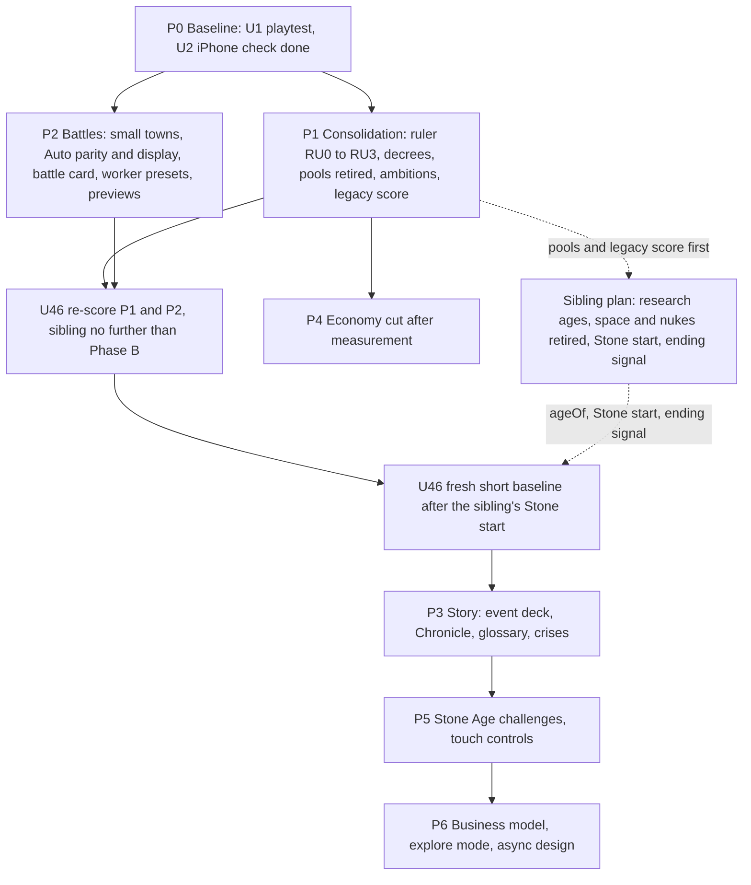

# Differentiation - Plan

## Goal Capsule

- **Objective:** A player on a phone in landscape spends earned things (gold, authority, the ruler's decrees won through deeds) instead of abstract points, plays one ruler with named ambitions across all of history, wins by one legacy score (or by domination), fights fewer but more meaningful battles with an Auto they can read and trust, and keeps a history of their people they can share; every phase is checked against a freshly re-scored playtest.
- **Means:** fix before adding (doc section 3 first), then the new signature features in the doc's recommended order (Key Decision KD1, KTD18).
- **Authority:** the user's chat decisions, then `plans/MASTER-PLAN.md` decisions (23, 24, 25, 37, 39), then `plans/RULER-PLAN.md` (accepted 2026-10-07), then this plan, then `plans/RESEARCH-DIFFERENTIATION.md`. Where this plan and the sibling `plans/2026-10-20-001-feat-eight-ages-plan.md` touch the same file, the owner named in KTD1 to KTD3, KTD7, KTD19 and KTD20 wins.
- **Stop conditions:** stop and ask the user when a unit would (a) take control of units away from the player, (b) cut triangles, LODs or soldier detail, (c) lower the battle size below 300 a side, (d) add captives, (e) switch a player's people, (f) read a world age or a calendar year in a rule, or (g) start a unit whose blocking question in Outstanding Questions is still open.
- **Execution profile:** 44 units to build (U2 already done; U3 and U37 considered and not built) over seven phases plus a re-score close step after each, two tracks in parallel after phase P0 (rules and battle), each phase one branch from `claude/integration`, merged into `claude/integration` when the user says; `main` only on the user's word.
- **Who finishes:** implementing agents per unit (model and skills named on each unit); the lead reviews, commits and merges through the `ship` skill.

---

## Product Contract

### Summary

Run a new full playtest first (the on-device crash check is done), then consolidate: retire the ADM/DIP/MIL point pools in favour of gold, authority and a small budget of ruler decrees earned mostly through deeds, build phase RU (one ruler for the whole game) extended with per-age ambitions, and replace the five victory types with one legacy score plus domination, ranked at the game's ending signal. On the battle track, let small unwalled towns fall without the battle screen, close the Auto parity gaps and show Auto's range, reasons and parity, add a battle card, automate the battle economy on phones, and preview the consequences of taking a city. Then add depth and identity: a linked event deck, the Chronicle with a glossary, condition-triggered history crises, verified weekly seeded challenges that start in the Stone Age, touch controls, a fair business model, and later an explore mode and an async multiplayer design.

### Problem Frame

Playtest 3 (2026-10-08, `plans/playtest-3-audit.md` section 3) scored economy 3, consistency 3, feedback 3, pacing 4, macro AI 4, diplomacy 4 and phone layout 4 out of 10; about 60 fix lanes merged since and none is re-scored. The engine still carries an older layer on top of the Civ-style city layer: three point pools that buy laws, governments, claims and province development (`src/data/actionCosts.js`, 46 entries with a pool cost; 55 `applyCosts(` lines in `src/engine/gameReducer.js`; `DEV_TYPE_POOL` in `src/engine/development.js`), random rulers every 15 to 40 years against decision 39 (`src/engine/rulers.js` `reignLengthTurns`), and seven victory entries (`src/data/victoryConditions.js`). Every assault opens the battle card (decision 23), Auto shows one odds line, and the event pool of 40 historical events and 10 templates repeats and ignores context (playtest 3 item M15). The research (`plans/RESEARCH-DIFFERENTIATION.md` sections 3 and 4) shows the game's rare strengths are real Earth, one people for all history, real-time battles inside grand strategy and an honest Auto; the risk is breadth.

### Key Decisions

- KD1. **Fix before adding.** Section 3 items come before section 4 features; the new features follow the doc's recommended order (ruler with ambitions, Chronicle, battle card, crises, challenges, touch). Governs R1, R33.
- KD2. **Pools become gold, authority and decrees** (default for question 6.2). Rationale: Old World's earned orders are loved, mana currencies are not. Governs R4, R5, R7.
- KD3. **Small unwalled towns and outposts fall without the battle screen** (default for question 6.1), with a setting that restores the choice; for the player's own towns under attack the choice stays on by default. Amends decisions 23 and 24 for that case only. Governs R12.
- KD4. **One legacy score plus domination** (default for question 6.4). Governs R10, R11.
- KD5. **The late game, the ages and the ending belong to the sibling plan.** The eight research ages, the Stone Age start, retiring the space race, nukes, satellites and missiles, the turn limit per speed and the Future age's final goal are planned in `plans/2026-10-20-001-feat-eight-ages-plan.md`; there is no world age and no calendar year in any rule (the year is a display label). This plan keeps its own work compatible (KTD1 to KTD3, KTD7, KTD19, KTD20). Governs R30, R34.
- KD6. **Every game starts in the Stone Age, challenges included; later-start historical scenarios are not built.** A weekly challenge is a seeded Stone Age world plus a turn limit and a goal. (session-settled: user-directed, chosen over a separate later-start Scenarios mode: it clashed with the ruling that every game starts in the Stone Age.) Governs R23, R24.
- KD7. **Never sell power**; the model is premium, or free with one capped unlock plus cosmetics (default for question 6.6). Governs R26.
- KD8. **Decrees come mostly from deeds** (ambitions, era goals met, wars won, wonders), with a small passive trickle only as a floor. (session-settled: user-directed, chosen over a steady per-turn income: a steady income would read as mana again.) Governs R7.

### Requirements

**Baseline and stability**
- R1. A full playtest of the current build re-scores all 15 categories of the playtest 3 scorecard at 844x390 landscape, with a row log and a use count for every player action.
- R2. A city battle on the user's iPhone runs three times in a row without a reload (met: confirmed by the user, U2).

**Currencies and the ruler**
- R4. A new game has no ADM, DIP or MIL pool and no pool bonus: every action, development, law and event that cost or granted pool points costs or grants gold, needs authority, spends decrees, or is free, as Appendix A maps it.
- R5. AI majors earn and spend gold, authority and decrees by the same rules and costs as the player.
- R6. Every major has one ruler for the whole game as `plans/RULER-PLAN.md` specifies (accepted decisions, section "Decisions"), with the changes in KTD5.
- R7. The ruler earns decrees mostly from deeds (ambitions, era goals, wars won, wonders) with a small passive trickle only as a floor, banks them to a cap, and spends them on the major acts of state listed in Appendix A.
- R8. Each age offers every major two or three named ambitions from templates; each people also has one historical ambition offered in its peak age. Completing one grants legacy score, renown and one decree.
- R9. A Ruler tab shows the ruler, attributes, Virtue tree, decrees and ambitions at 844x390 and on desktop, every number with its reasons on tap.

**Victory**
- R10. The game has one victory model: the legacy score ranks every major once, at the game's ending signal (the turn limit or the Future goal, owned by the sibling plan); domination is the one direct win, and no other victory type exists.
- R11. The legacy score adds era goals met, era legacies earned and ambitions completed, and the Legacy panel lists every part with its reason; AI majors score by the same rules.

**Battles**
- R12. An attack on an unwalled town at or below its age's small-town size, or on an outpost, with no army on its tile, resolves through the honest Auto without the battle screen and still shows the capture card; walled cities, field battles between armies and landings still offer Command or Auto. A setting brings the Command choice back for every assault, and for the player's own towns under attack it is on by default.
- R13. Auto and real time agree within the parity guardrail on all but one of the same and adjacent age pairs (built from `AGE_ORDER`) for manned forts and for landings, over 32 seeds each, and a garrisoned city and an empty city resolve through one Auto path with today's capture rules.
- R14. Before every battle the Auto line shows a predicted range, the top three reasons and the parity line for that battle kind.
- R15. Before deployment a battle card lists why this battle differs (supply, terrain, walls' HP, militia, generals, cards granted), and campaign events can grant cards that Command and Auto both read.
- R16. On phones a worker preset (balanced, food, military) and automatic rebuilding of drop sites keep the base economy running without taps, and both replay-verify.
- R17. Before taking a city the player sees which nations would join a pact against them and the city's loyalty forecast.

**Economy and events**
- R18. After the playtest, economy features below a measured use threshold are cut or merged, from a list the user picks.
- R19. Events come from a modular deck whose cards bind subjects (a city, a neighbour, a general, the ruler) and link into stories, never repeat inside their cooldown and check their context before they fire.

**Story and learning**
- R20. The Chronicle is a per-age history book of the player's people (borders per age, famous battles, ruler deeds, ambitions, wonders, cities founded and lost), shareable as an image.
- R21. A tap-to-learn glossary covers every people, city, tech and unit, with a true-start note for each people.
- R22. History crises start from world conditions rather than dates, scale to the world, run as linked event stories carried by existing systems (independents, raids, plague), and can be turned off at setup.

**Modes and reach**
- R23. A weekly seeded challenge gives every player the same Stone Age world and start, a turn limit and a goal, and a result enters the leaderboard only after a replay on the challenge's own engine build verifies it; only the verifier writes the leaderboard.
- R25. Touch controls let a player draw a path to move armies and squads, draw a circle to select, and hold a finger on any UI element for help, taught in their own tutorial steps.
- R26. No purchase changes game power: no pay-to-win, battle pass, gacha or paid speed-up; purchases are a capped unlock or cosmetics.
- R27. An explore mode lets a player travel the real Earth in peace with the Chronicle and the glossary.
- R28. Async multiplayer has a written design against the existing Supabase scaffolding before any build.

**Standing constraints**
- R29. No new rule takes units out of the player's command; morale stays a soft penalty only.
- R30. Work in this plan stays compatible with the sibling plan's ages, space and nuclear retirement, pacing and ending (KD5).
- R31. Every new game rule is deterministic from `state.rngSeed`, with no `Math.random()` or `Date.now()` in game logic.
- R32. Decision 37 holds (no captives), one people for the whole game, plain English with no em dashes, phone landscape first at 844x390, no triangle cuts unless the user asks.
- R33. After each phase the touched categories of the U1 scorecard are re-scored before the next phase's features start (U46): the P1 and P2 re-score runs on a build with no sibling phase past its Phase B, and a fresh short baseline is taken after the sibling's Stone start merges, before P3's re-check.
- R34. No rule in this plan reads a world age or a calendar year: a nation's age is its research age, `ageOf(state, nationId)`, and the year is only a display label.

### Scope Boundaries

- **Owned by the sibling plan, not planned here:** the eight research ages and their art, the Stone Age start, the turn limit per speed and the Future goal ending signal, `AUTO_TUNE` values for age pairs that do not exist today, retiring the space race, nukes, satellites and missiles (`src/data/spaceMissions.js`, `src/data/satellites.js`, `src/data/missiles.js`, `src/components/panels/SpacePanel.jsx`, `src/engine/aiMissiles.js`).
- **Considered and not built (revisit only if a later device check fails):** R3, battle texture memory under the 128 MB budget through KTX2 textures and per-device map texture tiers, and its unit U3 (KTX2 encode step in `scripts/art/`, KTX2Loader in `src/battle/render/`, raster tier in `src/components/map/gl/glLayers.js`, following `plans/art/TRIANGLE-BUDGET.md` item 6). U2's on-device check passed, so neither is needed now.
- **Deferred for later:** the async multiplayer build (R28 is design only), portraits beyond placeholders (RU4 art), link sharing of the Chronicle (image only now), cosmetics content beyond the unlock plumbing.
- **Outside this product's identity for now:** R24 and U37, five to ten historical short scenarios with later starts (1200 BCE collapse, Alexander, the fall of Rome, the Mongols, the age of sail), because every game starts in the Stone Age (KD6).
- **Outside this product's identity:** forced people switches between ages, captives, pay-to-win, battle passes, gacha heroes, paid speed-ups, routing the player's squads.

### Success Criteria

- The U46 re-score after P1 and P2 raises economy, consistency, feedback and phone layout to at least 5 against the U1 baseline.
- Auto parity: forts and landings each inside the guardrail on all but one of the same and adjacent age pairs (U19).
- Assault battle screens per 100 turns fall by at least a third in a scripted 300-turn peoples run, with captures per assault unchanged within seed noise (U18).
- A colleague who reads only a Chronicle image can say which people it is, what it did in each age and which battles mattered.

### Outstanding Questions

The user answered Q1, Q2, Q4, Q5, Q6 and Q7 on 2026-10-20; only U42 still waits on a final pick.

| ID | Question | User answer (2026-10-20) | Blocks |
|---|---|---|---|
| Q1 | 6.1: may small unwalled towns and outposts fall without the battle screen? | Yes, with "always ask" on by default for the player's own towns (KD3) | nothing |
| Q2 | 6.2: remove the ADM/DIP/MIL pools and pay with gold, authority and decrees? | Yes, on the condition that the system stays stable and players earn enough decrees: U6 and U8 show in balance-sim that player and AI decree income covers today's acts-of-state rate (within a quarter) at every speed and age, and the full suite stays green | nothing |
| Q4 | 6.4: replace the five victory types with a legacy score plus domination? | Yes (KD4) | nothing |
| Q5 | 6.5: which new ideas first? | The plan's order (KD1) | nothing |
| Q6 | 6.6: premium, or free with a capped unlock plus cosmetics? | Accepted the plan's approach: U41 writes the spec, never sell power (KD7); the final pick is made on that spec before U42 | U42 only |
| Q7 | Which measured economy features to cut (from U33's list)? | Accepted: decided after the playtest measures use | U34 only |

Question 6.3 was answered yes in the sibling plan. The decree shape (KD8), later-start scenarios (KD6) and verifier hosting (KTD16) were settled by the user. Deferred, not blocking: whether a drawn path in battle replaces today's drag-from-squad formation line (U38 prototypes both and asks with screenshots); whether a device tier may ever lower the battle size (decision 25 says never silently).

---

## Planning Contract

### Key Technical Decisions

- KTD1. **Every per-age rule reads a nation's research age, never a world age or a literal id.** Nation-owned rules (ambitions, decree pace, ruler attribute caps and virtue tiers, a nation's legacy parts) read `ageOf(state, nationId)` (sibling plan KTD1, in `src/engine/nationState.js`); Chronicle chapters close when the player's own age changes; crises read the age of the nation or nations they hit. Tables are built from `AGE_ORDER` in `src/data/ages.js` by index, so the sibling's eight ages plug in. A test fails if any module added or changed by this plan names an `AGE_ORDER` id outside data files. Owner of `src/data/ages.js` and `ageOf`: the sibling plan.
- KTD2. **One cost helper replaces the pools.** `canPay(state, nationId, cost)` and `payCost(state, nationId, cost)` in `src/utils/costs.js` replace `applyCosts` and `canAfford` (`src/utils/helpers.js:406`); `payCost` returns the next state, reading and writing through the `nationState` accessors (`state.resources` for the player, `nation.economy` for AI) and `nation.ruler.decrees`. Cost objects lose `adm`, `dip` and `mil` and gain `decrees` (spent) and `authority` (a threshold read through `authorityOf`, never spent). A test walks every entry of `src/data/actionCosts.js` and every dynamic cost function (`getLawChangeCost`, stability, great projects, annex, colonies, `getDevelopProvinceCost`), every modifier source and every event effect, and fails on any `adm`, `dip` or `mil` key and on any `admBonus`, `dipBonus` or `milBonus` key.
- KTD3. **Space and missile entries are stripped, not deleted.** U7 removes only the pool part of `launchSatellite`, `launchMission`, `asatStrike`, `buildMissile`, `missileStrike` and `buildAbmDefense`; the sibling plan deletes the entries and their systems. Either order of merging works; the later one resolves the conflict by deletion. The satellite and mission DIP income in `getPowerIncome` goes with the pools.
- KTD4. **Decrees are granted at deed sites; the trickle is only a floor.** Each deed grants one decree where it happens, through `grantDecree`: a completed ambition (U12), an era goal met (`eraGoals.js`), a war won (peace with war score 25 or more, `peace.js`), a wonder completed (great projects). The passive trickle gives one decree every `speedTurns(10, speed, ageOf)` turns and only while the bank is empty, so a nation that does nothing still gets one act of state now and then and a busy one earns nearly all of its decrees. Bank cap 3, plus 1 at Majesty 4 and at Majesty 8. Constants live in `src/data/decrees.js`; balance-sim (U8) tunes them, keeping the trickle under a quarter of an average major's decrees. Instantiates KD8 (session-settled: user-directed, chosen over a steady per-turn income: it would read as mana again; governs R7).
- KTD5. **The pool attributes and bonuses get new jobs.** RULER-PLAN section 3's "+1 power a turn" lines are replaced: Administration shortens the passive floor and adds governing capacity; Diplomacy keeps its opinion effect; Military keeps its manpower effect. Modifier keys move the same way: `national.admBonus` becomes decree pace, `national.dipBonus` becomes opinion, `national.milBonus` becomes `national.hrMult` 0.05 per point (this covers advisors, the era goal `war` legacy, governments and techs). The reshape cost of RULER-PLAN 4.6 becomes one decree and -1 stability. Low legitimacy's "-1 to the best pool" becomes a slower passive floor. `lawCostMult` becomes a decree refund chance on law changes, or is removed with its reform text rewritten (U7 picks by which reads simpler).
- KTD6. **One save version bump per merged phase, the next free number at merge.** `CURRENT_SAVE_VERSION` is 13 today (`src/engine/saveMigrations.js:36`), so RULER-PLAN's "v13" is taken. The P1 migration converts rulers per RULER-PLAN 7.3 and banked pools into decrees (1 per 300 pool points combined, up to the cap). The sibling plan bumps its own number; whichever merges second takes the next one.
- KTD7. **The legacy score is one module, ranked at the sibling's ending signal.** `legacyScore(state, nationId)` in `src/engine/legacy.js` returns `{ total, parts }`, each part with a reason key; `rankNations` in `src/engine/score.js` ranks by it and breaks ties with the old `calcNationScore`. Ranking happens once, when the one ending signal owned by the sibling plan fires (the turn limit per speed or the Future age's final goal), never on `END_YEAR`. Era goals are scored for every major (RULER-PLAN 5 already extends them). Points per part live in `src/data/legacy.js`, indexed by age (KTD1), so the sibling adds goals for new ages as data.
- KTD8. **Ambitions are templates plus one signature per people.** `src/data/ambitions.js` holds about 20 templates (found on a river, hold a pass, win a battle outnumbered, a wonder, a trade web) with age windows, and `src/data/ambitionsByPeople.js` adds one historical ambition per people offered in its peak age (the age of its signature unit in `plans/SIGNATURE-UNITS-PLAN.md`). The offer is drawn when the nation enters an age, with a hash of nation id and age (no rng draw), and checked through the predicate module shared with events (KTD13).
- KTD9. **Whether a battle screen opens is one function.** `battleRequired(state, attack)` in `src/engine/battleThreshold.js` returns false for an outpost, or for a city with no Defense-line tier at all (any tier counts as walls, the sibling's Stone earthwork included) and size at or below `SMALL_TOWN_SIZE[ageOf(defender)]` with no enemy stack on its tile. Each age's small-town size sits below that age's median city size, measured in balance-sim. The attack then runs `resolveAutoBattle` (the same entry as the Auto button) and `applyBattleOutcome` with the same operation id, so the ledger, the report and the capture card are the ones a fought battle gets. `battleSettings.smallTowns` is `'auto'` for the player's attacks and `battleSettings.smallTownDefense` is `'ask'` by default, so a pending defense of the player's own small town still offers Command (the no-forced-loss-of-control rule). Re-measure the sizes on a Stone start after the sibling's Phase C.
- KTD10. **One Auto path for cities, both capture rules kept.** The empty-city HP path (`resolveCityAttack` in `src/engine/cityAssault.js`) folds into `autoFromInputs` (`src/engine/autoBattle.js:182`) with the city's militia from `battleInputs.js` as the defending force. A militia-only city still emits `report.cityAttack` (HP, falls at 0); a garrisoned city still sets `garrisonFirst` (the field fight first, never takes the city). Fort and landing calibration happens in `AUTO_TUNE` with `autoCalib.sim.js`, never by special cases. U19 calibrates today's five ages; the sibling owns `AUTO_TUNE` for new pairs.
- KTD11. **Auto's range, reasons and parity are data, not new math.** The range is the 10th to 90th percentile of the existing 200-sample estimates in `src/engine/battleOdds.js`; the reasons are `explainInvasion` factors ranked by absolute effect; the parity line reads `src/data/autoParity.json`, written by U20's battle-lab script from `parityEco.sim.js` and committed, regenerated after each sibling parity unit. The browser never runs parity.
- KTD12. **Battle economy automation lives in the sim.** New order rows `workerPreset` and `autoRebuild` in `src/battle/sim/orderSchema.js`; `neediest` in `src/battle/sim/economy.js` reads the side's preset mix in place of the fixed `WORKER_MIX`; auto rebuild reuses the drop-site placement of `src/battle/sim/economyAI.js`. Replays and `battleVerify.js` cover them for free.
- KTD13. **The event deck is cards with subjects, requirements and links.** A card has `subjects` (role to selector), `requires` (predicates over state and subjects), `links` (follow-up cards with a delay in reference turns) and a `family` cooldown; selection is seeded, memory sits in `state.eventMemory`. The 40 historical events, 10 templates and 6 chain steps move into the format. Predicates are one module, `src/engine/predicates.js`, shared with ambitions (KTD8) and crises (KTD14).
- KTD14. **Crises are data over existing systems.** `src/data/crises.js` defines each crisis by trigger predicates (overextension, famine share, contact density, steppe bloc strength, the age of the nations it would hit), a scale, a cooldown and an opening event-deck story; effects run through raids.js surges, plague.js, migrations as independents and loyalty pressure. `state.settings.crises` (`'on'` default, `'off'`) is set on the start screen. Trigger checks run once a turn over world aggregates, inside the 80 ms turn budget.
- KTD15. **The Chronicle is appended at deed sites through one helper.** `recordChronicle(state, entry)` in `src/engine/chronicle.js`, called where deeds happen (like `grantRenown`), keeps entries per age; the player's own age change closes the chapter with a run-length encoded list of the player's tiles. Save growth is checked with `scripts/perf/save-size.mjs`. The image is drawn to a canvas and shared through the Web Share API or Capacitor Share.
- KTD16. **Challenges verify by macro replay on a pinned engine, in a scheduled GitHub Actions job.** The client keeps the player's action log for a challenge game (dispatched actions plus commanded battle replays). A new Supabase edge function only records submissions in migration `0004_challenges.sql`. A scheduled workflow, `.github/workflows/verify-challenges.yml` (every 15 minutes plus a manual trigger), runs the Node verifier `scripts/verifyChallenges.mjs` over queued submissions: it replays `createInitialState(seed, challenge)`, the actions and `resolveTurn`, and compares the final state hash (the balance-sim `stateHash` method) before a row enters the leaderboard. Each challenge stores its engine build id; the verifier checks only against the matching bundle, and a client on another build is told the challenge is closed. The weekly seed is derived from the ISO week in the menu, never in game logic. Security rules:
  - The workflow runs only on `main`; workflows triggered from pull requests never get the secret.
  - Its one secret is a dedicated least-privilege Supabase key for a `verifier` role, never the `service_role` key. Row-level security lets that role only read pending submissions and write verification results and leaderboard rows.
  - Clients may only insert their own submission (row-level security, a size cap, a rate limit) and read the leaderboard; only the verifier writes the leaderboard.
  - Submissions are untrusted input: schema-validated, size-capped, replayed with a time and turn budget, never evaluated as code.
  - The user adds the secret in GitHub settings; agents never handle key values.
  (session-settled: user-directed, chosen over a self-hosted or Supabase-hosted worker: the user asked the lead to decide with security in mind, and a scheduled main-only workflow with a scoped key needs no new infrastructure.)
- KTD17. **Entitlements never reach the engine.** Purchase state is read only by UI and cosmetic loaders; a test fails if any module under `src/engine/` or `src/battle/sim/` imports entitlement code.
- KTD18. **Two tracks after P0.** The rules track (P1, P3, P4) and the battle track (P2) touch different files; P5 starts after both. Parallel agents follow `superpowers:dispatching-parallel-agents` and merge into `claude/integration` before final tests.
- KTD19. **U26's event deck owns event selection.** After U26 merges no other picker exists: the sibling plan's age rule for events becomes a predicate in `src/engine/predicates.js`, and the sibling's new events are written as cards if they land after U26, or converted by U26's script if they land before.
- KTD20. **Parity targets are built from `AGE_ORDER`.** The guardrail check covers every same and adjacent age pair from `AGE_ORDER` and passes when all but one are inside, so it grows with the sibling's ages without a code change.

### High-Level Technical Design

Cost flow after P1: an action's cost object names gold, decrees and an authority threshold; `canPay` reads the treasury, the decree bank and `authorityOf`; `payCost` returns the next state with gold and decrees spent; the AI calls the same two functions.

### Assumptions

- The sibling plan provides `ageOf(state, nationId)`, `AGE_ORDER` in `src/data/ages.js`, `speedTurns` for waits, and one ending signal that this plan's U16 subscribes to.
- `scripts/campaignTelemetry.mjs` and its scripted policy stay the harness for whole-game numbers.
- Supabase auth (`src/services/auth.js`) is enough to tie a leaderboard row to a player.

### Sequencing and dependencies on the sibling plan

- P1's U7 (pools retired) and U16 (`legacyScore`) should merge before the sibling plan's units that add new actions or new age goals, so those price in gold and decrees and score through `legacyScore`. If the sibling lands first, U7 has fewer entries to convert and U16 adds goals for the ages that exist.
- U16 needs the sibling's ending signal; until it exists, U16 subscribes to today's end check through the same one call so the switch is one line.
- The P1 and P2 re-score (U46) runs on a build with no sibling phase past its Phase B, so the score measures this plan's work, not new ages.
- After the sibling's Stone start (its Phase C) merges, U46 takes a fresh short baseline before P3's re-check; U18 re-measures small-town sizes on a Stone start at the same point.
- Events: KTD19. Parity: KTD10, KTD11, KTD20. Save versions: KTD6.

### Risks

| Risk | Mitigation |
|---|---|
| Pool retirement breaks AI economies or hides a spend path | KTD2 test over every cost, bonus and event effect; the U7 grep; balance-sim compare before and after U7 and U8; `auditGameState` clean |
| The AI's rate of acts of state (laws, governments, claims, alliances) drops on one decree bank | U8 measures acts of state per AI major per 100 turns before and after and tunes KTD4 until it is within a quarter of today's |
| Decrees read as mana again | KD8 and KTD4: deeds first, a trickle only as a floor, kept under a quarter of decrees |
| Renown and ambitions snowball the leader | RULER-PLAN 4.5 limits; `rulerLevelTopToMedian` at most 1.5 in balance-sim |
| Small towns skipped makes conquest too easy | KTD9 uses the same Auto entry; captures per assault measured before and after |
| Auto recalibration shifts other matchups | parityEco on every pair from `AGE_ORDER`, no matchup leaves the guardrail that was inside |
| Chronicle snapshots bloat saves | run-length tiles, player only, `save-size.mjs` budget of +10% |
| Event deck migration loses existing events | a test that every old event id exists as a card |
| Replay verification desyncs across builds or devices | engine pinned per challenge (KTD16); determinism guards (`enginePurity.test.js`, `determinismGuard.test.js`) plus a cross-run hash test for challenge seeds |
| A leaked or over-broad key, or a hostile submission, corrupts the leaderboard | KTD16 security rules, U36's security tests and a security-lens review before U36 merges |
| Rail space at 844x390 is full (RULER-PLAN 6.1) | Ruler tab takes the last slot; Legacy moves into Menu if a ninth tab ever comes |
| Merge conflicts with the sibling plan | owners in KTD1 to KTD3, KTD7, KTD19, KTD20; merge `claude/integration` into each branch before final tests |

### Size estimate (agent sessions)

| Phase | Units | Sessions |
|---|---|---|
| P0 Baseline | U1 (U2 done) | 2 to 3 |
| P1 Consolidation | U4 to U17 | 20 to 26 |
| P2 Battles | U18 to U25 | 9 to 15 |
| P3 Story | U26 to U32 | 13 to 17 |
| P4 Economy cut | U33, U34 | 3 to 5 |
| P5 Challenges and touch | U35, U36, U38 to U40 | 8 to 11 |
| P6 Business and later | U41 to U44 | 6 to 8 |
| Close steps | U45, U46 (about four re-scores) | 4.5 to 5.5 |
| Total | 44 units to build | about 66 to 91 |

---

## Implementation Units

### Unit Index

| U-ID | Title | Files touched (key) | Depends on |
|---|---|---|---|
| U1 | Playtest 4 and re-scored baseline | `plans/playtest-4-audit.md`, `scripts/campaignTelemetry.mjs` | none |
| U2 | iPhone city-battle memory check (done) | `plans/art/TRIANGLE-BUDGET.md` | none |
| U4 | RU0 ruler names and titles | `plans/data/rulers.json`, `src/data/peoples.js` | none |
| U5 | RU1 fixed ruler and attributes | `src/engine/rulers.js`, `src/data/rulers.js` | U4 |
| U6 | Decrees engine | `src/engine/decrees.js`, `src/data/decrees.js` | U5 |
| U7 | Pools retired in costs, bonuses, events and reducer | `src/data/actionCosts.js`, `src/utils/costs.js`, `src/engine/gameReducer.js`, `src/engine/development.js` | U6 |
| U8 | AI spends gold and decrees | `src/engine/aiEconomy.js`, `src/engine/aiOperations.js`, `src/utils/aiLogic.js` | U7 |
| U9 | Pool UI retired, decree UI added | `src/components/ui/ResourceBar.jsx`, panels | U7 |
| U10 | Pool and decree copy, both locales | `src/i18n/locales/` | U9 |
| U11 | RU2 renown, levels, Virtue tree, AI | `src/engine/renown.js`, `src/data/rulerVirtues.js` | U5 |
| U12 | Ambitions engine | `src/engine/ambitions.js`, `src/engine/predicates.js` | U6, U11 |
| U13 | Ambitions content for 150 peoples | `src/data/ambitions.js`, `src/data/ambitionsByPeople.js` | U12 |
| U14 | RU3 Ruler tab | `src/components/ruler/` | U11, U12 |
| U15 | Ruler portrait placeholders | `src/assets/peoples/rulers/placeholder/` | U14 |
| U16 | Legacy score and one victory model | `src/engine/legacy.js`, `src/data/victoryConditions.js` | U12 |
| U17 | Legacy panel and game over | `src/components/panels/LegacyPanel.jsx`, `GameOverModal.jsx` | U16 |
| U18 | Small towns fall without the battle screen | `src/engine/battleThreshold.js`, `battleQueue.js` | U1 |
| U19 | Auto parity: forts, landings, one city path | `src/engine/autoBattle.js`, `cityAssault.js`, `battleOutcome.js` | U1 |
| U20 | Auto prediction data | `src/engine/battleOdds.js`, `src/data/autoParity.json` | U19 |
| U21 | Auto range, reasons, parity on the card | `src/components/battle/PreBattleModal.jsx` | U20 |
| U22 | Battle card | `src/components/battle/BattleCard.jsx` | U21 |
| U23 | Campaign cards from events | `src/engine/battleInputs.js`, `src/data/battleCards.js`, `applyEventEffects.js` | U22 |
| U24 | Worker presets and auto rebuild | `src/battle/sim/economy.js`, `orderSchema.js`, `EconomyHud.jsx` | U1 |
| U25 | Coalition and loyalty previews | `src/engine/consequences.js`, pre-battle and march UI | U1 |
| U26 | Event deck engine | `src/engine/eventDeck.js`, `src/engine/predicates.js` | U12 |
| U27 | Event deck content | `src/data/eventDeck/` | U26 |
| U28 | Chronicle record | `src/engine/chronicle.js` | U11, U16 |
| U29 | Chronicle reader and share image | `src/components/chronicle/` | U28 |
| U30 | Glossary and tap-to-learn | `src/data/glossary/`, `src/components/glossary/` | U29 |
| U31 | History crises engine | `src/engine/crises.js`, `src/data/crises.js` | U26 |
| U32 | Crisis setup option and crisis UI | `src/components/ui/StartScreen.jsx`, crisis banner | U31 |
| U33 | Economy use measurement | `scripts/economyUse.mjs`, `plans/economy-use-2026.md` | U1, U8 |
| U34 | Economy cuts | per the user's list | U33, Q7 |
| U35 | Macro replay verification | `src/engine/actionLog.js`, `src/engine/macroVerify.js` | U8 |
| U36 | Weekly seeded challenge and leaderboard | `src/engine/challenges.js`, `supabase/`, `.github/workflows/verify-challenges.yml` | U35, U16 |
| U38 | Touch: draw a path | `src/battle/input/gestures.js`, `GLMapView.jsx`, `orderSchema.js` | U24 |
| U39 | Touch: circle select and hold for help | `gestures.js`, `src/hooks/useHoldHelp.js` | U30, U38 |
| U40 | Controls tutorial copy | `src/engine/tutorial.js`, `battleCoach.js`, locales | U39 |
| U41 | Business model spec | `plans/BUSINESS-MODEL.md` | none |
| U42 | Capped unlock and cosmetic entitlements | `src/services/entitlements.js` | U41, Q6 |
| U43 | Explore mode | `src/engine/worldgen/`, `StartScreen.jsx` | U29, U30 |
| U44 | Async multiplayer design | `plans/ASYNC-MULTIPLAYER.md` | U35 |
| U45 | Docs and test lists | `CLAUDE.md`, `plans/MASTER-PLAN.md` | each phase |
| U46 | Per-phase re-score | `plans/playtest-4-audit.md` (re-score sections) | each phase, U1 |

U3 and U37 are not in the index: both were considered and not built (Scope Boundaries).

### Units by model

| Model | Count | Units |
|---|---|---|
| opus | 19 | U1, U5, U6, U7, U8, U11, U12, U16, U18, U19, U20, U26, U31, U34, U35, U36, U42, U44, U46 |
| sonnet | 22 | U2 (done), U4, U9, U13, U14, U15, U17, U21, U22, U23, U24, U25, U27, U28, U29, U30, U32, U33, U38, U39, U41, U43 |
| haiku | 3 | U10, U40, U45 |
| total | 44 | U3 and U37 not built |

### Phase P0: Baseline

### U1. Playtest 4 and re-scored baseline
- **Goal:** a new scorecard and log on the current build that every later unit is measured against.
- **Requirements:** R1, R33.
- **Files:** `plans/playtest-4-audit.md`, `plans/playtest-4-test-log.md`, `scripts/campaignTelemetry.mjs` (add per-action use counts), `scripts/campaignTelemetry.test.mjs`.
- **Approach:** play a Standard peoples world for 300 turns on Normal at King difficulty in an emulated 844x390 landscape browser, with the same play styles as playtest 3 section 2 (peaceful expansion, siege conquest, commanded assault, defensive war, diplomacy, deliberate bad choices, exploit checks) plus the "not tested" row of playtest 3 (naval, landings, vassals, saves). Score the same 15 categories with the same format; add a use count per action type from the telemetry and the reducer's dispatched actions in a dev-only counter outside game logic. Compare each finding to playtest 3 and to `plans/playtest-audits-item-inventory.md`.
- **Model:** opus. **Skills:** ux-superpowers:ux-validate, balance-sim, battle-lab, compound-engineering:ce-noslop.
- **Test Scenarios:** the telemetry test counts actions of a scripted 20-turn run; a missing action type reads 0, never undefined.
- **Verification:** the audit has the 15-row scorecard, a delta column against playtest 3, findings in the playtest 3 format, and the use count table that U33 reads.

### U2. iPhone city-battle memory check (done)
- **Goal:** know whether the crash-hunt fix holds on the user's iPhone.
- **Requirements:** R2.
- **Files:** `plans/art/TRIANGLE-BUDGET.md` (the measured row).
- **Approach:** done: the user confirmed city battles run on the iPhone without a reload. A later device check reruns `scripts/perf/memory-soak.mjs` and `scripts/perf/battle-soak.mjs`, and only a failure reopens R3 and U3.
- **Model:** sonnet. **Skills:** battle-lab, chrome-devtools-mcp:memory-leak-debugging.
- **Test Scenarios:** none left.
- **Verification:** the user's confirmation, recorded in the budget doc.

### Phase P1: Consolidation (rules track)

### U4. RU0 ruler names and titles
- **Goal:** a historical ruler name, gender, epithet and title overrides for each of the 150 peoples.
- **Requirements:** R6.
- **Files:** `plans/data/rulers.json`, `src/data/peoples.js`.
- **Approach:** RULER-PLAN 2.1 and step RU0; a source and web check column per row; sensitive names (RULER-PLAN 9 risks) flagged for the user.
- **Model:** sonnet. **Skills:** compound-engineering:ce-noslop.
- **Test Scenarios:** every people in `peoples.js` has `ruler.name` and `ruler.gender`; no name is a Civilization leader copied whole (a list check).
- **Verification:** the JSON has 150 rows with sources; `npx vitest run src/data` passes.

### U5. RU1 fixed ruler and attributes
- **Goal:** one ruler per major for the whole game, six attributes, no reigns, houses or random traits.
- **Requirements:** R6, R31, R32, R34.
- **Files:** `src/data/rulers.js`, `src/engine/rulers.js`, `src/engine/resolveTurn.js` (rulers phase, lines 707 to 732 today), `src/engine/civilWar.js`, `src/data/traits.js` (deleted), `src/engine/modifiers/sources.js`, `src/engine/authority.js`, `src/engine/saveMigrations.js`, tests beside each.
- **Approach:** RULER-PLAN step RU1 with KTD1 (attribute caps by `ageOf` index, not the calendar age RULER-PLAN question 14 chose) and KTD5 (pool attributes keep feeding the pools until U7 lands, then switch). Save bump per KTD6.
- **Model:** opus. **Skills:** add-mechanic, balance-sim, superpowers:test-driven-development.
- **Test Scenarios:** every major starts 3/3/3/0/0/0 in a Standard peoples world; no reign ends in 300 turns; a lost civil war keeps the ruler; a nation that researches into the next age gets the next cap while its neighbour does not; a v13 fixture migrates and passes `auditGameState`.
- **Verification:** lint, full suite, balance-sim compare (expected: the dice removed, little else).

### U6. Decrees engine
- **Goal:** the ruler's earned budget that replaces the pools for major acts of state.
- **Requirements:** R7, R5, R31, R34.
- **Files:** `src/data/decrees.js`, `src/engine/decrees.js`, `src/engine/resolveTurn.js` (rulers phase), `src/engine/rulers.js` (reshape cost), `src/engine/nationalPower.js` (legitimacy effect), deed sites (`src/engine/peace.js`, great projects, `src/engine/eraGoals.js`), tests.
- **Approach:** KTD4 and KTD5. `grantDecree(state, nationId, deedId)` is called at each deed site (era goal met, war won, wonder completed; U12 adds ambitions); the passive trickle runs in the rulers phase only while the bank is empty; `spendDecree`; bank on `nation.ruler.decrees`. Every grant and spend has a reason line for the UI, naming the deed.
- **Model:** opus. **Skills:** add-mechanic, superpowers:test-driven-development.
- **Test Scenarios:** each deed grants one decree once (a won war, an era goal, a wonder); the trickle never fires while the bank holds a decree; the trickle fires within one turn of each other in reference-turn terms at Fast, Normal and Marathon; the bank never exceeds the cap; low legitimacy slows the trickle; spending with an empty bank is refused and returns the same state.
- **Verification:** unit tests green; a 150-turn balance-sim run shows deeds at least three quarters of every average AI major's decrees.

### U7. Pools retired in costs, bonuses, events and reducer
- **Goal:** no pool and no pool bonus in a new game; every cost and grant paid in gold, decrees, authority or nothing.
- **Requirements:** R4, R30, R31.
- **Files:** `src/data/actionCosts.js`, `src/utils/costs.js` (new), `src/utils/helpers.js` (`getPowerIncome`, `applyCosts`, `canAfford` removed), `src/engine/gameReducer.js`, `src/data/laws.js`, `src/data/government.js` (`lawCostMult`, pool bonuses, reform text), `src/data/techTree.js` (pool bonuses), `src/data/greatProjects.js`, `src/engine/colonies.js`, `src/engine/development.js` (`getDevelopProvinceCost`, `DEV_TYPE_POOL` deleted), `src/engine/aiEconomy.js` (`tryDevelopProvince`), `src/data/events.js`, `src/data/proceduralEvents.js`, `src/data/eventChains.js`, `src/engine/applyEventEffects.js`, `src/engine/fieldBattle.js`, `src/engine/invasion.js`, `src/engine/navalBattle.js`, `src/data/eraGoals.js`, `src/engine/modifiers/sources.js`, `src/engine/resolveTurn.js` (banking lines 346 to 355), `src/engine/saveMigrations.js`.
- **Approach:** Appendix A mapping, KTD2 helper, KTD3 for space and missile entries, KTD5 for bonuses and `lawCostMult`, KTD6 migration. One branch with U8 so the AI never reads a pool that is gone.
- **Model:** opus. **Skills:** add-mechanic, balance-sim, superpowers:test-driven-development, compound-engineering:ce-work.
- **Test Scenarios:** the KTD2 walk over every cost, modifier source and event effect; changing a law needs authority and one decree; a token-cost action (gain control) now costs gold only; developing a province costs gold; an event that granted 80 ADM now grants one decree and one that granted 20 grants gold; a v13 save with 1,800 pool points arrives with a full decree bank; `auditGameState` clean after 100 turns.
- **Verification:** `rg -n "(resources|economy|pool)\??\.(adm|dip|mil)\b|DEV_TYPE_POOL|\b(adm|dip|mil)Bonus\b" src` finds nothing outside `src/engine/saveMigrations.js`; lint, full suite, build.

### U8. AI spends gold and decrees
- **Goal:** AI majors act on the new costs with the same cadence and strength as before.
- **Requirements:** R5.
- **Files:** `src/engine/aiEconomy.js` (lines 56 to 57, 82, 326 today, and `tryDevelopProvince`), `src/engine/aiOperations.js` (485, 695, 780), `src/engine/colonies.js` (150), `src/utils/aiLogic.js` (426), `src/data/decrees.js`, `scripts/simStats.mjs` (decree and act-of-state keys).
- **Approach:** replace each pool check with `canPay` and each spend with `payCost`; the AI holds one decree for war and peace acts by doctrine. Tune the gold factor for province development and the KTD4 constants. Measure the AI's rate of acts of state (laws, governments, claims, alliances, vassals) on one decree bank against today's. Missile AI is left to the sibling plan (KTD3).
- **Model:** opus. **Skills:** balance-sim, add-mechanic.
- **Test Scenarios:** an AI with gold and no decrees still builds and develops; an AI with decrees changes a law when its rule says so; no AI decree bank sits at the cap for 20 turns.
- **Verification:** balance-sim compare on 6 seeds x 150 turns: no starred move in `topLandShare`, `nationsAliveShare`, `nonFinite`, `auditViolations`; `msPerTurn` within 2 ms; acts of state per AI major per 100 turns within a quarter of the base commit.

### U9. Pool UI retired, decree UI added
- **Goal:** the top bar, sheets and cards show gold, authority and decrees, never pools.
- **Requirements:** R4, R9, R32.
- **Files:** `src/components/ui/ResourceBar.jsx`, `src/components/ui/ResourceBadge.jsx`, `src/data/powerPools.js` (deleted), `src/components/panels/DomesticPanel.jsx`, `src/components/panels/NationCard.jsx`, `src/components/modals/RegionInfoModal.jsx`, `src/components/panels/MilitaryPanel.jsx`, `src/components/panels/TechPanel.jsx`, `src/components/panels/empireText.js`, `src/components/ui/nationOverviewModel.js`, `src/components/battle/preBattleModel.js`, `src/components/city/cityPoliticsModel.js`.
- **Approach:** one decree badge in the top bar (count of cap, reasons and recent deeds on tap); every action button shows its new cost through one cost line component. 844x390 first.
- **Model:** sonnet. **Skills:** frontend-design:frontend-design, design:ux-copy.
- **Test Scenarios:** model tests for the cost line (gold only, decree only, both, authority short); no component imports `powerPools`.
- **Verification:** `node scripts/ui/panels-shots.mjs` at 844x390 and desktop; lint zero warnings.

### U10. Pool and decree copy, both locales
- **Goal:** no `pool.*` text left; plain decree text in English and Hebrew.
- **Requirements:** R4, R32.
- **Files:** `src/i18n/locales/en.js`, `src/i18n/locales/he.js`, `src/i18n/locales/ui/*`, `src/i18n/locales/msg/*`.
- **Approach:** remove the 13 `pool.*` keys and the pool lines in ui and msg files; add `decree.*` keys; run the key generator.
- **Model:** haiku. **Skills:** design:ux-copy, compound-engineering:ce-noslop.
- **Test Scenarios:** `src/i18n/hardcodedText.test.js` passes; no `pool.` key remains.
- **Verification:** `node scripts/ui/hebrew-audit.mjs` clean; no em dash in new strings.

### U11. RU2 renown, levels, Virtue tree, AI
- **Goal:** the ruler grows through deeds and the AI grows by the same rules.
- **Requirements:** R6, R5, R31, R34.
- **Files:** `src/engine/renown.js`, `src/data/rulerVirtues.js`, `src/engine/rulers.js`, `src/engine/rulerBias.js`, `src/engine/modifiers/registry.js`, deed sites (`battleOutcome.js`, `peace.js`, `research.js`, `settlers.js`, `eraGoals.js`), `scripts/simStats.mjs`.
- **Approach:** RULER-PLAN step RU2 with tiers gated by `ageOf` index (KTD1: six tiers spread over however many ages `AGE_ORDER` holds). RULER-PLAN's time renown "1 per 10 years" becomes a per reference turn amount (R34).
- **Model:** opus. **Skills:** add-mechanic, balance-sim, battle-lab (parityEco with Command 0 and 6).
- **Test Scenarios:** RULER-PLAN 7.5 list; a battle's renown granted once through `applyBattleOutcome`; time renown equal over the same reference turns at every speed.
- **Verification:** RULER-PLAN section 8 balance targets met; parityEco unchanged within noise.

### U12. Ambitions engine
- **Goal:** each age offers named ambitions; completion pays legacy, renown and a decree.
- **Requirements:** R8, R5, R31, R34.
- **Files:** `src/engine/ambitions.js`, `src/engine/predicates.js` (new, shared with U26 and U31), `src/engine/resolveTurn.js`, `src/engine/eraGoals.js`.
- **Approach:** KTD8; offers drawn when each major enters an age (its own `ageOf`), progress checked once a turn, completion through `grantRenown`, `grantDecree` and a legacy part (U16 reads it).
- **Model:** opus. **Skills:** add-mechanic, balance-sim, superpowers:test-driven-development.
- **Test Scenarios:** the same nation and age always get the same offer; the historical ambition appears only in the people's peak age; a completed ambition pays once; an AI major completes ambitions at a rate within a third of a scripted player's.
- **Verification:** 150-turn balance-sim: ambitions completed per major per age reported in `simStats`.

### U13. Ambitions content for 150 peoples
- **Goal:** about 20 templates and one historical ambition per people.
- **Requirements:** R8, R32.
- **Files:** `src/data/ambitions.js`, `src/data/ambitionsByPeople.js`, `plans/data/ambitions.json` (sources).
- **Approach:** peak age matches the signature unit's age; each line in plain English; predicates only from `predicates.js`.
- **Model:** sonnet. **Skills:** compound-engineering:ce-noslop, design:ux-copy.
- **Test Scenarios:** every people has one; every predicate id exists; every ambition is reachable on a Standard world from its start (a static check).
- **Verification:** data tests green; the user reviews flagged sensitive rows.

### U14. RU3 Ruler tab
- **Goal:** the Ruler sheet with decrees and ambitions.
- **Requirements:** R9, R32.
- **Files:** `src/components/ruler/RulerSheet.jsx`, `src/components/ruler/rulerSheetModel.js`, `src/components/panels/ActionPanelTabs.jsx`, `src/components/panels/PanelDrawer.jsx`, `src/components/ui/NationOverviewSheet.jsx`, `src/components/panels/DomesticPanel.jsx`, `src/components/ui/nextPromptModel.js`.
- **Approach:** RULER-PLAN section 6, with a decree row under the header and an ambitions strip above the tree; registers with `useInteraction`.
- **Model:** sonnet. **Skills:** frontend-design:frontend-design, design:ux-copy.
- **Test Scenarios:** `rulerSheetModel.test.js` (rows, chip states, the one brass action, the ambitions strip), tab badge counts points plus completable ambitions.
- **Verification:** screenshots at 844x390 and 1280x800 through `scripts/ui/panels-shots.mjs`.

### U15. Ruler portrait placeholders
- **Goal:** a placeholder bust per art theme until RU4 art exists.
- **Requirements:** R9.
- **Files:** `src/assets/peoples/rulers/placeholder/*.svg`, `src/components/ruler/rulerPortrait.js`.
- **Approach:** RULER-PLAN 2.2; tinted by people colour, lazy `import.meta.glob`.
- **Model:** sonnet. **Skills:** frontend-design:frontend-design.
- **Test Scenarios:** `rulerPortrait` returns the placeholder for every theme.
- **Verification:** the Ruler sheet screenshot shows the bust.

### U16. Legacy score and one victory model
- **Goal:** one legacy score ranks the game at its ending signal; domination is the one direct win.
- **Requirements:** R10, R11, R30, R34.
- **Files:** `src/engine/legacy.js`, `src/data/legacy.js`, `src/data/victoryConditions.js` (keep `domination`; remove `conqueror`, `economicHegemony`, `diplomatic`, `spaceAscendancy`, `eventVictory`; `finalScore` reads legacy), `src/engine/score.js`, `src/engine/resolveTurn.js` (victory phase near line 1294; the diplomatic streak near 1190 goes), `src/engine/eraGoals.js` (every major), tests.
- **Approach:** KTD7; subscribe to the sibling's one ending signal (until it exists, today's end check through the same call), never `END_YEAR`.
- **Model:** opus. **Skills:** add-mechanic, balance-sim, superpowers:test-driven-development.
- **Test Scenarios:** a player first in legacy when the turn limit fires wins; a nation completing the Future goal ends the game and legacy ranks once; each ending ranks exactly once even when both fire on the same turn; domination still wins on any turn; an old save mid-way to a diplomatic win loads and continues with legacy; every part has a reason key.
- **Verification:** balance-sim reports legacy spread; full suite green.

### U17. Legacy panel and game over
- **Goal:** the player sees the score, its parts and the rivals' totals.
- **Requirements:** R11, R32.
- **Files:** `src/components/panels/LegacyPanel.jsx`, `src/components/modals/GameOverModal.jsx`, locales.
- **Approach:** parts grouped by age, each with its reason; game over shows rank, the ending that fired and the top three rivals.
- **Model:** sonnet. **Skills:** frontend-design:frontend-design, design:ux-copy.
- **Test Scenarios:** model tests for parts, ranks and both endings.
- **Verification:** screenshots at 844x390 and desktop.

### Phase P2: Battles (battle track)

### U18. Small towns fall without the battle screen
- **Goal:** fewer, bigger battles: small unwalled towns and outposts resolve on Auto with the capture card.
- **Requirements:** R12, R29.
- **Files:** `src/engine/battleThreshold.js` (new), `src/engine/invasion.js` (`validateInvasion` near line 89), `src/engine/gameReducer.js` (`LAUNCH_INVASION` near 1563), `src/engine/battleQueue.js`, `src/components/battle/preBattleModel.js`, `src/components/ui/SettingsSheet.jsx`, `src/components/capture/captureCardModel.js`, `plans/MASTER-PLAN.md` (decision 23 amended).
- **Approach:** KTD9. Blocked by Q1. Re-measure `SMALL_TOWN_SIZE` on a Stone start after the sibling's Phase C.
- **Model:** opus. **Skills:** add-mechanic, battle-lab, balance-sim.
- **Test Scenarios:** a size 2 town with no Defense-line tier falls on Auto through `resolveAutoBattle` and the capture card opens; a size 2 town with any Defense-line tier (a Stone earthwork included) opens the battle card; an army on the town's tile opens the battle card; the `'ask'` setting opens the card every time; an AI attack on the player's small town offers Command by default; `SMALL_TOWN_SIZE` for each age is below that age's median city size.
- **Verification:** scripted 300-turn run: battle screens per 100 turns down at least a third, captures per assault unchanged within seed noise.

### U19. Auto parity: forts, landings, one city path
- **Goal:** Auto matches real time for forts and landings, and cities use one Auto path.
- **Requirements:** R13.
- **Files:** `src/engine/autoBattle.js` (`AUTO_TUNE`), `src/engine/cityAssault.js`, `src/engine/battleInputs.js`, `src/engine/battleOutcome.js`, `src/engine/battleOdds.js`, `src/engine/defense.js`, `src/components/battle/preBattleModel.js`, `.claude/skills/battle-lab/autoCalib.sim.js`, `src/engine/autoBattle.test.js`.
- **Approach:** KTD10 and KTD20; calibrate today's five ages only. Today forts are 0 of 32 in real time against 20 of 32 on Auto and landings 32 of 32 against 15 of 32 (`plans/MASTER-PLAN.md` 6.11).
- **Model:** opus. **Skills:** battle-lab, superpowers:systematic-debugging.
- **Test Scenarios:** parityEco on every same and adjacent pair for fort, landing, assault and sally; a militia-only city still emits `report.cityAttack` and falls at 0 HP; a garrisoned city still sets `garrisonFirst`; capture rate per assault matches the base commit within seed noise.
- **Verification:** forts and landings each inside the guardrail on all but one pair; no kind that was inside leaves it.

### U20. Auto prediction data
- **Goal:** a range, ranked reasons and a parity record per battle kind.
- **Requirements:** R14.
- **Files:** `src/engine/battleOdds.js`, `src/data/autoParity.json`, `.claude/skills/battle-lab/parityTable.sim.js` (new, writes the JSON), tests.
- **Approach:** KTD11; the script is rerun after each sibling parity unit.
- **Model:** opus. **Skills:** battle-lab, superpowers:test-driven-development.
- **Test Scenarios:** the range contains the median; reasons are sorted by absolute effect and capped at three; a missing parity row yields no line, never a made-up number.
- **Verification:** the JSON regenerates byte-identical on a second run.

### U21. Auto range, reasons and parity on the card
- **Goal:** the pre-battle card shows what Auto expects and why.
- **Requirements:** R14, R32.
- **Files:** `src/components/battle/PreBattleModal.jsx`, `src/components/battle/preBattleModel.js`, `src/components/battle/autoCompare.js`, `src/components/battle/defenseSheetModel.js`, `src/i18n/locales/ui/pre.en.js`, `pre.he.js`.
- **Approach:** one line "Auto: win 55 to 70%, you lose 300 to 600 men", three reason chips, a small parity line; fits the 844x390 card.
- **Model:** sonnet. **Skills:** frontend-design:frontend-design, design:ux-copy.
- **Test Scenarios:** model tests for each battle kind and for no-parity data.
- **Verification:** `.claude/skills/battle-lab/hud-shot.mjs` style screenshots at 844x390.

### U22. Battle card
- **Goal:** before deployment the player sees why this battle differs.
- **Requirements:** R15.
- **Files:** `src/components/battle/BattleCard.jsx`, `src/components/battle/battleCardModel.js`, `src/components/battle/TacticalBattleHost.jsx`.
- **Approach:** reads `battleInputs.js` (supply, starvation, plague, walls' HP, militia, reinforcements) and the tile context from `src/battle/setup/tileContext.js`; never its own numbers.
- **Model:** sonnet. **Skills:** frontend-design:frontend-design, battle-lab.
- **Test Scenarios:** every input with a non-zero effect has a row; none of the rows has a number different from the inputs.
- **Verification:** battle-lab screenshot at 844x390.

### U23. Campaign cards from events
- **Goal:** won events grant battle cards (a ford scouted, a traitor at the gate, a supply depot).
- **Requirements:** R15, R31.
- **Files:** `src/data/battleCards.js`, `src/engine/battleInputs.js`, `src/engine/applyEventEffects.js`, tests.
- **Approach:** a card is an input modifier both Command and Auto read through `battleInputs.js`, so parity holds by construction; cards are granted by a new effect in the existing `applyEventEffects.js` and kept on the nation with an expiry in reference turns. U27 adds deck links to them later.
- **Model:** sonnet. **Skills:** add-mechanic, battle-lab.
- **Test Scenarios:** a card changes the same input for Command setup and Auto; it expires; it is spent once.
- **Verification:** parityEco with and without a card moves Auto and real time together.

### U24. Worker presets and auto rebuild
- **Goal:** the base economy needs no taps on a phone.
- **Requirements:** R16, R29.
- **Files:** `src/battle/sim/economy.js` (`neediest` near line 178), `src/battle/sim/orderSchema.js`, `src/battle/data/economy.js` (preset mixes), `src/battle/sim/economyAI.js`, `src/components/battle/EconomyHud.jsx`, `src/components/battle/TacticalBattleScreen.jsx`.
- **Approach:** KTD12; auto rebuild on by default on phones; the player can always order workers by hand.
- **Model:** sonnet. **Skills:** battle-lab, superpowers:test-driven-development.
- **Test Scenarios:** the food preset moves the mix; a destroyed drop site is rebuilt at the AI's spot; a replay with presets verifies.
- **Verification:** `node scripts/battle-bench.mjs --eco` and `.claude/skills/battle-lab/eco-shot.mjs`.

### U25. Coalition and loyalty previews
- **Goal:** the player sees the consequences before taking a city.
- **Requirements:** R17.
- **Files:** `src/engine/consequences.js` (new: projected AE from `src/engine/expansion.js` against `PACT_FORM_AE` in `src/engine/pacts.js`, and `loyaltyForecast` from `src/engine/loyalty.js`), `src/components/battle/preBattleModel.js`, `src/components/map/armySheetModel.js`.
- **Approach:** pure projection on a copy, no state change; list the nations that would join and the turns until the city's loyalty settles.
- **Model:** sonnet. **Skills:** add-mechanic, design:ux-copy.
- **Test Scenarios:** a projection matches what happens after the capture in a test world; no projection mutates state.
- **Verification:** screenshots of the march-to-attack sheet and the pre-battle card.

### Phase P3: Story (rules track)

### U26. Event deck engine
- **Goal:** events that bind subjects, check context and link into stories.
- **Requirements:** R19, R31, R34.
- **Files:** `src/engine/eventDeck.js`, `src/engine/predicates.js`, `src/engine/resolveTurn.js`, `src/data/events.js`, `src/data/proceduralEvents.js`, `src/data/eventChains.js`, `src/engine/applyEventEffects.js`, `src/components/modals/EventModal.jsx`, `scripts/convertEvents.mjs`.
- **Approach:** KTD13 and KTD19; old events and any sibling events already merged convert by the script, the old pickers go, the sibling's age rule becomes a predicate.
- **Model:** opus. **Skills:** add-mechanic, balance-sim, superpowers:test-driven-development.
- **Test Scenarios:** every old event id exists as a card; a card with an unmet requirement never fires; a link fires after its delay; no family repeats inside its cooldown over 300 turns; no card reads a year.
- **Verification:** balance-sim 300 turns: events per age, repeats 0 inside cooldowns.

### U27. Event deck content
- **Goal:** linked stories with subjects across the ages.
- **Requirements:** R19, R15, R32.
- **Files:** `src/data/eventDeck/*.js`, locales.
- **Approach:** about 60 cards in 15 linked stories, each with a subject, a context and two or three choices in plain English; links to U23's battle cards; no captives (decision 37).
- **Model:** sonnet. **Skills:** design:ux-copy, compound-engineering:ce-noslop.
- **Test Scenarios:** data validation (subjects, predicates, links resolve).
- **Verification:** a 300-turn scripted run shows at least five stories completed.

### U28. Chronicle record
- **Goal:** the game keeps the facts the Chronicle needs.
- **Requirements:** R20, R31, R34.
- **Files:** `src/engine/chronicle.js`, deed sites (`battleOutcome.js`, `settlers.js`, conquest, `ambitions.js`, great projects, `renown.js`), `src/engine/saveMigrations.js`.
- **Approach:** KTD15; chapters close on the player's own age change.
- **Model:** sonnet. **Skills:** add-mechanic, superpowers:test-driven-development.
- **Test Scenarios:** a chapter closes when the player's research age changes, not when a rival's does, with a tile snapshot; an idempotent battle writes one entry; save size grows less than 10% over 300 turns.
- **Verification:** `node scripts/perf/save-size.mjs` against the base commit.

### U29. Chronicle reader and share image
- **Goal:** a history book of the player's people, shareable as an image.
- **Requirements:** R20, R32.
- **Files:** `src/components/chronicle/ChronicleSheet.jsx`, `src/components/chronicle/chronicleModel.js`, `src/components/chronicle/chronicleImage.js`.
- **Approach:** chapters per age with the border map drawn from the snapshot, famous battles (by size and battle names from `src/engine/battleNames.js`), ruler deeds, ambitions, wonders, cities founded and lost; years shown only as labels.
- **Model:** sonnet. **Skills:** frontend-design:frontend-design, design:ux-copy.
- **Test Scenarios:** model tests for a chapter with no battles and one with many.
- **Verification:** screenshots at 844x390 and desktop, and the exported PNG.

### U30. Glossary and tap-to-learn
- **Goal:** tap any people, city, tech or unit name to learn about it.
- **Requirements:** R21.
- **Files:** `src/data/glossary/`, `src/components/glossary/GlossarySheet.jsx`, `src/components/glossary/GlossaryLink.jsx`, `src/data/geo/peopleCapitals.json` (read).
- **Approach:** entries built from existing data plus a short note each; the true-start line for each people ("historically, this people founded X here").
- **Model:** sonnet. **Skills:** design:ux-copy, compound-engineering:ce-noslop.
- **Test Scenarios:** every people, tech and unit id has an entry.
- **Verification:** screenshots; `hebrew-audit.mjs` clean.

### U31. History crises engine
- **Goal:** world crises that come from conditions.
- **Requirements:** R22, R31, R29, R34.
- **Files:** `src/engine/crises.js`, `src/data/crises.js`, `src/engine/raids.js`, `src/engine/plague.js`, `src/engine/independents.js`, `src/engine/resolveTurn.js`.
- **Approach:** KTD14; first set: Bronze Age collapse, Sea Peoples, plague, steppe surge, Little Ice Age, world wars, each gated by the age of the nations it hits, never a year; a crisis never forces the player's units to move (R29).
- **Model:** opus. **Skills:** add-mechanic, balance-sim.
- **Test Scenarios:** a crisis triggers only when its predicates hold; a nation outside the crisis's age window is not hit; `'off'` stops all; turn time stays within budget with `PERF_CHECKS=1`.
- **Verification:** balance-sim with crises on and off: `nationsAliveShare` does not collapse; at least one crisis in 300 turns on 4 of 6 seeds.

### U32. Crisis setup option and crisis UI
- **Goal:** turn crises off at setup and follow a running one.
- **Requirements:** R22.
- **Files:** `src/components/ui/StartScreen.jsx`, `src/components/ui/CrisisBanner.jsx`, locales.
- **Approach:** one toggle on the start screen; a banner that registers with `useInteraction` and opens the crisis story.
- **Model:** sonnet. **Skills:** frontend-design:frontend-design, design:ux-copy.
- **Test Scenarios:** the toggle writes `state.settings.crises`.
- **Verification:** start-screen screenshots (`scripts/ui/start-steps-shots.mjs`).

### Phase P4: Economy cut

### U33. Economy use measurement
- **Goal:** a ranked list of economy features by use.
- **Requirements:** R18.
- **Files:** `scripts/economyUse.mjs`, `plans/economy-use-2026.md`.
- **Approach:** combine U1's use counts with the scripted policy's actions over 6 seeds (districts with adjacency, nine building lines, rush buying, standing works, growth purchases); flag what players and the scripted player never use, and the chores the research warns of (rising costs, crafting).
- **Model:** sonnet. **Skills:** balance-sim, product-management:metrics-review.
- **Test Scenarios:** the script runs headless and writes the same table on a rerun.
- **Verification:** the doc lists every feature with counts and a cut, merge or keep proposal for the user (Q7).

### U34. Economy cuts
- **Goal:** remove or merge what the user picks from U33.
- **Requirements:** R18, R5.
- **Files:** per the user's list (`src/engine/economy.js`, `src/data/buildings.js`, city UI).
- **Approach:** blocked by Q7; remove code, data, UI and copy together, migrate saves.
- **Model:** opus. **Skills:** add-mechanic, balance-sim, compound-engineering:ce-simplify-code.
- **Test Scenarios:** removed actions are refused; old saves load.
- **Verification:** balance-sim compare; full suite.

### Phase P5: Challenges, scenarios, touch

### U35. Macro replay verification
- **Goal:** a finished game can be proven from its seed and the player's actions.
- **Requirements:** R23, R31.
- **Files:** `src/engine/actionLog.js`, `src/engine/macroVerify.js`, `src/engine/battleVerify.js` (reuse), tests.
- **Approach:** KTD16's verifier as a pure function first, runnable in Node.
- **Model:** opus. **Skills:** superpowers:test-driven-development, battle-lab.
- **Test Scenarios:** a 50-turn game replays to the same hash; one edited action fails; a commanded battle inside replays through its own verify.
- **Verification:** the same hash on Windows Node and in Chromium.

### U36. Weekly seeded challenge and leaderboard
- **Goal:** a weekly same-world Stone Age challenge with a verified leaderboard.
- **Requirements:** R23, R34.
- **Files:** `src/engine/challenges.js`, `src/data/challenges.js`, `supabase/migrations/0004_challenges.sql` (tables, the `verifier` role, row-level security, size cap, rate limit), `supabase/functions/submit-challenge/` (records only), `scripts/verifyChallenges.mjs`, `.github/workflows/verify-challenges.yml`, `src/services/challenges.js`, `src/components/challenges/`.
- **Approach:** KTD16. A challenge is a seed, a people, the normal Stone Age start, a turn limit, a goal, a score rule (legacy score from U16) and an engine build id; it needs nothing from the not-built U37. The verifier validates each log against a schema and a size cap before replaying it under a time and turn budget. The user adds the `verifier` key as a GitHub secret.
- **Model:** opus. **Skills:** compound-engineering:ce-work, superpowers:test-driven-development, security-review.
- **Test Scenarios:**
  - A forged result is rejected; a result from another engine build is refused with "challenge closed"; the same week gives the same seed and a Stone Age start on every device; the edge function never runs a replay.
  - Security: a workflow run triggered from a pull request has no secret; a client key cannot insert into or update the leaderboard; a client cannot insert a submission for another player; an oversized log is rejected before replay; a log with unknown action types or fields fails the schema; a log that exceeds the turn or time budget is marked failed; the `verifier` role cannot read anything but pending submissions.
- **Verification:** a local Supabase run of the function and the verifier on a recorded game; the security tests green; a security-lens review (the `security-review` skill or `compound-engineering:ce-code-review` with a security focus) passes before U36 merges.

### U38. Touch: draw a path
- **Goal:** draw a path to move an army on the map and a squad in battle.
- **Requirements:** R25, R31.
- **Files:** `src/battle/input/gestures.js`, `src/battle/sim/orderSchema.js` (new `movePath` row with capped waypoints), `src/battle/sim/pathing.js`, `src/components/map/gl/GLMapView.jsx`, `src/engine/routes.js`.
- **Approach:** prototype both options for the battle gesture (path from a selected squad, or a Path mode like Select mode) and ask the user with screenshots before keeping one; on the map a drawn path becomes a tile route.
- **Model:** sonnet. **Skills:** battle-lab, frontend-design:frontend-design.
- **Test Scenarios:** `gestures.test.js` cases for the new stroke; the order schema refuses too many waypoints; a replay with `movePath` verifies.
- **Verification:** Playwright touch emulation at 844x390, then the user's iPhone.

### U39. Touch: circle select and hold for help
- **Goal:** circle to select, hold for help on any UI element.
- **Requirements:** R25.
- **Files:** `src/battle/input/gestures.js`, `src/hooks/useHoldHelp.js`, `src/components/ui/Tooltip.jsx`, glossary links.
- **Approach:** a closed stroke selects what it encloses (the lasso exists as double-tap then drag); hold on UI elements opens help from the glossary; hold on battlefield ground keeps today's context action.
- **Model:** sonnet. **Skills:** frontend-design:frontend-design, chrome-devtools-mcp:a11y-debugging.
- **Test Scenarios:** gesture tests for a closed and an open stroke; hold does not fire on a pan.
- **Verification:** Playwright touch run; tap targets at least 44 px.

### U40. Controls tutorial copy
- **Goal:** teach the controls in their own steps, apart from the rules.
- **Requirements:** R25, R32.
- **Files:** `src/engine/tutorial.js`, `src/components/battle/battleCoach.js`, locales.
- **Approach:** three short steps (draw a path, circle select, hold for help) after the first battle starts.
- **Model:** haiku. **Skills:** design:ux-copy, compound-engineering:ce-noslop.
- **Test Scenarios:** tutorial tests for step order.
- **Verification:** hebrew-audit clean.

### Phase P6: Business model and later

### U41. Business model spec
- **Goal:** a written comparison for the user's decision.
- **Requirements:** R26.
- **Files:** `plans/BUSINESS-MODEL.md`.
- **Approach:** premium against free with one capped unlock, cosmetics from the existing art pipeline (culture skins, banners, unit skins), store rules for iOS and Android under Capacitor, never selling power.
- **Model:** sonnet. **Skills:** product-management:competitive-brief, product-management:write-spec, compound-engineering:ce-noslop.
- **Test Scenarios:** none (document).
- **Verification:** the user can answer Q6 from it.

### U42. Capped unlock and cosmetic entitlements
- **Goal:** the chosen model's plumbing, with power never for sale.
- **Requirements:** R26.
- **Files:** `src/services/entitlements.js`, `src/components/store/`, cosmetic loaders.
- **Approach:** blocked by Q6; KTD17.
- **Model:** opus. **Skills:** compound-engineering:ce-work, superpowers:test-driven-development.
- **Test Scenarios:** the KTD17 import test; a cosmetic changes no state hash.
- **Verification:** a seeded game hashes the same with and without every cosmetic.

### U43. Explore mode
- **Goal:** a peaceful mode over the real Earth with the Chronicle and glossary.
- **Requirements:** R27.
- **Files:** `src/engine/worldgen/`, `src/components/ui/StartScreen.jsx`, `src/engine/hostility.js` (no fights in the mode).
- **Approach:** a scenario flag that turns off wars and raids; glossary links on the map.
- **Model:** sonnet. **Skills:** add-mechanic, frontend-design:frontend-design.
- **Test Scenarios:** `canFight` is false for every pair in the mode.
- **Verification:** a 50-turn headless run with zero battles.

### U44. Async multiplayer design
- **Goal:** a design for async play before any build.
- **Requirements:** R28.
- **Files:** `plans/ASYNC-MULTIPLAYER.md`.
- **Approach:** Through the Ages style turns over `src/services/multiplayer.js`, `supabase/migrations/0002_multiplayer.sql` and the U35 verifier; undo until End Turn; jumping between games.
- **Model:** opus. **Skills:** engineering:system-design, compound-engineering:ce-noslop.
- **Test Scenarios:** none (document).
- **Verification:** the lead can cut build units from it.

### Close steps (after each phase)

### U45. Docs and test lists
- **Goal:** CLAUDE.md and the master plan describe what was built.
- **Requirements:** R30.
- **Files:** `CLAUDE.md`, `plans/MASTER-PLAN.md` (decision 23 amendment, decision 39 extended with decrees and ambitions, status rows), `plans/RULER-PLAN.md` (status line, caps by research age), test lists.
- **Approach:** after each phase merge, through the `ship` skill.
- **Model:** haiku. **Skills:** ship, compound-engineering:ce-noslop.
- **Test Scenarios:** none.
- **Verification:** every new module named in this plan is listed in CLAUDE.md's architecture section.

### U46. Per-phase re-score
- **Goal:** each phase is measured against the baseline before the next phase's features start.
- **Requirements:** R33.
- **Files:** `plans/playtest-4-audit.md` (a dated re-score section per run), `plans/playtest-4-test-log.md`.
- **Approach:** a short playtest at 844x390 that reruns only the U1 scorecard categories the phase touched, in U1's format with a delta column. Runs: after P1 and P2 on a build with no sibling phase past its Phase B; a fresh short baseline of all 15 categories after the sibling's Stone start merges; after P3 against that fresh baseline; after P5.
- **Model:** opus. **Skills:** ux-superpowers:ux-validate, balance-sim, compound-engineering:ce-noslop.
- **Test Scenarios:** none (playtest).
- **Verification:** each run's section names the build commit, the sibling phase reached and the categories re-scored.

---

## Verification Contract

| Gate | Command | Applies to |
|---|---|---|
| Lint, zero warnings | `npm run lint` | every code unit |
| Unit and integration tests | `npx vitest run` | every code unit; long full-game tests may be rerun alone |
| Build | `npm run build` | every code unit |
| End to end | `PLAYWRIGHT_CHROMIUM_EXECUTABLE_PATH=/opt/pw-browsers/chromium npx playwright test` (plain `npx playwright test` on Windows) | U9, U14, U18, U21, U29, U38, U39 |
| Pool grep | `rg -n "(resources\|economy\|pool)\??\.(adm\|dip\|mil)\b\|DEV_TYPE_POOL\|\b(adm\|dip\|mil)Bonus\b" src` finds nothing outside `src/engine/saveMigrations.js` | U7, U8, U9 |
| Literal age test | the KTD1 test over modules added or changed by this plan | U5, U6, U11, U12, U16, U18, U26, U28, U31, U36 |
| Challenge security | U36's security tests, and a security-lens review before merge | U36 |
| Balance compare | `SCENARIO=peoples SIZE=standard PLAYER=akkad .claude/skills/balance-sim/compare.sh <base-ref> 150 11-16` | U5, U7, U8, U11, U12, U16, U18, U26, U31, U34 |
| Battle parity | `npx vitest run -c .claude/skills/vitest.skills.config.js .claude/skills/battle-lab/parityEco` | U11, U19, U20, U23 |
| Parity table | U20's `parityTable.sim.js` regenerates `src/data/autoParity.json` byte-identical | U20, and after each sibling parity unit |
| Battle economy | `node scripts/battle-bench.mjs --eco` | U24 |
| Save size | `node scripts/perf/save-size.mjs` | U7, U28 |
| Panels | `node scripts/ui/panels-shots.mjs` (dev server on 5197) | every UI unit |
| Hebrew | `node scripts/ui/hebrew-audit.mjs` | U10, U30, U40 |
| Turn budget | `PERF_CHECKS=1 npx vitest run` | U12, U26, U31 |
| Invariants | `auditGameState` clean in the unit's long-run test | every engine unit |
| Re-score | U46 section for the phase | after each phase |

Worktree note: lint and vite skip `.claude/**`, so lint and the full suite run again after each merge into `claude/integration`.

---

## Definition of Done

Global:
- Every requirement R1, R2, R4 to R23 and R25 to R34 is met by a merged unit or is waiting only on its blocking question; R3 and R24 stay considered and not built.
- No `adm`, `dip` or `mil` pool or pool bonus in new games (the U7 grep), no victory type but domination and legacy (U16), no reign change in 300 turns (U5), no rule reading a world age or a year (KTD1 test).
- The U46 re-scores show the Success Criteria.
- No em dash in any new string, doc or comment; every path in docs is repo-relative.
- Abandoned attempts are removed from the diff; no dead pool code, flags or commented-out blocks remain.

| Unit group | Done when |
|---|---|
| U1, U2 | scorecard and log committed; the iPhone check is recorded (done) |
| U4 to U10 | pools and pool bonuses gone, decrees live and mostly from deeds, AI acts of state within range, UI and copy in both locales, save migrates |
| U11 to U17 | ruler grows, ambitions complete, legacy ranks once at the ending signal, screens at 844x390 |
| U18 to U25 | fewer battle screens with captures unchanged, parity gaps closed, Auto range and reasons shown, battle card and presets live, previews shown |
| U26 to U32 | deck owns event selection, Chronicle and glossary live, crises optional and measured |
| U33, U34 | measured list delivered; cuts done once the user picks |
| U35, U36, U38 to U40 | replay verifies; Stone Age challenge and leaderboard live with the security tests green and the review passed; touch gestures checked on the iPhone |
| U41 to U44 | spec and design docs delivered; U42 built once the user picks |
| U45, U46 | CLAUDE.md and the master plan current, and a re-score section written, after each phase |

---

## Appendix

### A. Pool cost mapping (from `src/data/actionCosts.js`, dynamic costs, bonuses and events)

| Today | Entries | After |
|---|---|---|
| Token 1 to 3 points next to a gold cost | gainControl, buildInfrastructure, buildDefenses, constructBuilding, developResourceSite, quellUnrest, settleColonize, populationPolicy, buildClimateResilience, recruitUnit, hireGeneral, fundScholars, tradeAgreement, giftBribe, espionage, counterIntelligence, culturalExport, declareWarUnjustified | gold only (the pool part dropped) |
| Pool-only military orders | launchInvasion, embarkUnit, disembarkUnit, amphibiousAssault, navalEngagement, suppressRebellion, setResearchFocus | free (supply, movement and manpower already limit them) |
| Pool-only diplomacy | declareWarJustified, demand, assignDiplomat, openBorders | declareWarJustified and demand: 1 decree; assignDiplomat, openBorders: free or gold |
| Big diplomacy acts | fabricateClaim (11), militaryAlliance (16), proposeMarriage (10), vassalize (20), annex vassal (dynamic) | gold as today plus 1 decree |
| Big state acts | changeGovernmentType (300), enactGovernmentReform (100), moveCapital (200), shiftIdentity (50) | 2 decrees for a government change, 1 for the others, plus authority thresholds where `canEnactLaws` applies |
| Laws | `getLawChangeCost` (50 x tier ADM, `src/data/laws.js:101`) | 1 decree, authority at least `AUTHORITY_NO_LAWS` |
| `lawCostMult` (governments, reforms) | `src/data/government.js` | a decree refund chance on law changes, or removed with the reform text rewritten (KTD5) |
| Develop province | `getDevelopProvinceCost` by `DEV_TYPE_POOL` (`src/engine/development.js`; AI `tryDevelopProvince`) | gold: `getDevelopProvinceCost` x a gold factor tuned in U8; `DEV_TYPE_POOL` deleted |
| Pool bonuses | `national.admBonus`, `national.dipBonus`, `national.milBonus` (governments, techs, advisors, era goal `war` legacy) | admBonus to decree pace, dipBonus to opinion, milBonus to `national.hrMult` 0.05 per point (KTD5) |
| Event pool grants and costs | `src/data/events.js`, `src/data/proceduralEvents.js`, `src/data/eventChains.js` through `src/engine/applyEventEffects.js` | gold; a grant above 50 pool points becomes one decree |
| Increase stability | `getIncreaseStabilityCost` (ADM) | gold plus 1 decree |
| Great projects | 100, 150, 200 ADM a tier | production and gold only |
| Colonies | gold plus ADM (`src/engine/colonies.js`) | gold only |
| Space and missiles | launchSatellite, launchMission, asatStrike, buildMissile, missileStrike, buildAbmDefense | pool part dropped; entries deleted by the sibling plan (KTD3) |
| Ruler reshape (RULER-PLAN 4.6) | 200 ADM | 1 decree and -1 stability |

### B. Facts checked in the repo (claude/integration, a6e8f521)

- `src/data/actionCosts.js` 430 lines; `src/engine/gameReducer.js` 3,307 lines with 55 lines calling `applyCosts(`.
- `CURRENT_SAVE_VERSION = 13` at `src/engine/saveMigrations.js:36`.
- `reignLengthTurns` at `src/engine/rulers.js:38`; rulers phase in `src/engine/resolveTurn.js` from line 707.
- Victory ids at `src/data/victoryConditions.js` lines 74 to 131 (seven entries); victory phase near `resolveTurn.js:1294`.
- `DEV_TYPE_POOL` and `getDevelopProvinceCost` in `src/engine/development.js`, used by `src/engine/aiEconomy.js`, `src/engine/gameReducer.js` and `src/components/city/cityPoliticsModel.js`; `lawCostMult` in `src/data/government.js` and `src/data/laws.js`.
- `garrisonFirst` is set in `src/engine/autoBattle.js` (around line 168) for a garrisoned city.
- `autoGather` at `src/battle/sim/economy.js:198`; `WORKER_MIX` at `src/battle/data/economy.js:54`; no worker preset or player drop-site rebuild exists.
- Battle gestures (`src/battle/input/gestures.js`) already have a double-tap lasso, long-press context and a Select mode; no path order exists in `src/battle/sim/orderSchema.js`.
- `loyaltyForecast` at `src/engine/loyalty.js:182`; pacts at `src/engine/pacts.js` (`PACT_FORM_AE` 40); no coalition preview in the UI.
- 13 `pool.*` keys in `src/i18n/locales/en.js`.
- Supabase migrations 0001 to 0003 and the `resolve-turn` function exist; no leaderboard table.
- `scripts/campaignTelemetry.mjs` exists with a scripted player policy; no per-action use counter.
