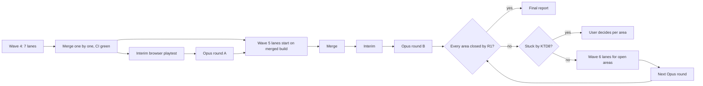

# Every Graded Area to 8 - Plan

---

## Goal Capsule

- **Objective:** Opus playtests score every graded area of Terra Imperium (campaign, battle, art and animation, plus sound and Hebrew) at 8/10 by the done rule in R1, and in those runs a player wins a commanded battle, fights at sea and reaches the late game with decisions to make every few turns.
- **Means:** finish wave 4 (the seven lanes running now), then wave 5 (U5 to U13 below), then wave 6 lanes built only from areas still under 8, each wave closed by an Opus grade round (KTD1, KTD2).
- **Authority:** the user's standing rules (CLAUDE.md "Working rules" and "Lead workflow", plans/HANDOFF-2026-10-29.md section 2) win over this plan; this plan wins over lane briefs; a lane's report never overrides a grade.
- **Stop conditions:**
  - Every area closed by R1: publish the final report (R15).
  - The month's API spend would pass $90: stop dispatching, tell the user.
  - A fix would break a kept design decision: stop that lane, ask the user.
  - An area moves less than 1 point across two Opus rounds after its owner lane merged: stop sending lanes at it and bring it to the user (KTD8).
  - 31 Dec 2026: publish the final report with each area's status, closed or not.
- **Execution profile:** the lead session runs lanes as local worktree sessions (cloud sub sessions when the PC is busy), at most seven at once, merges one at a time into `claude/integration`, and pushes `main` only with the user's go.

---

## Product Contract

### Summary

Every area below 8 gets a named owner, the causes testers gave, a fix and a proof. The seven wave 4 lanes cover most battle, forecast, naval, pacing, help and polish causes. Wave 5 adds nine lanes for areas no one owns today: battle HUD, tech tree, diplomacy answers, early pace, sieges and sea starts, map speed, battle art, map art, sound and Hebrew. Opus grade rounds run on November money at the end of each wave, with free browser playtests in between.

### Problem Frame

After 40+ merged lanes since 27 Oct, only start screen (8.0) and save (8.3) reach 8 in round 3b, and the 29 Oct manual playtest gave save a 4 and most areas 3 to 6. Three things keep grades low:
- Grades lag fixes: every round 3b score predates r3-campaign, r3-battle, the two lead-fix lanes and all of wave 4.
- Lanes fix what a playtest named, and the next playtest finds the next layer (LOOP-REPORT, 28 Oct round 2).
- Some areas have no owner: tech tree, art and animation, battle HUD layout, sound, Hebrew.

Testers on the same build also disagree by up to 5 points (round 3b glossary 5/7/8/3), so a done rule that needs every tester above a line in one round can fail on grader noise alone.

### Requirements

Grades and process
- R1. Done rule: an area is closed when, in one Opus round, its average across that round's runs is 8+ and no run scores it below 7, except a low score whose cited cause is already fixed on the graded build or is a harness defect. A closed area stays closed unless a later round drops its average below 7.
- R2. A grade counts only from a fresh playtest. Free browser playtests are interim grades that steer lanes; only an Opus round closes an area. Sound is the exception: it closes by KTD6.
- R3. Old grades stay in the dashboard; each round appends rows.
- R4. API spend stays at $90 a calendar month or less, each dispatch's `max_usd` added to the month's spend before it runs.

Battles
- R5. A player who follows the forecast wins a commanded battle the forecast calls likely; forecast, card, Auto and result screen read the same forces.
- R6. Every battle the player is in ends on a result screen or a report; Finish now, Retreat and Switch to Auto always work.
- R7. On a phone at 844x390 the battle field stays readable: open panels together cover at most a quarter of the field, units and banners readable at the default zoom, nothing hidden under roofs.

Campaign
- R8. A coastal player who builds a warship meets a sea fight by turn 150 in most seeds, and naval orders (build, board, sail, land) never contradict each other.
- R9. Event cards are rarer and sharper, ages last long enough on every speed to meet their goals, and the last three ages offer a decision every few turns.
- R10. The tech tree shows every tech of every age with prerequisites and honest turn counts.
- R11. Every button that cannot act stays tappable and says why; every action answers; the camera always shows what the player selected.
- R12. Diplomacy, economy and cities have no silent failures, no unconfirmed big spend, and early builds take a sensible number of turns.

Presentation
- R13. Art and animation (map units, melee, hits, deaths, projectiles, sea, unit size, transitions) reach 8, judged from real-GPU shots (KTD5).
- R14. Sound and music reach 8 by KTD6; Hebrew reaches 8 in an Opus run played in Hebrew.

Delivery
- R15. A very extensive report of what was done and the status of every area, with screenshots and explanations, published as an artifact.

### Key Decisions

- **Free browser playtests count as interim grades; only Opus closes an area.** (session-settled: user-approved — chosen over Opus-only grading: Opus runs are 3-4 a month.) Governs R1, R2.
- **Rule changes are allowed, each proven by balance-sim or battle-lab.** (session-settled: user-approved — chosen over UI-only fixes: testers name rules, not only screens.) Governs R5, R8, R9, R12.
- **Sound and music join the graded areas.** (session-settled: user-approved — chosen over leaving them out.) Governs R14.
- **Core loop first:** battles, forecasts, events and pacing merge first, then naval and units, then presentation. (session-settled: user-approved — chosen over weakest-area-first.) Governs Sequencing.
- **Kept user decisions are constraints:** battle rule Q3 (bases lose only when base buildings are gone), a city falls only when its defence is beaten, units keep their age and upgrade with gold on own land, cities build only the upgraded unit, no routing (morale is a soft penalty). Governs R5, R6.

### Success Criteria

- Every area closed by R1 in the last Opus round, with sound closed by KTD6.
- At least one Opus run wins a commanded battle, one fights a sea battle and one plays a late-age slice with a decision every few turns.
- Every finding in plans/playtests/manual-2026-10-29.md is fixed or recorded as a decision with evidence.

### Scope Boundaries

- In: every area in the dashboard scores dataset, sound and music, Hebrew.
- Out: online multiplayer (plans/ASYNC-MULTIPLAYER.md), store and payments (plans/BUSINESS-MODEL.md), app store releases, the parked items (U34 economy cuts, plans/research-ai-math.md).
- Considered and not built:
  - Named save slots: one manual slot apart from the autosave closes F152; named slots only if save stays under 8.
  - Blocking walled assaults without siege engines: a warning keeps the player's choice (LOOP-REPORT, 29 Oct).
  - AI fleets hunting the player's fleets: pirates give the first warship a target with less AI risk; revisit if naval stays under 8.
  - A loudness-measuring audio script: the user's 1-10 score judges quality; a cue-coverage test is enough as the gate (KTD6).
  - A separate interim rubric document: the interim run reads the playtester's own area list (U2).

### Deferred to Follow-Up Work

- A map-to-battle zoom transition: only if transitions stay under 8 after wave 5.
- Crumbling wall models (needs the user's open Blender).
- A raid warning card with pay, muster or accept, and visible power effects on the field: only if round A names them again.

---

## Planning Contract

### Key Technical Decisions

- KTD1. **Waves, not a rolling stream.** A wave's lanes share no files and merge one at a time; one grade round follows on the merged build. Wave 4 = the seven lanes running now. Wave 5 = U5 to U13. Wave 6 = lanes written after round B from areas still under 8, with no pre-written units.
- KTD2. **Every lane brief carries its target grade, the tester step numbers and shots, and a "check on current integration first" rule.** To stop lanes fitting the graders' exact paths, each Opus round plays a people and seed that no lane brief has seen (held-out run); an area only closes if the held-out run also scores it 7+.
- KTD3. **Interim grades from a free browser playtest after each merge batch; Opus rounds only at wave ends.** The interim run uses the playtester's own area list (U2), a late-age save slice for the late game, and balance-sim navalTrace as the interim proof of R8. Interim scores that the browser cannot judge the same way as Opus (touch, sound) are marked not comparable.
- KTD4. **Budget, at $0.025 a step on Opus with `limit` always set:**
  - Round A (November): newcomer-phone 255 steps $6.40, civ-veteran 400 steps $10 (one slice from a late-age save), warmonger 330 steps $8.25, battle-commander 320 steps $8 = about $33.
  - Round B (November if spend allows, else December): the same four, with newcomer-phone playing in Hebrew (`lang: he`) so Hebrew needs no fifth run = about $33.
  - Held: about $24 for one more full round or a targeted rerun.
  - Each round first checks the harness: the run reached its limit, taps registered, no stuck step loop. A failed check means the round does not count and its cost is recorded.
- KTD5. **Art is judged from real-GPU shots.** CI shots may be software-rendered, so art rows from them are provisional. Art lanes attach before and after shots at 844x390 from a real GPU (the user's PC) to their report, and the next grade run is given those shots alongside its own. Art work happens only in the user's open Blender (memory: live Blender only).
- KTD6. **Sound closes by a gate plus the user's score.** Gate: a test that every map and battle event id has a cue and every age has music, and that music and effects have separate volumes with a one-tap mute on map and battle. Score: the user rates sound 1-10 after one phone session. Sound is closed at 8+ with the gate passing.
- KTD7. **odds-truth owns every force count; battle-truth does not touch autoBattle.js.** One owner for the honest auto-resolve (lead call, 29 Oct).
- KTD8. **Convergence check.** After each Opus round, an area that moved less than 1 point since the previous round, with its owner lane merged in between, gets no new lane. The lead writes down why it is stuck (grader, design gap, or next layer) and asks the user to choose: a design change, accept the grade with evidence, or change the rubric row.
- KTD9. **One UI pattern for phones:** a disabled button stays tappable and shows its reason in a one-line note; tap targets are at least 40 px at 844x390; text at least 11 px. Every UI lane attaches mobile-check shots at 844x390 and 1600x900 in en and he.

### High-Level Technical Design

Area to owner map:

| Area (3b avg / manual) | Wave 4 lane (fixes before its merge) | Wave 5 owner for what wave 4 leaves |
|---|---|---|
| RTS battles (4.3) | battle-truth: wipes, Finish now, result screens, receipt, Finish now browser shot | U5: stronger warning before Command, pinned Continue |
| Tech tree (4.3 / 6) | none | U6 |
| Naval (4.7 / 3) | naval-9: discoverability, sail step, pirates, landing text | U9: sea battle start spacing |
| Diplomacy (5.0 / 5) | polish-8: trade terms, list sort, FRIENDLY label | U7: city-card peace answer, decree explained |
| Wars and AI (5.0 / 4) | odds-truth (standby, P1 march lines, P2 march fix), ai-armies | none |
| Fun (5.3 / 4) | pacing-8: late-game goals and crisis, card cooldown, Fast ages, war price | U8: early pace |
| Map (5.7 / 5) | help-map-8: march camera, close view chip, camera centring | U10: black map after load |
| Units (5.7 / 3) | help-map-8: Next army counts garrisons, greyed-button reasons | none |
| Economy (6.0 / 6) | pacing-8 (war price), polish-8 (buy confirm) | U8: late gold sink if round A names it |
| Glossary (6.0 / 7) | help-map-8: hold-for-help everywhere | U7: topic cards for battles, ships, decrees |
| Speed (6.7 / 5) | pacing-8: advisor skips 20+ turn builds, Fast ages | U8: early builds |
| Cities (7.0 / 5) | pacing-8 (Coal Plant, double Settlers), polish-8 (names) | U8: buy any queued item |
| Events (7.0 / 4) | pacing-8: card cooldown, dates, late game | U8: era goal chip |
| Save (8.3 / 4) | polish-8: manual slot | none |
| Start (8.0 / 7) | none needed | none |
| Battle deploy, mobile, economy HUD | battle-truth (first-clash camera) | U5: panel sizes, objective box, timed-prompt pause |
| Battle camera, readability, art rows | none | U11: default follow, zoom, banners, roofs, bars, flash, corpses |
| Battle buildings, powers, fun, speed | none | U9: walled mirror balance, sack length |
| Campaign map units (art) | none | U12 |
| Sound, Hebrew | none | U13 |

### Assumptions

- November API credit arrives on 1 Nov; no paid run in October.
- The PC runs up to seven local lanes with targeted tests only; full checks run after merges, alone.
- Round A grades `claude/integration`; it does not wait for the main push.
- The user can play one phone session for the sound score before round B.

### Sequencing

1. Close wave 4 (U1), interim playtest (U2), Opus round A (U3).
2. Wave 5 lanes start on the merged wave 4 build, as slots free (memory: auto-start lanes); each folds round A's findings into its brief when they land. U5 and U11 do not run at the same time (both touch battle presentation; U11 owns the renderer).
3. Merge wave 5, interim playtest, Opus round B (U14).
4. KTD8 check, then wave 6 or the user's decisions.
5. Final report (U15).

---

## Implementation Units

| U-ID | Title | Key files | Depends on |
|---|---|---|---|
| U1 | Close wave 4 lanes and merge | plans/lanes/*-REPORT.md | none |
| U2 | Interim playtest and rubric rows | scripts/ai/human-playtest.mjs | U1 |
| U3 | Opus grade round A | .github/workflows/claude-content.yml | U1, U2 |
| U4 | Dashboard and findings upkeep | dashboard datasets | U1 |
| U5 | battle-hud lane | src/components/battle/ | U1 |
| U6 | tech-tree lane | src/components/panels/TechPanel.jsx | U1 |
| U7 | answers lane | src/components/modals/RegionInfoModal.jsx | U1 |
| U8 | early-pace lane | src/data/buildings.js, src/engine/eraGoals.js | U1 |
| U9 | sieges and sea starts lane | src/engine/sieges.js, src/battle/sim/ | U1 |
| U10 | map-speed lane | src/components/map/gl/GLMapView.jsx | U1 |
| U11 | battle-art and camera lane | src/battle/render/ | U1, after U5 |
| U12 | map-art lane | src/components/map/closeView/ | U1 |
| U13 | sound and Hebrew lane | src/audio/, src/i18n/ | U1 |
| U14 | Opus round B | .github/workflows/claude-content.yml | U5-U13 |
| U15 | Final report artifact | artifact | U14 or 31 Dec |

### U1. Close wave 4 lanes and merge

**Goal:** merge the seven wave 4 lanes into `claude/integration`, each having finished the items its brief and the lead's messages gave it.
**Requirements:** R5, R6, R8, R9, R11, R12.
**Dependencies:** none.
**Files:** plans/lanes/ai-armies-REPORT.md, odds-truth-REPORT.md, battle-truth-REPORT.md, pacing-8-REPORT.md, naval-9-REPORT.md, help-map-8-REPORT.md, polish-8-REPORT.md; plans/LOOP-REPORT.md.
**Approach:**
1. Before each merge, check the lane's report against its brief and the manual-playtest items the lead sent on 29 Oct; resend what is missing.
2. Merge order: ai-armies (after it fixes the passive endgame test), odds-truth, battle-truth, pacing-8, naval-9, help-map-8, polish-8.
3. odds-truth builds P2 only after ai-armies is on integration (both edit warPlans.js).
**Patterns to follow:** CLAUDE.md "Lead workflow"; ship skill.
**Test scenarios:**
- After every merge the `endgameReachability` passive run ends on turnLimit.
- The Blidaru repro (Ahhiyawa, Fast, war on Dacia, march to Blidaru) shows one enemy count on march card, siege card and Auto.
- A commanded battle switched to Auto opens its report; Finish now ends the battle (browser shot in battle-truth's report).
- navalTrace over seeds 11-18: a ship-building coastal player meets a sea battle by turn 150 in at least 6 of 8.
- storyPulse: cards a turn in the last three ages rise from 0.17-0.24 and an age's last third brings a crisis that can pick the player.
**Verification:** integration CI green with all seven merged; their findings set to "merged, retest" with evidence (U4).

### U2. Interim playtest and rubric rows

**Goal:** the Opus playtester grades art, transitions and language rows, and a free browser playtest uses the same area list.
**Requirements:** R2, R3, R13, R14.
**Dependencies:** U1.
**Files:** scripts/ai/human-playtest.mjs (AREAS and BATTLE_AREAS), its test if one exists; plans/playtests/manual-YYYY-MM-DD.md per interim run.
**Approach:**
1. Add the art rows (campaign map units, melee, hits, deaths, projectiles, sea, unit size at phone zoom), transitions and a language row to the area lists.
2. The interim run reads the area list and required actions straight from that script (area names from AREAS and BATTLE_AREAS, actions from MUST_DO) and writes a report in the shape of plans/playtests/manual-2026-10-29.md.
3. Interim script: 60 turns Fast with a coastal people, one commanded field battle, one siege, one sea action, save and reload, one slice from a late-age save, 10 turns in Hebrew; navalTrace stands in for R8.
**Test scenarios:**
- A step reporting area "Hit feedback" is accepted by the playtester's area check; an unknown area is rejected as before.
**Verification:** one interim run after U1 scores every area including the new rows.

### U3. Opus grade round A

**Goal:** four Opus runs on the wave 4 build, appended to the dashboard.
**Requirements:** R1, R3, R4.
**Dependencies:** U1, U2.
**Files:** .github/workflows/claude-content.yml (inputs), dashboard datasets scores and spend.
**Approach:**
1. Dispatch per KTD4 on ref `claude/integration`, `play_model: opus`, `limit` and `max_usd` set; personas newcomer-phone, civ-veteran (late-age slice), warmonger, battle-commander over every age.
2. One run uses a people and seed no lane brief has seen (KTD2).
3. Run the harness check (KTD4) before the round counts; record real costs.
**Test expectation:** none -- dispatch only.
**Verification:** four reports on `ai/human-playtest-*` branches; grades appended; November spend at or under $90.

### U4. Dashboard and findings upkeep

**Goal:** the dashboard always shows current finding status and every round's grades.
**Requirements:** R3.
**Dependencies:** U1.
**Files:** dashboard datasets findings, scores, rounds, spend (artifact VCNKVfR3h4rvGmuC5i3SXD).
**Approach:** after each merge set fixed findings to "merged, retest" with evidence; after each round mark "done" or reopen and run KTD8; append scores, never edit old rows.
**Test expectation:** none -- data upkeep.
**Verification:** no finding left "in progress" whose lane is merged.

### U5. battle-hud lane

**Goal:** the battle HUD on a phone leaves the field visible and protects the player from a hopeless Command by mistake.
**Requirements:** R6, R7.
**Dependencies:** U1. Not at the same time as U11.
**Files:** src/components/battle/BattleHud.jsx, EconomyHud.jsx, PreBattleModal.jsx, BattleResultScreen.jsx, src/battle/worker/battleLoop.js; tests next to each (battleCardRows.test.js and new).
**Approach:**
1. Panel defaults: economy open in the build phase, objective box collapsed after 10 s, deploy card compact; each has a visible reopen handle; open panels together stay within a quarter of the field (F116, BC 35, BC 53).
2. Result screen: Continue pinned at 844x390 (NC 162).
3. Unlikely or Hopeless odds: the first tap on Command turns it into "Command anyway: Hopeless" for 3 s with Auto and Back still one tap; a tap elsewhere or the timeout resets it (WM fix 5). Never blocks the player.
4. Timed prompts pause the battle clock at every speed (F99, lead said yes).
**Patterns to follow:** useInteraction for overlays; KTD9; mobile-check skill.
**Test scenarios:**
- At 844x390 the deploy card and economy panel together cover at most 25% of the field.
- A Hopeless battle needs two taps on Command; the second tap after 3 s starts over; Auto stays one tap.
- A timed prompt at 3x speed stops the sim tick until answered.
- The result screen at 844x390 shows Continue without scrolling, in en and he.
**Verification:** battle mobile, deploy, economy HUD and battle end rows close by R1 in round B.

### U6. tech-tree lane

**Goal:** the tech panel shows every age's techs with clear states, prerequisites and honest turns.
**Requirements:** R10.
**Dependencies:** U1; round A's tech findings when they land.
**Files:** src/components/panels/TechPanel.jsx, src/components/modals/ResearchChoiceSheet.jsx, src/engine/research.js, src/data/techTree.js; tests next to each.
**Approach:**
1. Start from round A's tech findings against the r3-campaign era tabs and All techs chip; fix only what is still named.
2. Layout at 844x390: age tabs, a list per age, row states researched, current, queued, available, locked by a prerequisite, future age; tap opens a detail sheet with Queue as the main button and prerequisites as tappable chips.
3. Turn estimates from the current science rate (F143); the panel sits flush above the age strip and End Turn never covers a tab (F147).
**Test scenarios:**
- Every tech id in techTree.js appears under exactly one age tab.
- A tech's turn estimate equals the remaining cost divided by science per turn, rounded up.
- A future-age tech shows its age, not a turn count.
- A tech locked by a prerequisite lists that prerequisite as a chip.
**Verification:** tech tree closes by R1 in round B; mobile-check en and he (KTD9).

### U7. answers lane

**Goal:** every diplomacy action answers, decrees are explained, and topic cards for battles, ships and diplomacy costs exist.
**Requirements:** R11, R12.
**Dependencies:** U1 (polish-8 merged).
**Files:** src/components/modals/RegionInfoModal.jsx, src/components/panels/DiplomacyPanel.jsx, src/data/glossary/, src/components/glossary/, src/engine/tutorial.js; tests next to each.
**Approach:**
1. A peace offer from a city card shows the same answer bubble as the people's card: accept or refuse plus the reason, dismissed by tap (help-map-8 For the lead 2).
2. Actions that cannot act follow KTD9 and show their cost (NC issue 1).
3. Three topic cards, reachable from the How to play "?" and by holding a related button (data-help pattern) (NC issue 9).
**Test scenarios:**
- A peace offer from the city card produces an answer with accept or refuse and a reason.
- Tapping an unaffordable pact button shows its cost and why.
- Each topic card id resolves in the glossary in en and he.
**Verification:** diplomacy and glossary close by R1 in round B; mobile-check en and he.

### U8. early-pace lane

**Goal:** early builds take a sensible number of turns, any queued item can be bought safely, and era goals are understood.
**Requirements:** R9, R12.
**Dependencies:** U1 (pacing-8 merged).
**Files:** src/data/buildings.js, src/engine/aiProduction.js, src/components/city/cityBuildModel.js, src/engine/eraGoals.js, src/data/eraGoals.js; tests next to each.
**Approach:**
1. Measure first Settlers and Warband turns over the first 30 turns with balance-sim; aim for about 8-12 turns for the first Settlers on Normal (Civ VI reference) through speed scaling, never a literal turn count (F115).
2. Buy any queued row: price and gold-after on the button; a second tap above a share of the treasury; an unaffordable row shows the shortfall; a paid head item shows a lock and a reason, and cannot be cancelled or reordered (NC issue 2).
3. Era goal chip: goal, progress and reward in one line (WM 110).
**Execution note:** balance-sim before and after on seeds 11-18; passive-player defeats no higher than base; the passive endgame test still ends on turnLimit.
**Test scenarios:**
- Buying the second queued item moves it to the head and keeps the rest in order.
- A paid head item refuses cancel and reorder with a reason.
- First Settlers on Normal at seed 11 completes within the target band.
- The era goal chip names target, progress and reward.
**Verification:** cities, speed and events close by R1 in round B.

### U9. sieges and sea starts lane

**Goal:** walled assaults and sack defences are fair, and sea battles start fair.
**Requirements:** R5, R8.
**Dependencies:** U1 (naval-9 merged).
**Files:** src/engine/sieges.js, src/engine/raidBattle.js, src/battle/setup/cityBattle.js, sea battle setup in src/battle/setup/; tests next to each and battle-lab parity.
**Approach:**
1. Walled mirror assault: attacker wins move from 88% toward 40-60% (F98) through walls and militia, never handing the attacker a held city (kept decision).
2. Sack defence lasts long enough to use a power: a larger raid or waves (BC 56, F78).
3. Sea battle start spacing so no ship takes damage before the first order (BC 47).
**Execution note:** battle-lab parityEco and autoCalib before and after; SETUP_VERSION bump if setups change.
**Test scenarios:**
- parityEco walled mirror row lands in 40-60% attacker wins over N=32.
- A sack defence lasts at least 90 s of sim time at normal speed.
- No ship takes damage before tick 60 in the sea battle setup.
**Verification:** buildings and walls, battle naval and battle fun close by R1 in round B.

### U10. map-speed lane

**Goal:** the map never shows black after load or zoom.
**Requirements:** R11.
**Dependencies:** U1 (help-map-8 merged; it owns camera centring).
**Files:** src/components/map/gl/GLMapView.jsx, glLayers.js; scripts/perf/map-pan.mjs.
**Approach:**
1. Profile load and scroll-zoom with the perf skill against the base commit (F145).
2. First frame: base raster plus territory tints, no labels, a small loading chip until detail arrives; if detail fails, stay at low detail with a retry chip.
**Test scenarios:**
- After load, the first frame shows territories within 1 s on the perf script's phone profile.
- A failed detail tile leaves the low-detail frame and the retry chip, never black.
**Verification:** map closes by R1 in round B; perf numbers before and after in the lane report.

### U11. battle-art and camera lane

**Goal:** melee, hits, deaths, unit size, roofs and the battle camera read clearly on a phone.
**Requirements:** R7, R13.
**Dependencies:** U1; runs after U5 merges.
**Files:** src/battle/render/ (BattleRenderer.js, cityLayer.js, unit rendering), src/components/battle/TacticalBattleScreen.jsx (camera defaults); Blender sources through the user's open Blender.
**Approach:**
1. Camera: default follow of the selected squad or the first clash, default phone zoom one step closer, banners keep a minimum screen size (BC 5, 24, 28, 40).
2. Roofs fade near selected or fighting units (F137, Total War Warhammer reference).
3. One bar per squad in melee; hit flash at least 150 ms and visible on a real GPU; corpses readable for a few seconds.
**Execution note:** before and after shots at 844x390 on a real GPU in the lane report (KTD5).
**Test scenarios:**
- A unit inside a town is visible from the default camera (roof alpha below 0.5 within the fade radius).
- In a 4-squad melee exactly 4 bars draw.
- At the default phone zoom a squad's banner is at least 24 px tall.
**Verification:** the art rows, battle camera and unit readability close by R1 in round B.

### U12. map-art lane

**Goal:** map units in scale with towns, scouts drawn as scouts, no placeholder cubes.
**Requirements:** R13.
**Dependencies:** U1.
**Files:** src/components/map/closeView/closeViewScene.js, src/components/map/gl/sceneModel.js, spriteArt.js; tests next to each.
**Approach:**
1. Soldier figure sized to the town (memory: map models constant size, no zoom rescaling).
2. Scouts show a small scout figure and their real men count (F146).
3. A town whose model fails to load draws the fallback town, not cubes (Tiryns).
**Test scenarios:**
- A scout unit's label shows its real men count.
- A town with a failed model load draws the fallback model.
**Verification:** campaign map units closes by R1 in round B, judged from real-GPU shots.

### U13. sound and Hebrew lane

**Goal:** sound passes its gate and the user scores it 8+; Hebrew text and layout hold at 844x390.
**Requirements:** R14.
**Dependencies:** U1.
**Files:** src/audio/soundRegistry.js, music.js, audioSettings.js, mixLevels.json, a cue-coverage case in src/audio/soundRegistry.test.js, src/i18n/locales/; tests next to each.
**Approach:**
1. Cue-coverage test: every map and battle event id has a cue; every age has music.
2. Separate music and effects volume; one-tap mute on map and battle.
3. Fix missing cues and Hebrew breaks found in round A and in Hebrew mobile-check shots.
4. Ask the user for a 1-10 sound score after one phone session (KTD6).
**Test scenarios:**
- The cue-coverage test fails when an event id has no cue.
- The cue-coverage test fails when an age has no music track.
- Muting in battle silences both channels; unmuting restores the previous volumes.
**Verification:** sound closed by KTD6; Hebrew closes by R1 in round B's Hebrew run.

### U14. Opus round B

**Goal:** grade wave 5.
**Requirements:** R1, R4.
**Dependencies:** U5 to U13 merged.
**Files:** .github/workflows/claude-content.yml (inputs), dashboard.
**Approach:** same four personas per KTD4 with newcomer-phone in Hebrew and a new held-out people and seed; harness check first; then KTD8 for every area still open.
**Test expectation:** none -- dispatch only.
**Verification:** Success Criteria met, or a wave 6 lane list (or user decisions under KTD8) for the open areas.

### U15. Final report artifact

**Goal:** the user's final deliverable.
**Requirements:** R15.
**Dependencies:** U14 closes every area, or 31 Dec.
**Files:** a published artifact built from the dashboard data and the playtest and lane shots.
**Approach:** every area with grades per round, what changed and why, before and after shots, and what is left.
**Test expectation:** none -- report.
**Verification:** every area row shows its status and the run that set it.

---

## Verification Contract

- Lanes: `npm run lint` (zero warnings); `npm run test:related -- <files>`; mobile-check at 844x390 and 1600x900 in en and he for every UI change (KTD9); balance-sim for macro rules; battle-lab parity for battle rules; engine-rules-reviewer before merging engine or sim diffs.
- After each merge: `npm run test:quick`; before pushing main, the latest full CI run on `claude/integration` green.
- Once per wave, one real-touch check of battle gestures (draw a path, circle select) on the user's phone or touch emulation before battle orders or phone layout can close.
- Grades: only from playtest reports (R2); the dashboard scores dataset is the record.

## Definition of Done

- Every area closed by R1 (sound by KTD6), or the 31 Dec cap reached.
- Every dashboard finding is "done" or a recorded decision.
- No lane worktree left behind (prune after merge), no dead experiment code in merged diffs.
- Final report artifact published (U15).

## Risks & Dependencies

- **Grader noise:** testers disagree by up to 5 points; R1's exception for fixed causes and harness defects, plus KTD8, keep waves from chasing noise.
- **Budget:** two rounds plus a reserve fill $90; round B moves to December if November's spend would pass $90.
- **Shared PC load:** seven lanes make full test runs time out; targeted tests in lanes, full checks after merges alone.
- **Balance ripples:** ai-armies pushed the passive world to the Future goal early; every macro rule change runs the passive endgame test before merge.
- **Art needs the user's Blender and GPU:** U11 and U12 asset work and shots wait on the user's PC.
- **Sound needs the user:** sound cannot close without the user's phone session.
